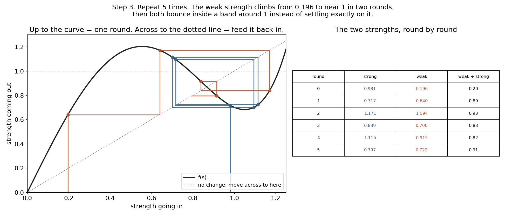

# How Muon turns a lopsided update into a fair one, step by step

[Muon](https://kellerjordan.github.io/posts/muon/) is an optimizer for the weight matrices of neural networks. Its core is one short formula, applied 5 times:

```
X  ←  3.4445·X  −  4.775·(XXᵀ)X  +  2.0315·(XXᵀ)²X
```

An optimizer is the part of training that decides how to change the weights after each batch of data. For years the default has been AdamW. Muon replaces it for the big weight matrices inside the network. The first and last layers and the small vectors still use AdamW.


Some facts:

- **The name is an acronym.** Muon stands for MomentUm Orthogonalized by Newton–Schulz.
- **The math is 91 years old.** Schulz published the core trick in 1933, as a way to invert a matrix using only multiplications. Muon uses a tuned version of it.
- **It started as a speed contest.** In October 2024 Muon set a record in the NanoGPT speedrun, a public race to train a small GPT-2 model to a fixed quality as fast as possible. That training became 1.35 times faster.
- **It now trains giant models.** Moonshot AI trained Moonlight (16B parameters, 5.7 trillion tokens) with Muon in February 2025. Kimi K2, with 1 trillion parameters and 15.5 trillion tokens, was trained with MuonClip, a Muon variant, in July 2025.
- **It is cheap.** Muon remembers 1 number per weight, AdamW remembers 2. The 5 rounds of the formula add about 0.7% compute in the NanoGPT speedrun. For a model the size of Llama 405B the estimate is 0.5%.


The first two numbers come from Keller Jordan's post. The third is from Moonshot AI's scaling experiments, where Muon reached the same loss with about half the compute of AdamW. All are reported by their authors, not measured here.

This post explains what the formula does, using one small 2×2 matrix and pictures. Every number in the pictures from section 1 on comes from the scripts in this repo.

## 1. A matrix stretches space

During training, each weight matrix gets an update matrix G. In Muon, G is the gradient averaged over recent steps (momentum).

A matrix can be pictured by what it does to a circle. Multiply every point of a circle by G and you get an ellipse. The ellipse has a long arrow and a short arrow. Their lengths are the matrix's **strengths**. The textbook name for them is singular values.


Here G stretches one direction by 1.00 and the other by 0.20. A plain update with this G moves the weights 5 times more along the blue arrow than along the rust one.

In real networks this imbalance is far worse. Muon's author reports that updates for transformer weight matrices are dominated by a few directions, and the rest are almost zero. Muon's goal is to make every strength equal to 1. The arrows keep their directions. Only their lengths change. The ellipse becomes a circle, so the update moves every direction by a similar amount.

## 2. Step 0: divide G by its size

The formula only works when every strength starts between 0 and 1. A real gradient can have strengths of 0.001 or 40. So Muon first divides G by one number, its size:

1. Square every entry of G and add them up. Here 0.750 + 0.010 + 0.250 + 0.030 = 1.040.
2. Take the square root. √1.040 = 1.020.
3. Divide every entry by 1.020.

Every strength gets divided by the same 1.020. So 1.00 becomes 0.981 and 0.20 becomes 0.196. This size is always at least the biggest strength, so after dividing, every strength is 1 or less.


The right panel shows why this matters. Put a strength of 1.5 into the formula and 4.48 comes out. A strength of 3 gives 375. The rounds would blow up instead of pulling toward 1.

## 3. Step 1: one round is one curve

Here is the key fact. The matrix formula does the same thing as feeding each strength into this curve:

```
f(s) = 3.4445·s − 4.775·s³ + 2.0315·s⁵
```

Why? Write X with its arrows and strengths as X = U·S·Vᵀ, where S holds the strengths. Then XXᵀ = U·S²·Uᵀ, so (XXᵀ)X = U·S³·Vᵀ. Multiplying by XXᵀ cubes every strength and leaves the arrows alone. Doing it twice gives the fifth power. So the whole formula gives U·f(S)·Vᵀ: the same arrows, with each strength replaced by f(strength).

You never compute the arrows or the strengths. The formula only uses matrix multiplications, which GPUs are fast at. The strengths change anyway.


For our matrix:

| strength | into the curve | out of the curve |
|---|---|---|
| weak | 0.196 | 0.640 |
| strong | 0.981 | 0.717 |

The weak strength more than triples. Near 0 the curve's slope is 3.4445, so small strengths get multiplied by about 3.4 each round. The strong one is pulled down. After a single round, weak ÷ strong goes from 0.20 to 0.89.

## 4. Repeat 5 times

Each round's output is the next round's input. On the plot, go up to the curve (one round), then across to the dotted line (feed the result back in), then up again.



| round | strong | weak |
|---|---|---|
| 0 | 0.981 | 0.196 |
| 1 | 0.717 | 0.640 |
| 2 | 1.171 | 1.094 |
| 3 | 0.839 | 0.700 |
| 4 | 1.115 | 0.915 |
| 5 | 0.797 | 0.722 |

The weak strength passes 1 after two rounds. After that, both strengths bounce between about 0.7 and 1.2. They never settle exactly on 1. That is on purpose. The coefficients were picked to make small strengths grow as fast as possible, and the price is this wobble. Muon's author reports that not reaching exactly 1 did not hurt training.

Here is the same matrix after each round:


The arrows never turn. The thin ellipse becomes a rounder shape after one round and stays round.

## 5. Quintic vs cubic

The formula above is called **quintic** because its curve goes up to s⁵. It is Muon's default. The older textbook version is **cubic** Newton–Schulz:

```
X  ←  1.5·X  −  0.5·(XXᵀ)X        curve: f(s) = 1.5·s − 0.5·s³
```


| | quintic | cubic |
|---|---|---|
| slope near 0 | 3.4445 | 1.5 |
| what happens to s = 1 | goes to 0.70 | stays exactly 1 |
| after 5 rounds | anything from 0.005 to 1.2 lands between 0.68 and 1.15 | anything above 0.3 lands within 0.004 of 1, small ones stay small |
| matrix multiplications per round | 3 | 2 |

The cubic is exact but slow to lift small strengths. It multiplies them by only 1.5 per round, so after 5 rounds a strength of 0.01 reaches only 0.076. The quintic is rough but lifts everything.

On an 8×8 matrix with strengths 1, 0.6, 0.3, 0.15, 0.08, 0.04, 0.02, 0.01 (run `python3 muon_orth.py`):

| method | multiplications | strengths after | error vs exact answer |
|---|---|---|---|
| quintic × 4 rounds | 12 | 0.68 to 1.17 | 0.211 |
| quintic × 5 rounds | 15 | 0.70 to 1.13 | 0.210 |
| cubic × 5 rounds | 10 | 0.06 to 1.00 | 0.565 |

The exact answer is the matrix with the same arrows and every strength equal to 1. The error is the distance from that answer, divided by its size.

## 6. The code

```python
import numpy as np

QUINTIC = (3.4445, -4.775, 2.0315)
CUBIC = (1.5, -0.5)

def muon_orth(G, steps=5, kind="quintic", eps=1e-7):
    X = G / (np.linalg.norm(G) + eps)   # step 0: every strength now ≤ 1
    tall = X.shape[0] > X.shape[1]
    if tall:
        X = X.T                          # keep XXᵀ the smaller square matrix
    for _ in range(steps):
        A = X @ X.T
        if kind == "quintic":
            a, b, c = QUINTIC
            X = a * X + (b * A + c * A @ A) @ X
        else:
            a, b = CUBIC
            X = a * X + b * A @ X
    return X.T if tall else X
```

Real Muon runs the same loop in bfloat16 on the GPU.

## Run it

```bash
pip install -r requirements.txt
python3 muon_orth.py      # the 8×8 table above
python3 teach_size.py     # images/step0_size.png
python3 teach.py          # images/step1.png … step4.png
python3 plot_poly.py      # images/poly_plot.png
python3 intro_plots.py    # images/muon_timeline.png, muon_numbers.png
```

## Sources

- Muon, its coefficients 3.4445, −4.775, 2.0315, the speedrun, CIFAR-10, 1.5B-model and compute-overhead numbers: Keller Jordan, [Muon: An optimizer for hidden layers in neural networks](https://kellerjordan.github.io/posts/muon/) (December 2024).
- Moonlight and the 2× compute result: Moonshot AI, [Muon is Scalable for LLM Training](https://arxiv.org/abs/2502.16982) (February 2025).
- Kimi K2 and MuonClip: Moonshot AI, Kimi K2 technical report (July 2025), as covered by [HPCwire](https://www.hpcwire.com/aiwire/2025/07/14/chinas-moonshot-ai-releases-trillion-parameter-model-kimi-k2/).
- Schulz, *Iterative Berechnung der reziproken Matrix*, Zeitschrift für Angewandte Mathematik und Mechanik 13 (1933), 57–59.
