# How Muon turns a lopsided update into a fair one, step by step

[Muon](https://kellerjordan.github.io/posts/muon/) is an optimizer for the weight matrices of neural networks. Its core is one short formula, applied 5 times:

```
X  ←  3.4445·X  −  4.775·(XXᵀ)X  +  2.0315·(XXᵀ)²X
```

An optimizer is the part of training that decides how to change the weights after each batch of data. For years the default has been AdamW. Muon replaces it for the big weight matrices inside the network. The first and last layers and the small vectors still use AdamW.

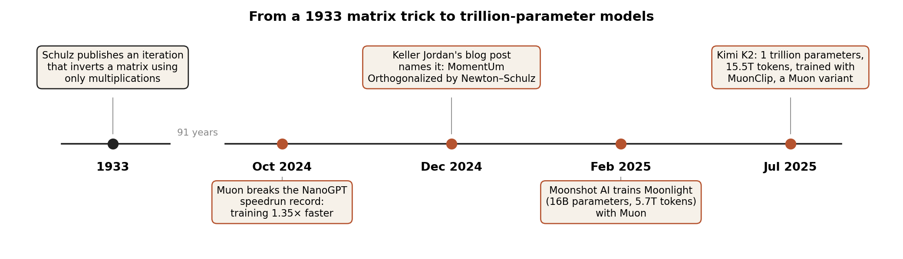

*Figure 1. Timeline: Schulz 1933, NanoGPT record Oct 2024, blog post Dec 2024, Moonlight Feb 2025, Kimi K2 Jul 2025.*

Some facts:

- **The name is an acronym.** Muon stands for MomentUm Orthogonalized by Newton–Schulz.
- **The math is 91 years old.** Schulz published the core trick in 1933, as a way to invert a matrix using only multiplications. Muon uses a tuned version of it.
- **It started as a speed contest.** In October 2024 Muon set a record in the Modded NanoGPT speedrun, a public race to train a small GPT-2 model to a fixed quality as fast as possible. That training became 1.35 times faster.
- **It now trains giant models.** Moonshot AI trained Moonlight (16B parameters, 5.7 trillion tokens) with Muon in February 2025. Kimi K2, with 1 trillion parameters and 15.5 trillion tokens, was trained with MuonClip, a Muon variant, in July 2025.
- **It uses less memory than AdamW.** Muon remembers 1 number per weight, AdamW remembers 2.
- **It costs a little more compute per step than AdamW.** Each training step already does about 6 operations per weight per token for the forward and backward pass. With 524,288 tokens per step in the NanoGPT speedrun, that is about 3 million operations per weight. AdamW adds about 15 per weight, so its extra cost is close to 0%. Muon's 5 rounds add about 0.7%. For a model the size of Llama 405B the estimate is 0.5%. So Muon pays off whenever it needs at least 0.7% fewer steps than AdamW. Every measurement below says it needs more than that.

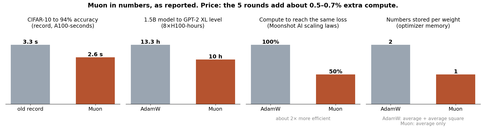

*Figure 2. Muon vs AdamW: CIFAR-10 record 3.3 to 2.6 s, 1.5B model 13.3 to 10 h, compute to the same loss 52% (Moonshot) or 91% (Wen et al.), half the optimizer memory, 0.7% extra cost vs 9–48% saving.*

The first two numbers come from Keller Jordan's post. All numbers are reported by their authors, not measured here.

How much compute Muon saves is disputed:

- **Moonshot AI says about 2×.** They fit scaling curves on models from 0.4B to 1.5B parameters. Muon needed about 52% of AdamW's compute to reach the same loss. AdamW's settings were found by grid search. Muon reused AdamW's settings.
- **Wen et al. at Stanford say much less.** They compared 10 optimizers on models from 0.1B to 1.2B parameters, and tuned every optimizer's settings separately. The best matrix-based optimizers, Muon among them, were about 1.3–1.4× faster than AdamW at 0.1B, and only about 1.1× faster at 1.2B. They found that many earlier speedups came from a weak AdamW baseline. In one example, tuning only AdamW's learning rate in a standard recipe made it about 2× faster on a 0.1B model.

Both studies agree that Muon beats AdamW. They disagree on how much, and the second one finds the gain shrinking as models grow. Which number holds for very large models is not settled. Kimi K2, the largest Muon-trained model, has no AdamW run of the same size to compare against.

This post explains what the formula does, using one small 2×2 matrix and pictures. Every number in the pictures from section 1 on comes from the scripts in this repo.

## 1. A matrix stretches space

During training, each weight matrix gets an update matrix G. In Muon, G is the gradient averaged over recent steps (momentum).

A matrix can be pictured by what it does to a circle. Multiply every point of a circle by G and you get an ellipse. The ellipse has a long arrow and a short arrow. Their lengths are the matrix's **strengths**. The textbook name for them is singular values.

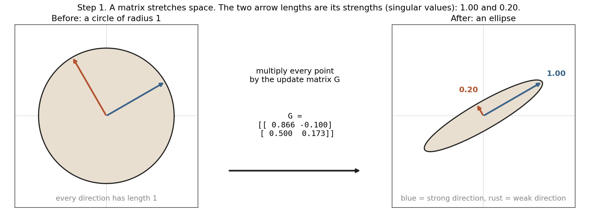

*Figure 3. A circle multiplied by G becomes an ellipse with strengths 1.00 and 0.20.*

Here G stretches one direction by 1.00 and the other by 0.20. A plain update with this G moves the weights 5 times more along the blue arrow than along the red one.

The arrows are not the x and y axes. The long arrow is the longest radius of the ellipse, and the short arrow is the shortest. Every other radius is somewhere in between. The two arrows are always at 90° to each other. Our G stretches first and then turns everything by 30°, so its arrows point diagonally. Another matrix puts them at another angle.

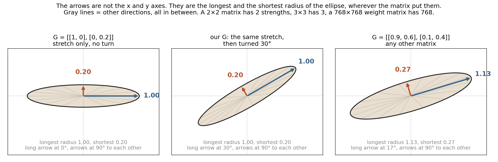

*Figure 4. Three matrices: arrows on the axes, turned 30°, turned 17°. Always the longest and shortest radius.*

A 2×2 matrix has 2 strengths. A 3×3 matrix turns a ball into an egg shape with 3 arrows. A 768×768 weight matrix has 768 strengths, one per arrow, all at 90° to each other.

In real networks this imbalance is far worse. Muon's author reports that updates for transformer weight matrices are dominated by a few directions, and the rest are almost zero. Muon's goal is to make every strength equal to 1. The arrows keep their directions. Only their lengths change. The ellipse becomes a circle, so the update moves every direction by a similar amount.

### Why this helps

A plain update spends almost its whole step on the few big directions. The small directions barely move, step after step. Muon's author guesses that some of these small directions carry rare signals that still matter for learning. Setting every strength to 1 gives them the same share of the step as the big ones. This is his guess at why training gets faster. Nobody has shown that it is the reason. What the speed records show is only that training does get faster.

**What is a direction, in a network?** A weight matrix reads a list of numbers that describes one token, for example 768 numbers, and writes a new list. A direction is one pattern across those numbers. Roughly, a pattern stands for something the network has noticed about the token, such as "this word is a verb", "we are inside a quote" or "this is a chemistry term". The update's arrows say which patterns the layer should react to more, and what it should write in response. The strengths say how much.

**Why some strengths are small.** The gradient G is a sum. Every token in the batch adds its own small matrix to it, entry by entry. That small matrix is the token's input list times how the layer's output should change for that token. A 2×2 example: say one input pattern is "grammar" and the other is "chemistry".

```
one grammar token adds      [0.1  0  ]      1,000 grammar tokens add up to   [100  0]
                            [0    0  ]
one chemistry token adds    [0    0  ]      10 chemistry tokens add up to    [0    1]
                            [0    0.1]
                                                              G  =  [100  0]
                                                                    [0    1]
```

G stretches the grammar direction by 100 and the chemistry direction by 1. Every grammar token pushes the same entries the same way, so those numbers pile up. Chemistry has only 10 tokens to pile up. So a strength is big when many tokens push the same pattern, and small when few do. In a real batch the patterns are mixed across many entries, not one entry each, but they add up the same way.

A plain update with this G moves grammar 100 times further than chemistry, so it mostly learns what is common, and learns rare things slowly. Muon sets both strengths to 1, so the rare pattern gets the same step size as the common one.

This is about what knowledge gets stored in the weights, and how fast. It does not change how tokens are generated: generation just uses whatever weights training produced. Real directions are rarely as clean as "verb" or "chemistry"; one direction usually mixes several meanings. The labels are a way to picture it, not a measurement.

Here is that difference, step by step. Take two updates of the same total size, 1. The plain one has strengths 1.00 and 0.05. Muon's has 0.71 and 0.71.

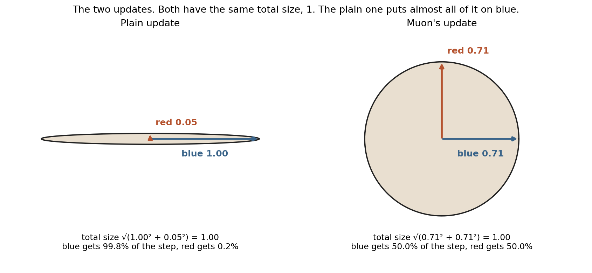

*Figure 5. The two updates: a thin ellipse (blue 1.00, red 0.05) and a circle (0.71, 0.71), both of total size 1.*

Apply each update 4 times and track how far the weights have moved along each direction.

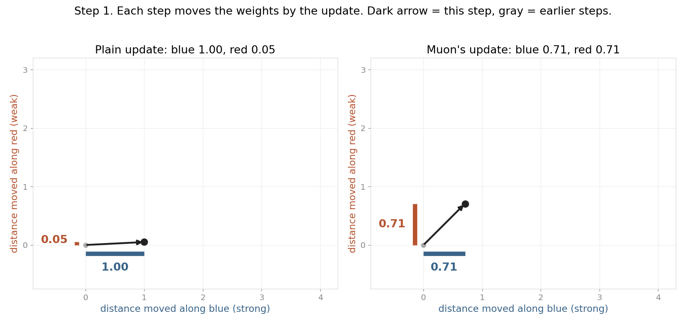

*Figure 6. Step 1: each update moves the weights once.*

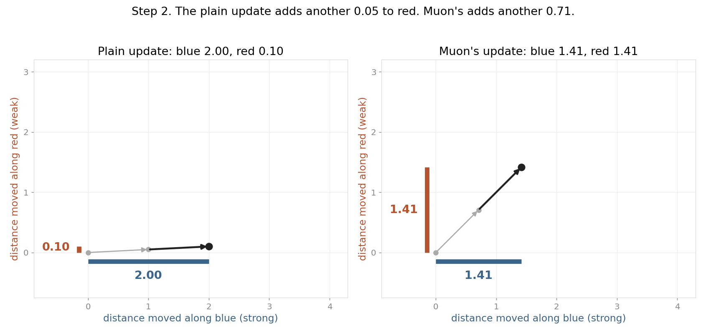

*Figure 7. Step 2: red has moved 0.10 with the plain update, 1.41 with Muon's.*

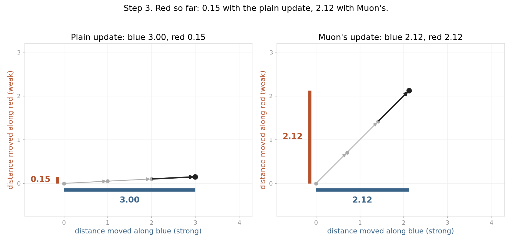

*Figure 8. Step 3: red has moved 0.15 with the plain update, 2.12 with Muon's.*

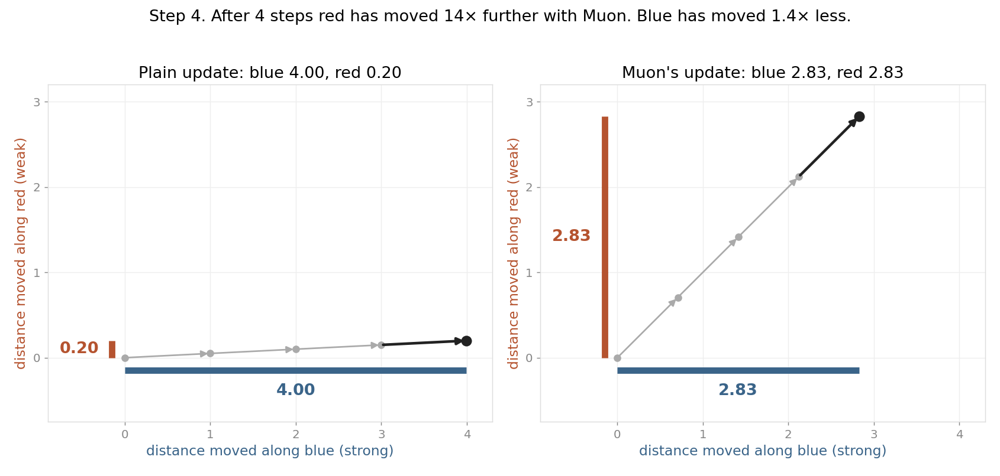

*Figure 9. Step 4: red has moved 14 times further with Muon's update.*

After 4 steps the plain update has moved red by 0.20. Muon's has moved it by 2.83, 14 times further. Blue pays for it: 2.83 instead of 4.00.

### Why it took until 2024

The idea of setting every strength to 1 is older than Muon:

- **2015–2016.** Carlson and colleagues proposed *stochastic spectral descent*, which did exactly this with an exact SVD. Their methods had no momentum. Muon's author found momentum necessary.
- **2018.** The Shampoo optimizer came out. In 2024 Bernstein and Newhouse showed that Shampoo, with its running averages removed, gives this same update.
- **2022.** Tuddenham and colleagues orthogonalized gradients with an SVD and added momentum afterwards. Their best setup lost to well-tuned SGD with momentum, and the paper was mostly overlooked.

Three things changed with Muon:

1. **Speed.** An exact SVD of every weight matrix at every step is far too slow on a GPU. Newton–Schulz uses only matrix multiplications, and it stays stable in bfloat16, the fast low-precision number format of modern GPUs.
2. **Order.** Muon averages the gradients first (momentum) and then sets the strengths to 1. Muon's author found that this works better than the reverse.
3. **A fair race.** Many optimizer papers beat an AdamW that was not tuned well. The NanoGPT speedrun is a public race against a heavily tuned baseline, with a fixed target and a timer. Muon won there, which made people believe it.

## 2. The plan, and step 0: divide G by its size

### What Muon wants

Every matrix can be written as three moves: a turn, a stretch, and another turn. Here they are one at a time, on an example matrix that turns by −50°, stretches by 1.00 and 0.30, and turns by +30°.

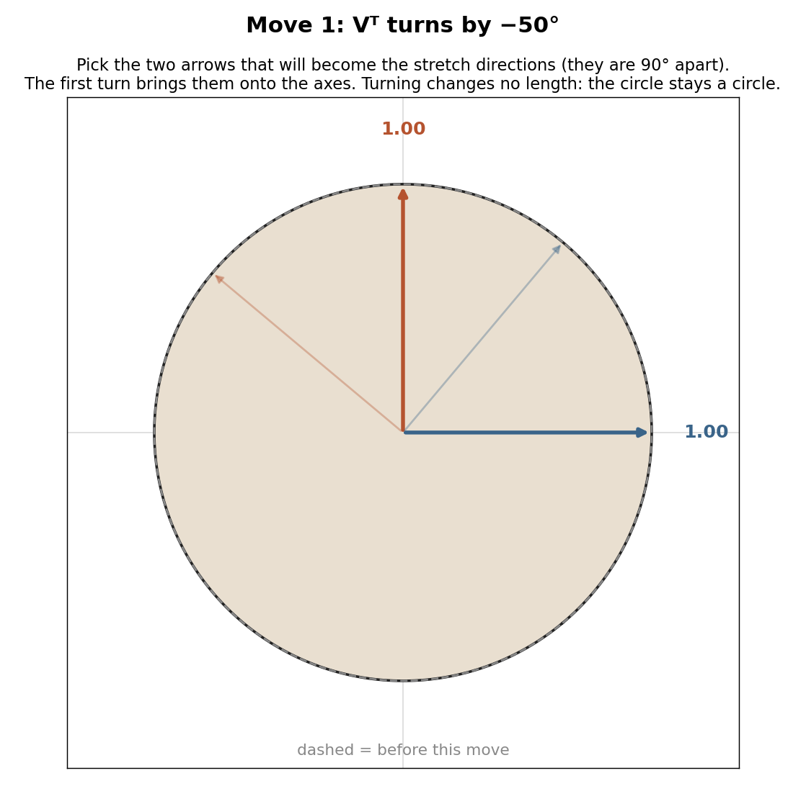

*Figure 10. Move 1: the first turn brings the two chosen arrows onto the axes; the circle stays a circle.*

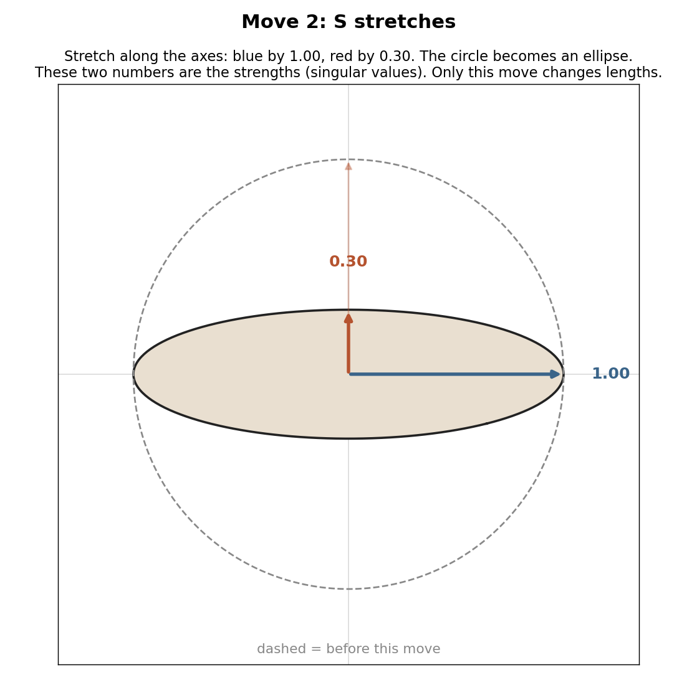

*Figure 11. Move 2: the stretch makes the circle an ellipse with half-widths 1.00 and 0.30.*

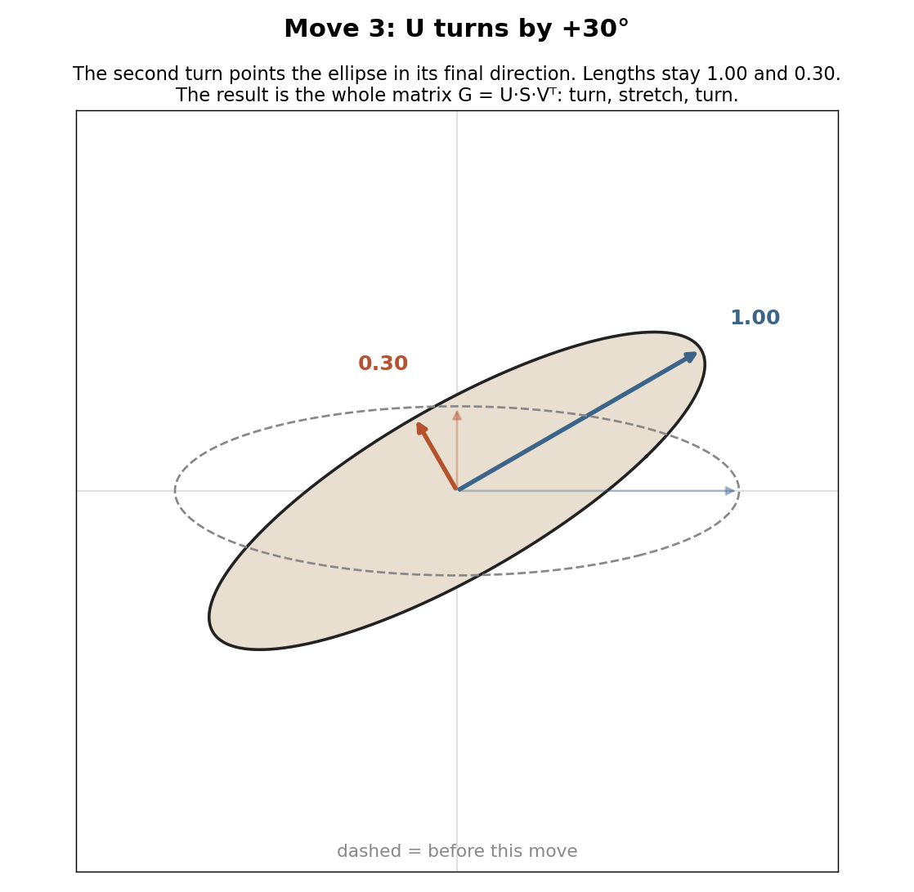

*Figure 12. Move 3: the second turn points the ellipse in its final direction.*

In symbols:

```
G     =  U · S · Vᵀ          Vᵀ turns, S stretches by the strengths, U turns
goal  =  U · Vᵀ              the same two turns, with the stretch removed
```

Our G is built exactly this way: a stretch by 1.00 and 0.20, then a 30° turn. Its first turn is 0°, which is why the example above uses a different matrix. Removing the stretch means setting every strength to 1. In the picture, the ellipse becomes a circle again, and the arrows keep their directions.

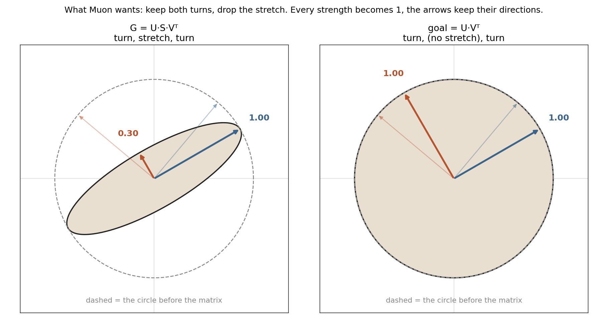

*Figure 13. G turns, stretches and turns; the goal U·Vᵀ does the same two turns with no stretch.*

### Why not compute U, S and V directly

The textbook tool that finds U, S and V is the singular value decomposition (SVD). Muon's author tried it. It is far too slow to run on every weight matrix at every training step. A GPU is fastest at one job, multiplying matrices. So Muon only multiplies. The next parts show, one step at a time, how multiplying alone changes the strengths and leaves the arrows where they are.

Two names first:

- **X** is the matrix Muon works on. It starts as G divided by its size (step 0, further down). For our G, X stretches by 0.981 and 0.196.
- **s** stands for one strength of X. Our X has two: s = 0.981 (blue) and s = 0.196 (red).

### The idea: build a curve out of powers

This part answers two questions: why Muon needs s³ and s⁵, and where the numbers 3.4445, −4.775 and 2.0315 come from, in five steps with pictures.

**First, a reminder of what s is.** X stretches a circle into an ellipse. The ellipse has two arrows, blue and red, and their lengths are X's two strengths: blue 0.981, red 0.196. **s** is the name for one of these lengths. When a sentence says "every s", it means "blue's length, and also red's length".

**Muon works on the whole matrix, never on single strengths.** It does not pull the strengths out, put each one through a curve and put them back. It only multiplies and adds whole matrices. "Each strength goes through the curve" describes what those whole-matrix operations turn out to do to the ellipse, as [section 3](#3-step-1-one-round-on-our-matrix) shows with numbers. The curves below are a way to see that effect, one strength at a time.

**Step 1: the goal, drawn as a line.** Every picture below reads the same way. Pick a strength s on the bottom axis, go up to the line, and read the new strength on the left axis. Muon wants a line that sends every strength to 1. Red has to grow from 0.196 to 1, which is ×5.10, because 0.196 × 5.10 = 1. Blue only has to grow from 0.981 to 1, which is ×1.02, because 0.981 × 1.02 = 1. Each strength needs a different multiplier.

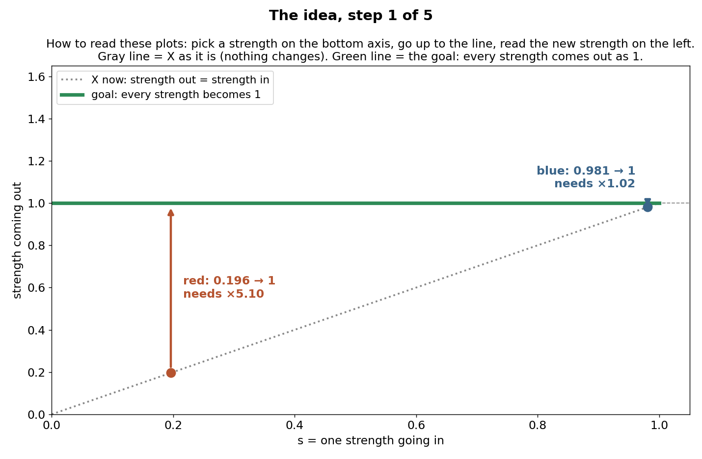

*Figure 14. Step 1: the goal is the flat line at 1; red needs ×5.10, blue needs ×1.02.*

**Step 2: the building blocks.** Muon can only multiply matrices. The next parts show that multiplying gives matrices with the same arrows as X and strengths s, s³ or s⁵. Here s³ means s·s·s ("s cubed"), and s⁵ means s·s·s·s·s ("s to the fifth"). A small strength almost disappears when cubed: 0.196³ = 0.0075. A strength near 1 barely changes: 0.981³ = 0.944. So s³ and s⁵ are large only where s is large.

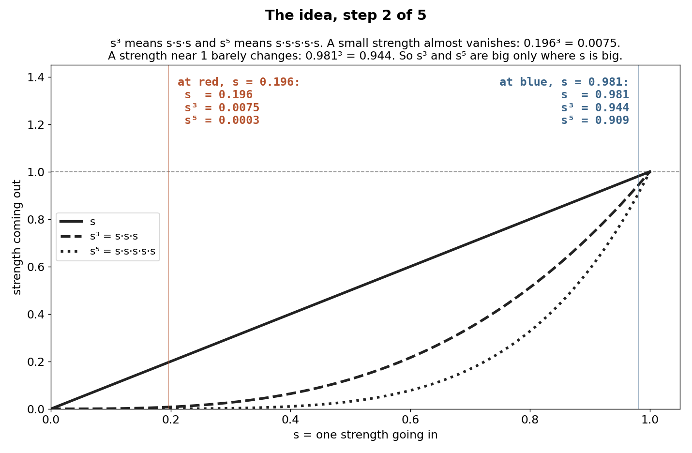

*Figure 15. Step 2: s, s³ and s⁵; at red they are 0.196, 0.0075 and 0.0003, at blue 0.981, 0.944 and 0.909.*

**Step 3: why multiplying X by one number is not enough.** The simplest thing Muon can do to X is multiply the whole matrix by one ordinary number. Call that number **a**. Multiplying by a makes the whole ellipse a times bigger, so both arrows grow by a: blue becomes a × 0.981 and red becomes a × 0.196.

Which a should Muon pick? Try the two obvious ones:

- To bring red to 1, a must be 1 ÷ 0.196 = 5.10. But blue grows by the same 5.10: 5.10 × 0.981 = 5.01, far past 1.
- To bring blue to 1, a must be 1 ÷ 0.981 = 1.02. But red grows by the same 1.02: 1.02 × 0.196 = 0.20, still far below 1.

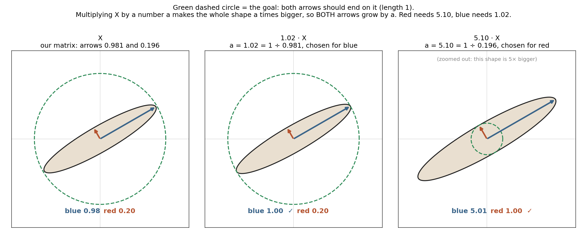

*Figure 16. Step 3: X, 1.02·X and 5.10·X; whichever arrow a is chosen for reaches the circle, the other does not.*

**Where the straight line comes from.** The next steps draw each choice as a line on a plot, so here is how a single number turns into a line.

Our X has only two strengths, but a real weight matrix has hundreds, anywhere between 0 and 1. So the question is not only "what does 5.10 do to red and blue" but "what does 5.10 do to every possible strength". Answer it one strength at a time and mark each answer as a dot: across = the strength going in, up = the strength coming out.

- 0.1 goes in, 5.10 × 0.1 = 0.51 comes out: a dot at (0.1, 0.51).
- Red: 0.196 goes in, 1.00 comes out: a dot at (0.196, 1.00).
- 0.5 goes in, 2.55 comes out: a dot at (0.5, 2.55).
- Blue: 0.981 goes in, 5.01 comes out: a dot at (0.981, 5.01).

Now do it for every strength from 0 to 1 in steps of 0.05. Each step of 0.05 to the right adds the same 5.10 × 0.05 = 0.255 upward. Same step up for every step right means the dots sit on a straight line. Join them, and the line answers the question for any strength at once: find the strength on the bottom axis, go up to the line, read the result.

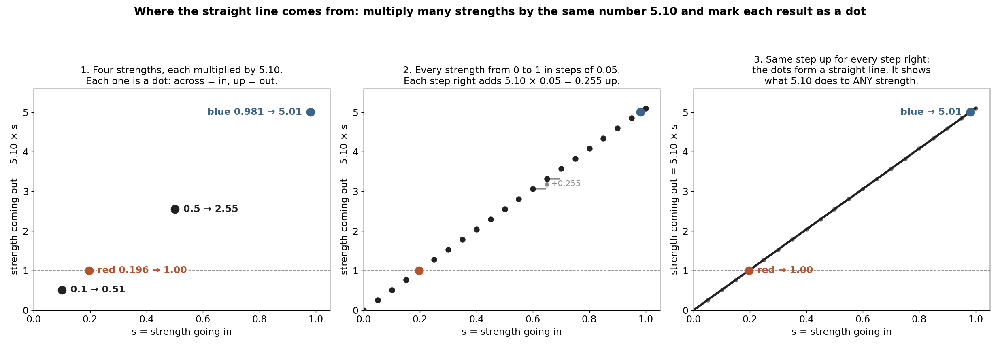

*Figure 17. The straight line: dots for 4 strengths, then for every strength in steps of 0.05, then joined into a line.*

So "multiply X by one number a" and "a straight line through 0" are the same thing, drawn two ways. A bigger a gives a steeper line. Here are both choices from above as lines. The goal is the flat dashed line at 1. Neither straight line is flat, and no a can make one flat: a straight line through 0 always sends small strengths to small results. So Muon needs a way to grow small strengths more than big ones.

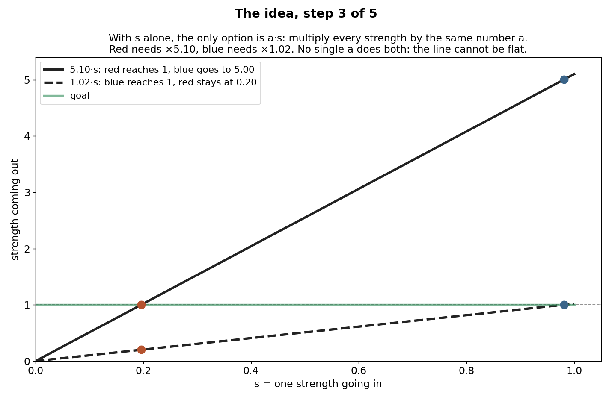

*Figure 18. Step 3, as curves: 5.10·s fixes red and breaks blue; 1.02·s fixes blue and leaves red small.*

**Step 4: why s³ is needed.** Add b·s³ with a negative b. From step 2, s³ is almost 0 at red and almost 1 at blue. So this term takes almost nothing from red and a lot from blue, and the straight line bends down at the right. Now a can be big for red, and b pulls blue back down.

With only these two numbers there is a trade-off. Both curves below send 1 to a fixed end: the gentle one to 1.0, the steep one to 0.7.

- The gentle curve 1.5·s − 0.5·s³ never goes above 1, but red only reaches 0.290.
- The steep curve 3.4445·s − 2.7445·s³ lifts red to 0.654, but it rises to 1.49 before it comes down.

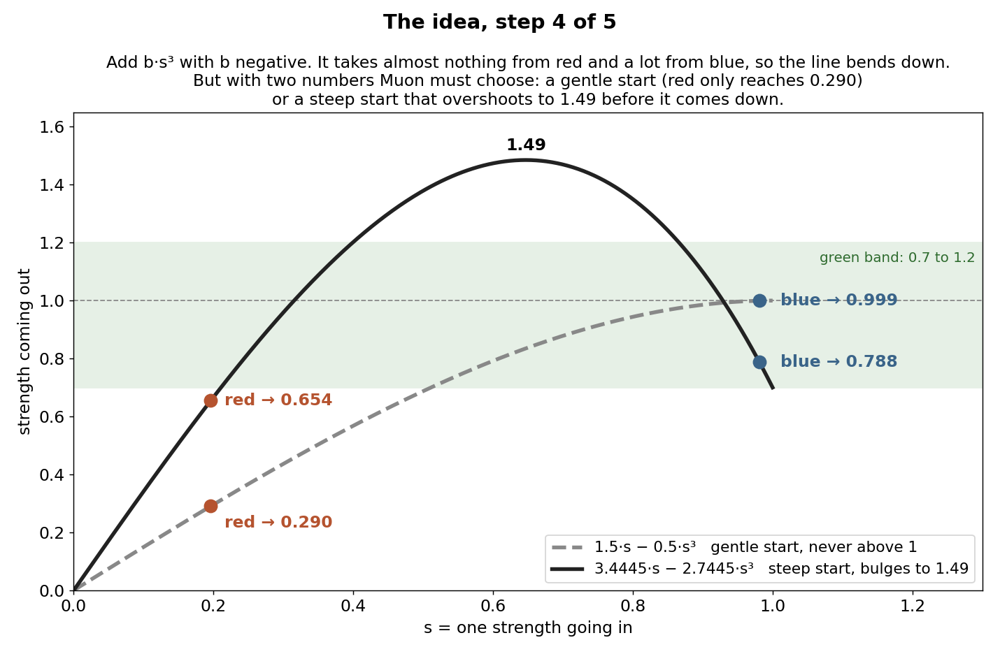

*Figure 19. Step 4: two cubic curves; the gentle one is slow for red, the steep one overshoots to 1.49.*

**Step 5: why s⁵ is needed.** Add c·s⁵. Like s³, it acts only on big strengths, even more so. A third number lets s³ pull down harder (−4.775 instead of −2.7445) and s⁵ lift the right end back up. The start stays as steep, so red still reaches 0.640, and the top of the curve drops from 1.49 to 1.20.

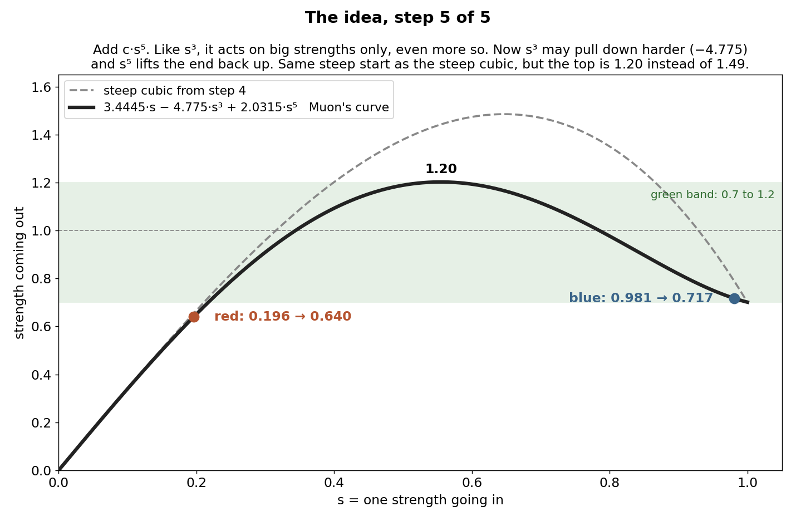

*Figure 20. Step 5: Muon's curve has the same steep start but tops out at 1.20 instead of 1.49.*

**Is this the final curve? No: it is one round.** Look at the left part of the curve above. A strength of 0.1 comes out as 0.34, far from 1. After one round, every strength below 0.22 is still below 0.7. That is expected, because Muon runs the curve 5 times. The output of round 1 goes into round 2, and so on. Each round multiplies a small strength by about 3.4, so it keeps growing until it reaches the green band:

| starts at | round 1 | round 2 | round 3 | round 4 | round 5 |
|---|---|---|---|---|---|
| 0.01 | 0.034 | 0.118 | 0.400 | 1.093 | 0.699 |
| 0.1 | 0.340 | 0.992 | 0.707 | 1.107 | 0.712 |
| red 0.196 | 0.640 | 1.171 | 0.839 | 0.914 | 0.798 |
| blue 0.981 | 0.717 | 1.095 | 0.700 | 1.114 | 0.722 |

Once inside the band, a strength bounces between about 0.68 and 1.20 and stays there. After 5 rounds, every strength above 0.0016 ends between 0.68 and 1.20. That is "close to 1" in Muon's sense: not exactly 1, but within a factor of about 1.7 of each other, where X started with red and blue 5 times apart.

**Every round, one picture each.** Each round uses the same step 5 curve. Only the input changes: round 1 takes the strengths X starts with, and every later round takes what came out of the round before. In each picture below:

- **Left:** the round itself. Each dot starts on the bottom axis at the strength going into this round, goes up to the curve, and the strength after the round is read on the left side.
- **Right:** the whole curve so far. Every starting strength (bottom axis) is shown where it sits after this many rounds. The dashed line is the round before. The pink strip covers the starting strengths that are still below 0.68.

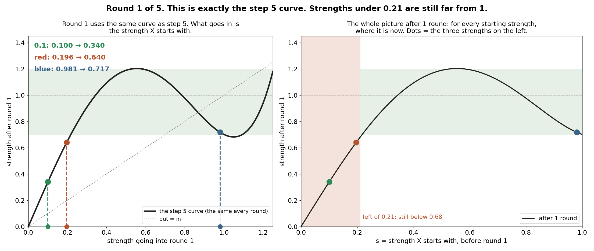

*Figure 21. Round 1: the step 5 curve itself; strengths under 0.21 are still far from 1.*

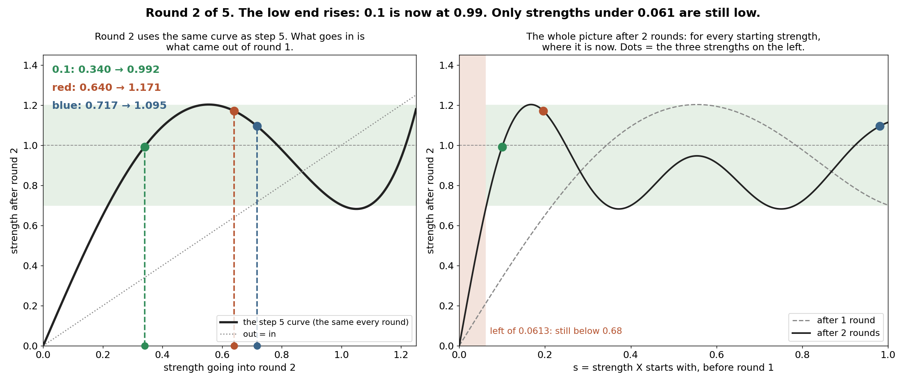

*Figure 22. Round 2: 0.1 reaches 0.99; only strengths under 0.061 are still low.*

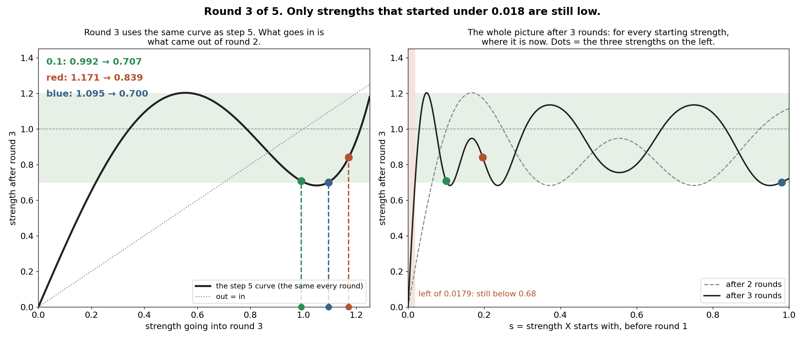

*Figure 23. Round 3: only strengths that started under 0.018 are still low.*

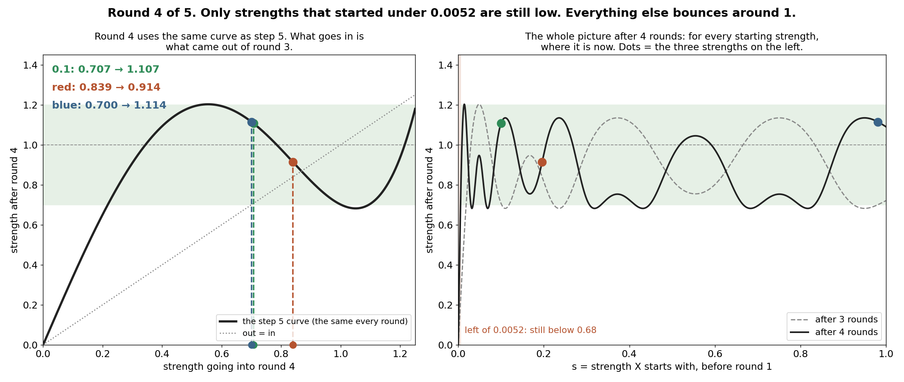

*Figure 24. Round 4: only strengths that started under 0.0052 are still low.*

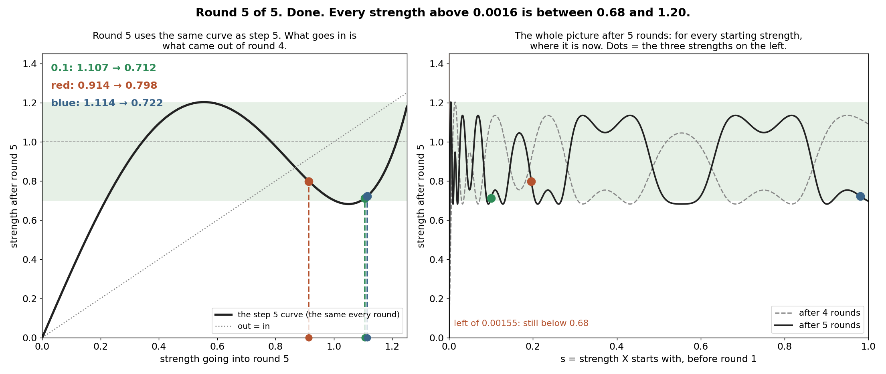

*Figure 25. Round 5: every strength above 0.0016 is between 0.68 and 1.20.*

The right panel gets wavier every round because each round folds the curve once more: strengths past the top at 0.555 come back down, then go up again in the next round. The waves stay between 0.68 and 1.20, so they do no harm: Muon needs every strength near 1, not a smooth curve.

Summary of all 5 rounds:

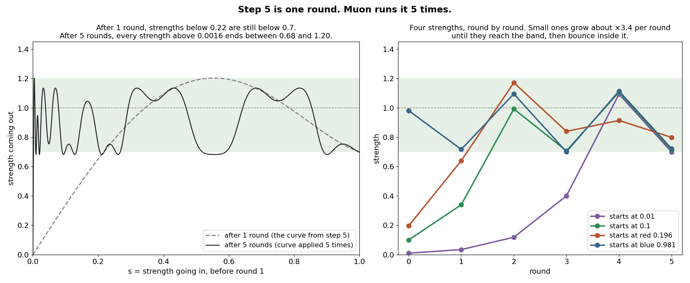

*Figure 26. After 5 rounds: the curve applied 5 times stays in the band; four strengths round by round.*

[Section 4](#4-repeat-5-times) shows the same 5 rounds on our matrix, one picture per round.

**Directions and numbers.** The update matrix has a few directions, our blue and red arrows. Each direction has one number, its strength: how far the update moves the weights along that direction. The 5 rounds never change the directions. They only change the numbers: blue goes 0.981 → 0.722, red goes 0.196 → 0.798.

**Is the goal 1, or 0.68 to 1.20?** The ideal is exactly 1 for every direction: that is U·Vᵀ, both turns with no stretch. Muon settles for 0.68 to 1.20 on purpose.

- **What hurts training is lopsidedness,** a big gap between directions. Before the rounds, red moves 5 times less than blue (0.196 vs 0.981), and in a real weight matrix the gap can be 1000 times. After 5 rounds, every direction is within about 1.7 times of every other (0.68 vs 1.20), so no direction is starved.
- **Exactly 1 costs more.** A curve that ends exactly at 1 needs a gentler start, like the gentle cubic in step 4, and so more rounds. Each round is 3 matrix multiplications at every training step. Keller Jordan reports that strengths near 1 train as well as exactly 1, so the curve trades exactness for speed. [Section 7](#7-experiment-does-every-direction-need-an-equal-push) tests this on a small model.
- **Where 0.68 and 1.20 come from.** Both are points on the step 5 curve. 1.20 is its top, at s = 0.555. 0.68 is the bottom of its dip, at s = 1.05. A strength between 0.68 and 1.20 comes out of the next round between 0.682 and 1.136, so once a strength is in that range it stays there.

**Where the three numbers come from.** No formula produces them. Keller Jordan, Muon's author, tuned them for this trade-off:

- 3.4445 is the slope at the start: how many times a small strength grows in one round. He made it as large as the next condition allows.
- −4.775 and 2.0315 then had to keep the curve from going too far above 1. Once a strength is above about 0.22, the curve sends it to somewhere between about 0.7 and 1.2.

[Why these three numbers](#why-these-three-numbers) shows the curve built one term at a time with red and blue, and why he wanted a steep start.

**What remains to show.** Muon cannot reach into X and change each strength. It needs two new matrices with the same arrows as X and every strength cubed (s³) or raised to the fifth power (s⁵), made only by multiplying. Then adding 3.4445·X, −4.775 times the s³ matrix and 2.0315 times the s⁵ matrix applies the curve to every strength at once. The next parts build the s³ matrix.

### The obvious try, X·X·X, fails

To cube a plain number, multiply it by itself: 0.196 · 0.196 · 0.196 = 0.0075. The same idea fails for a matrix. Even X·X goes wrong.

X is three moves: turn, stretch, turn. (Matrices act from right to left, so in U·S·Vᵀ the turn Vᵀ happens first, then the stretch S, then the turn U.) X·X is turn, stretch, turn, turn, stretch, turn. The two turns in the middle, U and then Vᵀ, have nothing to do with each other, so they do not cancel. They turn the ellipse between the two stretches, and the result points somewhere new. Its strengths are not 0.981² and 0.196² either, but 0.407 and 0.091.

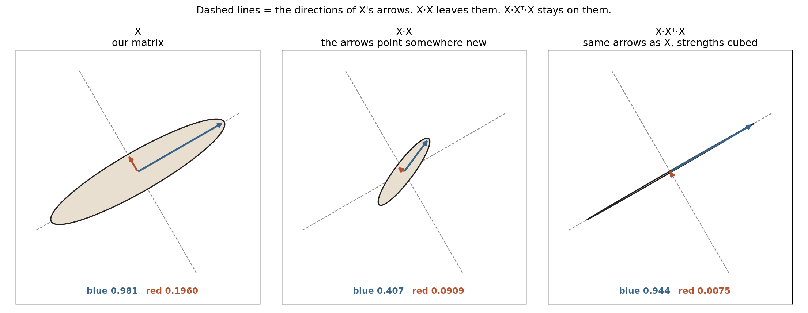

*Figure 27. X, X·X and X·Xᵀ·X: X·X leaves the dashed lines of X's arrows, X·Xᵀ·X stays on them.*

### The fix: Xᵀ, which runs X's turns backwards

The turns between the stretches have to cancel. Muon needs a matrix that starts by undoing X's last turn. That matrix is Xᵀ.

Xᵀ is X with rows and columns swapped. Swapping runs X's moves in reverse order and reverses each turn:

```
X   =  U · S · Vᵀ       turn by Vᵀ,  stretch by S,  turn by U
Xᵀ  =  V · S · Uᵀ       turn back by Uᵀ,  stretch by S,  turn back by V
```

The stretch is not reversed. Xᵀ stretches by the same S again.

### Why three: X, then Xᵀ, then X

Follow the moves:

1. **X**: turn by Vᵀ, stretch, turn by U.
2. **Xᵀ**: its first turn Uᵀ cancels U. Then it stretches a second time. Then it turns by V. The shape is now stretched twice, but X's last turn U is gone.
3. **X again**: its first turn Vᵀ cancels that V. Then it stretches a third time and turns by U, which brings back X's last turn.

What is left is X's first turn Vᵀ, three stretches, and X's last turn U. The X at each end supplies one of X's two turns. The Xᵀ in the middle makes the turns between them cancel. Each of the three brings one stretch, so each strength is multiplied by itself 3 times.

Here are the 9 moves one at a time, with our strengths 0.981 and 0.196. Our G has no first turn, so the picture adds one of −50° to make every turn visible.

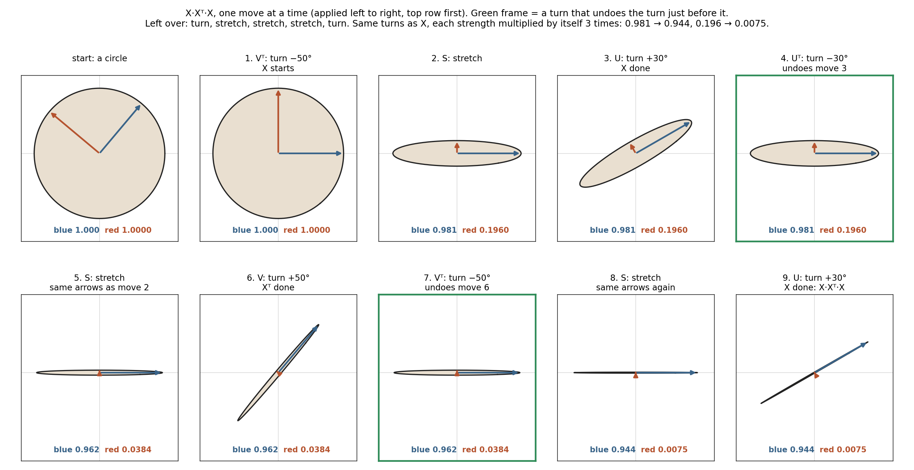

*Figure 28. X·Xᵀ·X as 9 moves on a circle: moves 4 and 7 undo the turn before them; three stretches remain.*

In symbols:

```
X·Xᵀ·X  =  U·S·Vᵀ · V·S·Uᵀ · U·S·Vᵀ
        =  U·S·S·S·Vᵀ            Vᵀ·V and Uᵀ·U cancel
        =  U·S³·Vᵀ
```

The turns are the same as X's. 0.981 becomes 0.944, and 0.196 becomes 0.0075.

The formula at the top writes the same product as (XXᵀ)X. Here it is as three shapes:

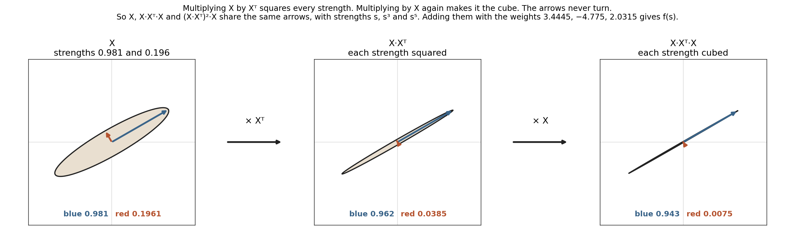

*Figure 29. X, then X·Xᵀ with every strength squared, then X·Xᵀ·X with every strength cubed; the arrows stay put.*

### Two more moves give the fifth power

**Why we need a fifth power.** With only s and s³, a steep start bulges up to 1.49 (step 4 of [the idea](#the-idea-build-a-curve-out-of-powers)). s⁵ keeps the top at 1.20 (step 5).

**How to get it.** The same trick, one pair longer: (XXᵀ)²X = X·Xᵀ·X·Xᵀ·X = U·S⁵·Vᵀ. Each extra Xᵀ·X pair adds two turns that cancel and two more stretches. Red becomes 0.196⁵ = 0.0003.

**Why only odd powers.** An even number of X's cannot keep X's arrows. X·Xᵀ = U·S²·Uᵀ starts with the turn Uᵀ and ends with U, but X starts with Vᵀ. The X at each end is what supplies X's two turns, so the count is always odd: 1, 3, 5.

### Adding them gives a curve

**Why add them.** Muon wants one matrix whose strengths are a chosen curve of X's strengths. A sum of s, s³ and s⁵ with three chosen numbers can take many shapes, and the next part picks the shape that ends near 1.

**Why adding works.** X, (XXᵀ)X and (XXᵀ)²X all have the same turns. Two matrices with the same turns differ only in their stretches, so adding them adds the stretches: U·a·Vᵀ + U·b·Vᵀ = U·(a+b)·Vᵀ, like 3 apples + 5 apples = 8 apples. So the formula

```
3.4445·X  −  4.775·(XXᵀ)X  +  2.0315·(XXᵀ)²X
```

has the same turns as X, and each strength s of X becomes

```
f(s) = 3.4445·s − 4.775·s³ + 2.0315·s⁵
```

For red, s = 0.196:

| term | value |
|---|---|
| 3.4445 · 0.196 | 0.675 |
| −4.775 · 0.196³ | −0.036 |
| 2.0315 · 0.196⁵ | 0.001 |
| f(0.196) | 0.640 |

For blue, s = 0.981: 3.379 − 4.508 + 1.846 = 0.717.

Muon never computes s. It only multiplies and adds whole matrices. The curve happens to every strength at once, as a side effect.

### Why these three numbers

Each term has its own job. Here the curve is built one term at a time.

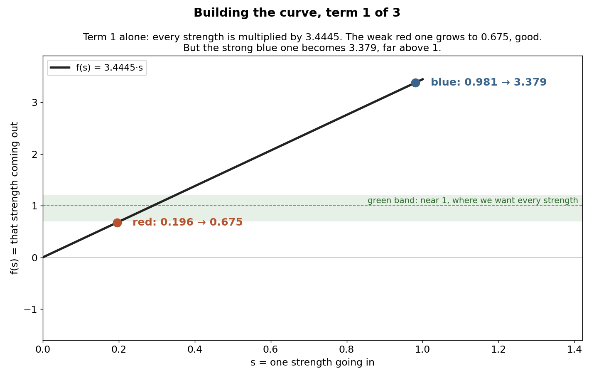

*Figure 30. Term 1: 3.4445·s lifts red to 0.675 but sends blue to 3.379.*

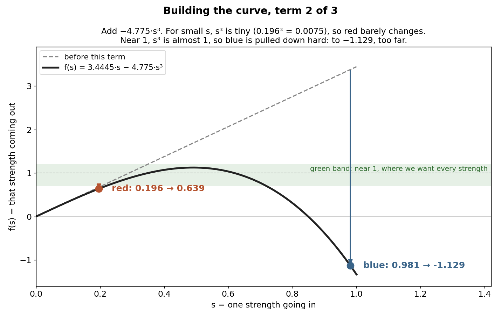

*Figure 31. Term 2: −4.775·s³ barely touches red but pulls blue down to −1.129.*

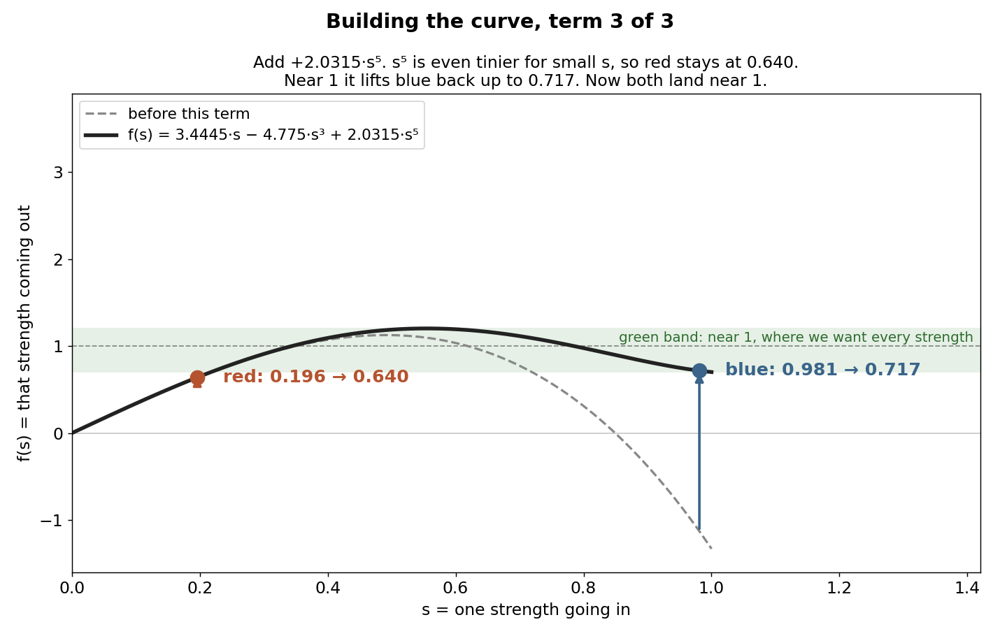

*Figure 32. Term 3: +2.0315·s⁵ leaves red at 0.640 and lifts blue back to 0.717.*

- **3.4445** sets how fast small strengths grow. For small s, s³ and s⁵ are almost 0, so only this term counts.
- **−4.775** pulls big strengths down. s³ is tiny for small s but close to s near 1.
- **2.0315** lifts big strengths back up, so they do not fall too far.

Keller Jordan, Muon's author, tuned the three numbers.

- **Why make the first number big.** Near 0 the curve multiplies a strength by about 3.4445 each round. After step 0 many strengths of a real update are far below 1: 0.036 in the 768×768 example further down, and less for rare directions. The bigger this number, the fewer rounds they need. With 3.4445, a strength of 0.005 goes 0.017, 0.059, 0.203, 0.661, 1.154 in 5 rounds.
- **Why not bigger still.** A steeper start makes the curve bulge higher before it comes back down near 1. Then strengths bounce further from 1.
- **Why not end exactly at 1.** A curve that sends 1 exactly to 1 has to start flatter. The older textbook choice, 1.5 and −0.5, does this, and small strengths grow only 1.5× per round. Muon's author accepts strengths between about 0.7 and 1.2 instead, and reports that this did not hurt training. Section 5 compares the two.

### The plan

1. Step 0: divide G by its size, so every strength is 1 or less. The curve only behaves for strengths up to about 1.2; the next three parts explain this.
2. Rounds 1 to 5: apply the formula. Each round feeds every strength through f(s). One round is not enough because a small strength grows only about 3.4× per round. Five rounds lift anything from 0.005 up into 0.68–1.15 (section 5). More rounds would cost 3 more multiplications each.

[Section 3](#3-step-1-one-round-on-our-matrix) runs round 1 on our matrix. [Section 4](#4-repeat-5-times) runs all 5.

### Why the strengths must start at 1 or less

The s⁵ term grows fastest. Above about 1.2 it wins, and the curve shoots up. It pulls toward 1 only for inputs from 0 to about 1.2. Put 1.5 in and 4.48 comes out. Put 3 in and 375 comes out. Real gradients can have strengths of 0.001 or 40. So before the rounds, every strength must be moved into the safe range.

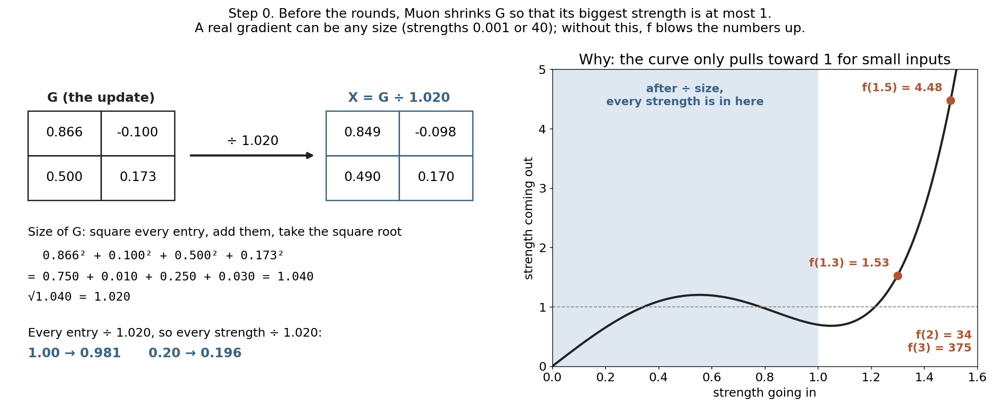

*Figure 33. Dividing G by its size, and why: the curve explodes for inputs above about 1.2.*

### Why divide by the size

Dividing G by a number divides every strength by that number. Which number is best? Take a G with strengths 1.00 and 0.20 and try three divisors:

| divide by | strengths after | what happens |
|---|---|---|
| 0.5, smaller than the biggest strength | 2.00 and 0.40 | 2.00 is above 1.2, and one round sends it to 33.7 |
| 5, much bigger | 0.20 and 0.04 | safe, but red starts lower: 3 rounds to pass 0.7 |
| 1.00, the biggest strength | 1.00 and 0.20 | safe, and red passes 0.7 after 2 rounds |

Dividing by less than the biggest strength pushes it above 1, into the range where the curve explodes. Dividing by more than it is safe, but shrinks every strength further from 1, and each extra shrink costs rounds. So the best divisor is the biggest strength itself: it is the smallest divisor that keeps everything at 1 or below.

But finding the biggest strength needs the SVD again. So Muon divides by a number it can get from the entries alone, the size:

1. Square every entry of G and add them up. Here 0.750 + 0.010 + 0.250 + 0.030 = 1.040.
2. Take the square root. √1.040 = 1.020.
3. Divide every entry by 1.020.

Here is why this works. The sum of the squared entries always equals the sum of the squared strengths:

```
size² = (sum of every entry²) = s₁² + s₂² + s₃² + …
```

For our G: 1.00² + 0.20² = 1.040, the same total as the 4 entries. The reason is that turning never changes lengths, so only the stretch counts. The size² contains the biggest strength squared plus other terms that are never negative. So the size is never smaller than the biggest strength. After dividing, every strength is 1 or less. For our G, 1.00 becomes 0.981 and 0.20 becomes 0.196.

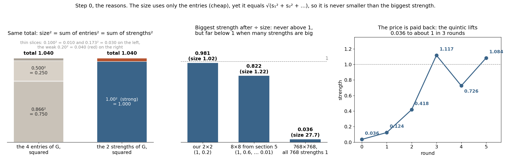

*Figure 34. Size² equals the sum of squared strengths; the biggest strength after dividing; the 768 case lifted in 3 rounds.*

### The price

When many strengths are big, the size is much bigger than the biggest strength. Take a 768×768 matrix with all 768 strengths equal to 1. Its size is √768 = 27.7, so every strength becomes 0.036. That is far below 1, and it is why the curve's start matters. Near 0 it multiplies by 3.4445, so 0.036 becomes 0.124, then 0.418, then 1.117. Three rounds pay the price back.

## 3. Step 1: one round on our matrix

Round 1 applies the formula once to our X. As [section 2](#adding-them-gives-a-curve) showed, that feeds each strength through the curve, and the arrows stay where they are:

```
f(s) = 3.4445·s − 4.775·s³ + 2.0315·s⁵
```

**What Muon actually computes in one round.** All four lines work on the whole matrix X:

1. A = X·Xᵀ (one matrix multiplication)
2. B = A·X, which is X·Xᵀ·X (second multiplication)
3. C = A·B, which is (X·Xᵀ)²·X (third multiplication)
4. new X = 3.4445·X − 4.775·B + 2.0315·C (multiply each matrix by a number, then add)

Muon never computes the arrows or the strengths. Matrix multiplications are what GPUs are fast at. The strengths change anyway.

**Seeing it on a matrix with no turns.** Take X = [0.981, 0; 0, 0.196]: only a stretch, its two strengths sit on the diagonal. For such a matrix, multiplying matrices just multiplies the diagonal numbers:

| matrix | top-left | bottom-right |
|---|---|---|
| X | 0.981 | 0.196 |
| B = X·Xᵀ·X | 0.944 (= 0.981³) | 0.0075 (= 0.196³) |
| C = (X·Xᵀ)²·X | 0.909 (= 0.981⁵) | 0.0003 (= 0.196⁵) |
| 3.4445·X − 4.775·B + 2.0315·C | **0.717** | **0.640** |

Here each strength visibly goes through f(s) by itself, because the matrix is nothing but its two strengths.

**Our actual X has turns.** Its four entries mix both strengths, and the same four lines change all of them:

| | entries | strengths |
|---|---|---|
| X | [0.849, −0.098; 0.490, 0.170] | 0.981, 0.196 |
| new X | [0.621, −0.320; 0.359, 0.554] | **0.717, 0.640** |

The entries change in a way you cannot read by eye. Measure the strengths of the new X and you get exactly 0.717 and 0.640, the same as the no-turn case, and the arrows still point the same way. The reason is in [section 2](#adding-them-gives-a-curve): the turns cancel inside X·Xᵀ·X, so only the stretch changes.

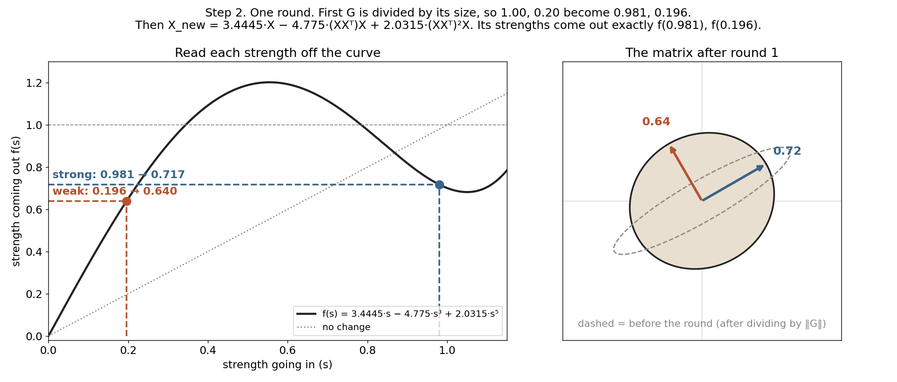

*Figure 35. One round: read each strength off the curve. 0.196 becomes 0.640, 0.981 becomes 0.717.*

For our matrix:

| strength | into the curve | out of the curve |
|---|---|---|
| weak | 0.196 | 0.640 |
| strong | 0.981 | 0.717 |

The weak strength more than triples. Near 0 the curve's slope is 3.4445, so small strengths get multiplied by about 3.4 each round. The strong one is pulled down. After a single round, weak ÷ strong goes from 0.20 to 0.89.

## 4. Repeat 5 times

Each round's output is the next round's input. On the plot, go up to the curve (one round), then across to the dotted line (feed the result back in), then up again. One round per image:

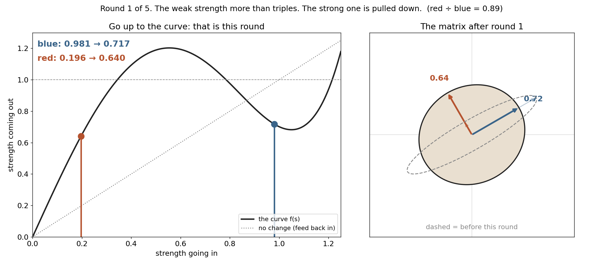

*Figure 36. Round 1: red 0.196 → 0.640, blue 0.981 → 0.717.*

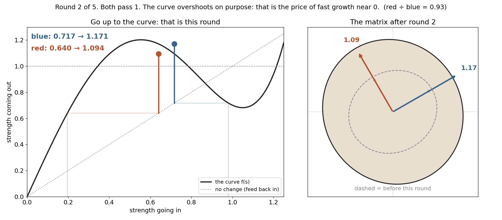

*Figure 37. Round 2: both pass 1.*

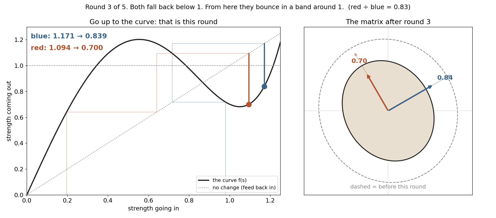

*Figure 38. Round 3: both fall back below 1.*

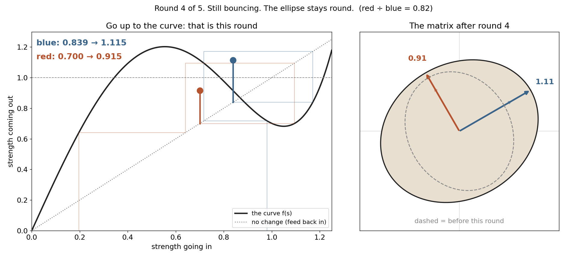

*Figure 39. Round 4: still bouncing around 1.*

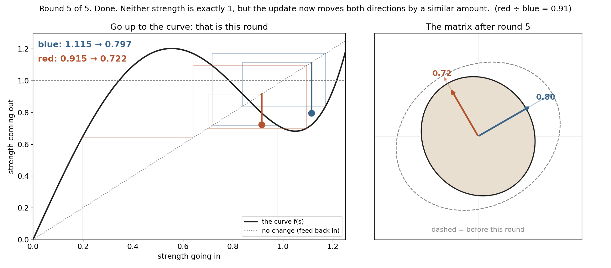

*Figure 40. Round 5: red 0.722, blue 0.797.*

The same numbers as a table:

| round | strong | weak |
|---|---|---|
| 0 | 0.981 | 0.196 |
| 1 | 0.717 | 0.640 |
| 2 | 1.171 | 1.094 |
| 3 | 0.839 | 0.700 |
| 4 | 1.115 | 0.915 |
| 5 | 0.797 | 0.722 |

The weak strength passes 1 after two rounds. After that, both strengths bounce between about 0.7 and 1.2. They never settle exactly on 1. That is on purpose. The coefficients were picked to make small strengths grow as fast as possible, and the price is this wobble. Muon's author reports that not reaching exactly 1 did not hurt training.

Here is the same matrix after each round:

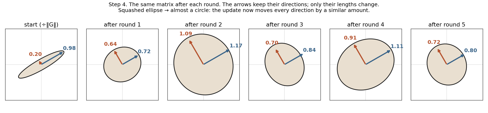

*Figure 41. The ellipse after each round becomes almost a circle.*

The arrows never turn. The thin ellipse becomes a rounder shape after one round and stays round.

## 5. Quintic vs cubic

The formula above is called **quintic** because its curve goes up to s⁵. It is Muon's default. The older textbook version is **cubic** Newton–Schulz:

```
X  ←  1.5·X  −  0.5·(XXᵀ)X        curve: f(s) = 1.5·s − 0.5·s³
```

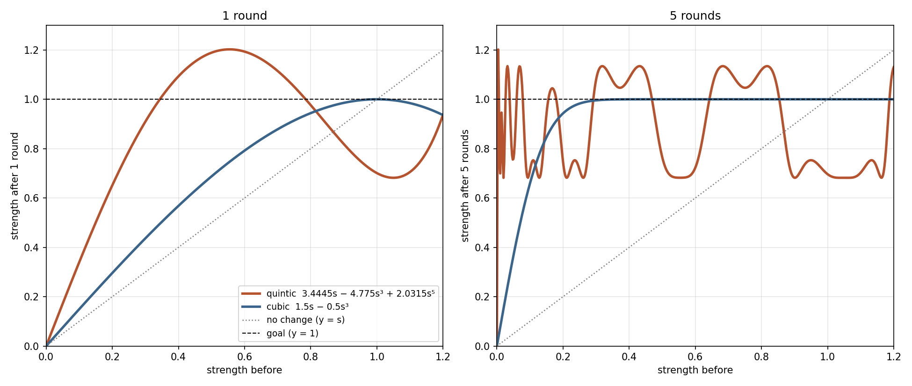

*Figure 42. Quintic vs cubic after 1 round and after 5 rounds.*

| | quintic | cubic |
|---|---|---|
| slope near 0 | 3.4445 | 1.5 |
| what happens to s = 1 | goes to 0.70 | stays exactly 1 |
| after 5 rounds | anything from 0.005 to 1.2 lands between 0.68 and 1.15 | anything above 0.3 lands within 0.004 of 1, small ones stay small |
| matrix multiplications per round | 3 | 2 |

The cubic is exact but slow to lift small strengths. It multiplies them by only 1.5 per round, so after 5 rounds a strength of 0.01 reaches only 0.076. The quintic is rough but lifts everything.

On an 8×8 matrix with strengths 1, 0.6, 0.3, 0.15, 0.08, 0.04, 0.02, 0.01 (run `python3 muon_orth.py`):

| method | multiplications | strengths after | error vs exact answer |
|---|---|---|---|
| quintic × 4 rounds | 12 | 0.68 to 1.17 | 0.211 |
| quintic × 5 rounds | 15 | 0.70 to 1.13 | 0.210 |
| cubic × 5 rounds | 10 | 0.06 to 1.00 | 0.565 |

The exact answer is the matrix with the same arrows and every strength equal to 1. The error is the distance from that answer, divided by its size.

## 6. The code

```python
import numpy as np

QUINTIC = (3.4445, -4.775, 2.0315)
CUBIC = (1.5, -0.5)

def muon_orth(G, steps=5, kind="quintic", eps=1e-7):
    X = G / (np.linalg.norm(G) + eps)   # step 0: every strength now ≤ 1
    tall = X.shape[0] > X.shape[1]
    if tall:
        X = X.T                          # keep XXᵀ the smaller square matrix
    for _ in range(steps):
        A = X @ X.T
        if kind == "quintic":
            a, b, c = QUINTIC
            X = a * X + (b * A + c * A @ A) @ X
        else:
            a, b = CUBIC
            X = a * X + b * A @ X
    return X.T if tall else X
```

Real Muon runs the same loop in bfloat16 on the GPU.

## 7. Experiment: does every direction need an equal push?

Muon's ideal is the same push for every direction (all strengths = 1). We tested whether that matters, on a tiny language model that trains in one minute on a laptop.

**Setup.** Split each update exactly with an SVD, then raise every strength to a power p: s becomes s^p. Then scale the whole update so its total size is the same for every p. p = 0 pushes every direction equally, Muon's ideal. p = 1 keeps the update's own shape, so weak directions are barely pushed. Only p changes; every run has the same starting weights and batches, and each p gets its own best learning rate.

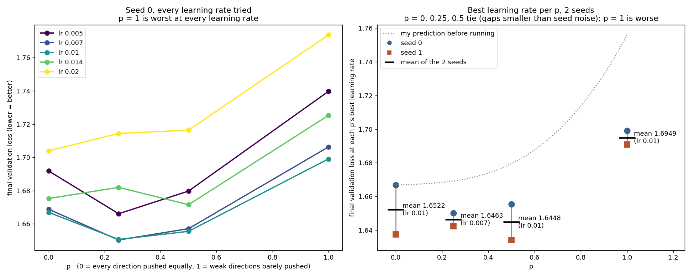

*Figure 43. Validation loss vs p: p = 0, 0.25 and 0.5 tie within seed noise; p = 1 is worse at every learning rate.*

**Results.** At each p's best learning rate, averaged over 2 seeds: p = 0 reaches 1.652, p = 0.25 reaches 1.646, p = 0.5 reaches 1.645, p = 1 reaches 1.695.

**Analysis.**

- **Starving the weak directions costs learning.** p = 1 is the worst at every learning rate and on both seeds.
- **Pushing them somewhat less costs nothing measurable.** p = 0, 0.25 and 0.5 are within 0.008 of each other, while changing only the seed moves a result by 0.03.
- **So Muon's band of 0.68 to 1.20 is enough.** It is far more even than p = 0.5, which already tied with exact equality. Reaching exactly 1 would cost more rounds and, at this size, buy nothing.

Full setup, every run, limits and code: [experiments/README.md](experiments/README.md).

## Run it

```bash
pip install -r requirements.txt
python3 muon_orth.py      # the 8×8 table above
python3 teach_size.py     # images/step0_size.png
python3 teach_why_size.py  # images/step0_why.png
python3 teach.py          # images/step1.png … step4.png
python3 teach_directions.py  # images/step1b_directions.png
python3 teach_steps.py    # images/move0.png … move4.png
python3 teach_series.py   # images/tst1.png … tst4.png, cube.png, round1.png … round5.png
python3 teach_ladder.py   # images/idea1.png … idea6.png, idea3a.png, idea3b.png, rounds1.png … rounds5.png, chain.png, xx_fail.png, curve1.png … curve3.png
python3 plot_poly.py      # images/poly_plot.png
python3 intro_plots.py    # images/muon_timeline.png, muon_numbers.png
cd experiments && python3 exp2_power.py 0.01 && python3 plot_exp2.py   # section 7, see experiments/README.md
```

## Sources

- Muon, its coefficients 3.4445, −4.775, 2.0315, the speedrun, CIFAR-10, 1.5B-model and compute-overhead numbers: Keller Jordan, [Muon: An optimizer for hidden layers in neural networks](https://kellerjordan.github.io/posts/muon/) (December 2024).
- Moonlight and the 2× compute result: Moonshot AI, [Muon is Scalable for LLM Training](https://arxiv.org/abs/2502.16982) (February 2025).
- Earlier work: Carlson et al., stochastic spectral descent (2015–2016); Gupta, Koren, Singer, [Shampoo](https://arxiv.org/abs/1802.09568) (2018); Tuddenham, Prügel-Bennett, Hare, [Orthogonalising gradients to speed up neural network optimisation](https://arxiv.org/abs/2202.07052) (2022); Bernstein, Newhouse, [Old Optimizer, New Norm: An Anthology](https://arxiv.org/abs/2409.20325) (2024).
- The smaller speedup over well-tuned AdamW: Kaiyue Wen, David Hall, Tengyu Ma, Percy Liang, [Fantastic Pretraining Optimizers and Where to Find Them](https://arxiv.org/abs/2509.02046) (September 2025, ICLR 2026).
- Kimi K2 and MuonClip: Moonshot AI, Kimi K2 technical report (July 2025), as covered by [HPCwire](https://www.hpcwire.com/aiwire/2025/07/14/chinas-moonshot-ai-releases-trillion-parameter-model-kimi-k2/).
- Schulz, *Iterative Berechnung der reziproken Matrix*, Zeitschrift für Angewandte Mathematik und Mechanik 13 (1933), 57–59.
