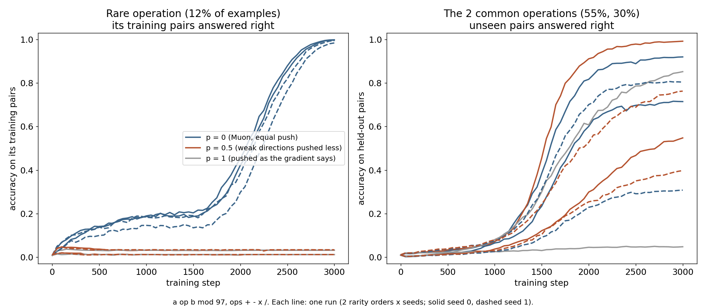

# Rare operations: what does Muon learn about them?

**Question.** Muon pushes every direction of the update equally, including weak directions that only a few examples in the batch ask for. The [speedrun test](../speedrun/README.md#does-muon-push-weak-directions-too-hard) found that pushing weak directions less (p = 0.25, 0.5) gives lower average loss. Average loss is dominated by common data. Does the model then know less about rare things?

**Task** ([arith.py](arith.py)). `a op b = ?` modulo 97, with 4 operations + − × ÷. Every operation has 4,704 training pairs and 4,705 held-out pairs. Batches draw the operations at different rates: 55%, 30%, 12%, 3%. Two orders, so rarity is not mixed up with difficulty:

- order A: + 55%, − 30%, × 12%, ÷ 3%
- order B: ÷ 55%, × 30%, − 12%, + 3%

Model: embeddings of the 3 tokens → three Muon matrices (192×256, 256×256, 256×256) → answer. 3000 steps × batch 512, Muon lr 0.02, momentum 0.95, weight decay 0.05, AdamW lr 0.01 on embeddings and output.

Muon matrices get U S^p V^T from an exact SVD, scaled to the total size of exact Muon. p = 0 is exact Muon (every direction pushed equally). p = 0.5 pushes weak directions less. p = 1 pushes them as the gradient says. Only the shape of the update changes, not its size.



## Results (seeds 0 and 1)

Accuracy at step 3000. "train" = its own training pairs, "test" = held-out pairs.

| p | order | seed | 55% op test | 30% op test | 12% op train | 3% op train |
|---|---|---|---|---|---|---|
| 0 | A | 0 | 0.92 | 0.92 | **1.00** | 0.02 |
| 0 | B | 0 | 0.70 | 0.72 | **1.00** | 0.02 |
| 0 | A | 1 | 0.30 | 0.31 | **0.99** | 0.02 |
| 0 | B | 1 | 0.80 | 0.81 | **0.98** | 0.02 |
| 0.5 | A | 0 | 0.50 | 0.59 | 0.03 | 0.02 |
| 0.5 | B | 0 | 0.99 | 0.99 | 0.01 | 0.01 |
| 0.5 | A | 1 | 0.38 | 0.42 | 0.03 | 0.02 |
| 0.5 | B | 1 | 0.74 | 0.78 | 0.01 | 0.01 |
| 1 | A | 0 | 0.83 | 0.88 | 0.03 | 0.02 |
| 1 | B | 0 | 0.04 | 0.06 | 0.01 | 0.01 |

Guessing gives 0.01.

**What it means.**

- **Only Muon learns the 12% operation.** With equal pushes it answers 98–100% of that operation's training pairs, in all 4 runs. With p = 0.5 or 1 it stays at 1–3%, in all 6 runs. So pushing weak directions less does make the model know less about the rarer operation.
- **Rarity decides, not difficulty.** In order A, × and ÷ are the rare ones and are not learned. In order B, ÷ and × are common and learn the rule (70–99% on unseen pairs), while − and + are rare and are not learned.
- **Nobody learns the 3% operation** in 3000 steps.
- **Nobody learns a rule for the 12% operation**, only its training pairs: held-out accuracy stays at 0.01–0.03.
- **Common operations:** no clear winner. Held-out accuracy swings from 0.30 to 0.99 between seeds and orders for the same p.
- **Muon memorizes the 12% operation late,** after step 1700. The learning rate starts falling at step 1500.

**Limits.** 2 seeds, one learning rate for every p, one tiny model, one task. 3000 steps is too short for the 3% operation.

**How this fits the speedrun result.** On text, p = 0.25–0.5 gave about 0.01 lower average loss. Here, at 12% frequency, the same change loses an operation completely. Lower average loss and knowing less about rare data can both be true.

## Run it

```bash
WD=0.05 python3 arith.py 0 "+-*/" 0     # p, order (most common first), seed -> one line in arith.jsonl
python3 plot_arith.py
```

arith.jsonl also has 3 exploratory p = 0 runs at weight decay 1 and 3; the chart and table use weight decay 0.05.
