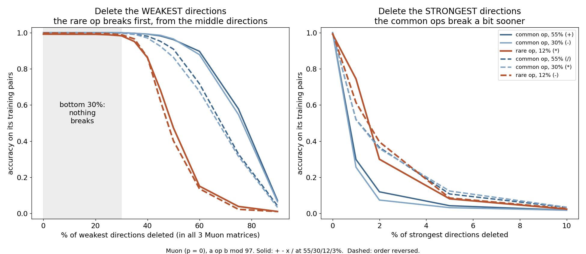
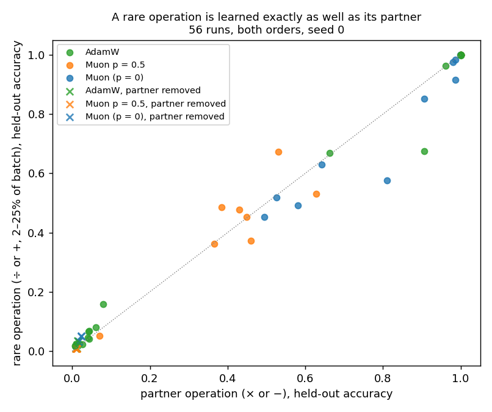
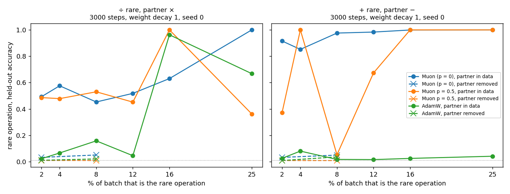
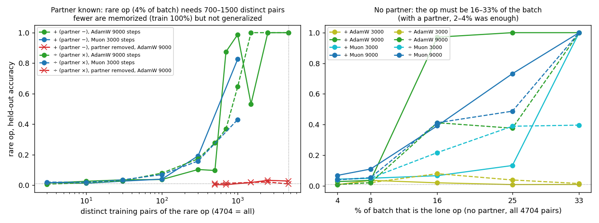
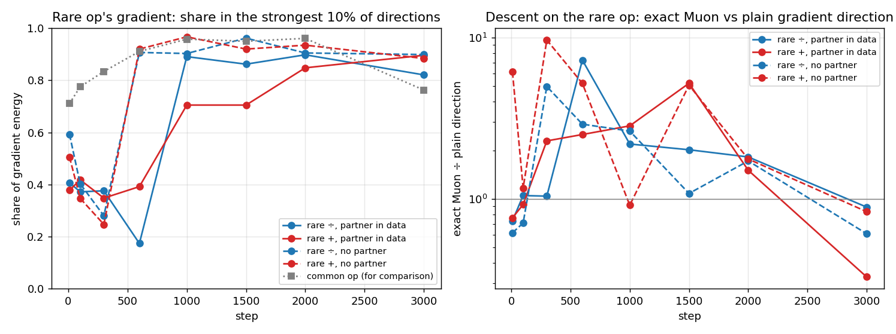
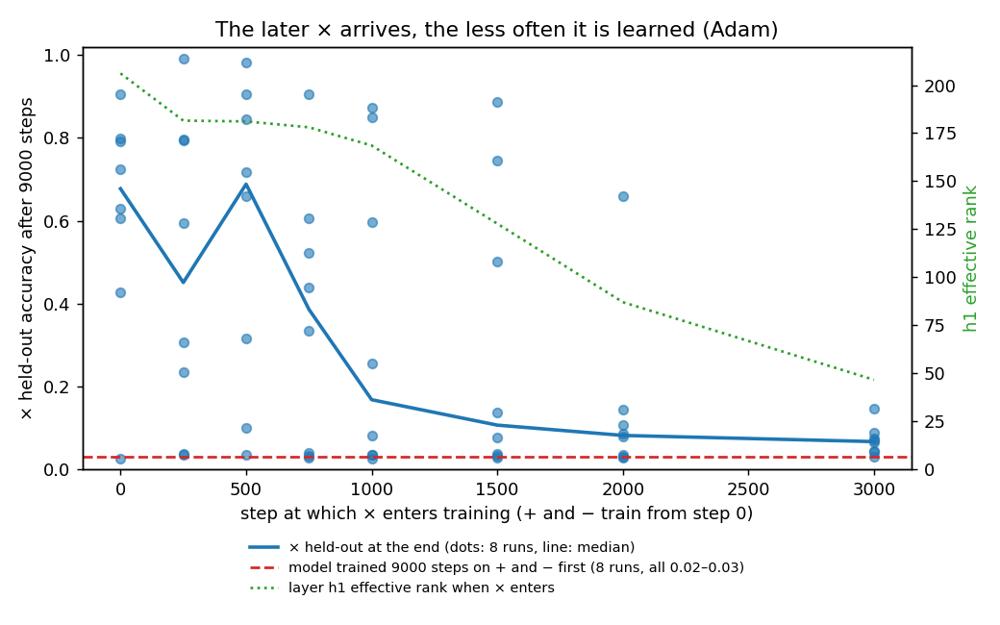
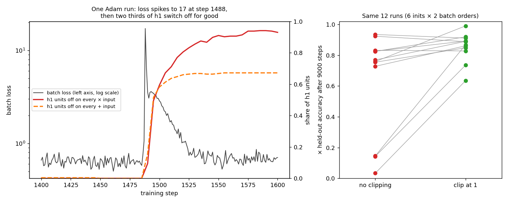

# Rare operations: what does Muon learn about them?

**Question.** Muon pushes every direction of the update equally, including weak directions that only a few examples in the batch ask for. The [speedrun test](../speedrun/README.md#does-muon-push-weak-directions-too-hard) found that pushing weak directions less (p = 0.25, 0.5) gives lower average loss. Average loss is dominated by common data. Does the model then know less about rare things?

**Task** ([arith.py](arith.py)). `a op b = ?` modulo 97, with 4 operations + − × ÷. Every operation has 4,704 training pairs and 4,705 held-out pairs. Batches draw the operations at different rates: 55%, 30%, 12%, 3%. Two orders, so rarity is not mixed up with difficulty:

- order A: + 55%, − 30%, × 12%, ÷ 3%
- order B: ÷ 55%, × 30%, − 12%, + 3%

Model: embeddings of the 3 tokens → three Muon matrices (192×256, 256×256, 256×256) → answer. 3000 steps × batch 512, Muon lr 0.02, momentum 0.95, weight decay 0.05, AdamW lr 0.01 on embeddings and output.

Muon matrices get U S^p V^T from an exact SVD, scaled to the total size of exact Muon. p = 0 is exact Muon (every direction pushed equally). p = 0.5 pushes weak directions less. p = 1 pushes them as the gradient says. Only the shape of the update changes, not its size.


## Results (seeds 0 and 1)

Accuracy at step 3000. "train" = its own training pairs, "test" = held-out pairs.

| p | order | seed | 55% op test | 30% op test | 12% op train | 3% op train |
|---|---|---|---|---|---|---|
| 0 | A | 0 | 0.92 | 0.92 | **1.00** | 0.02 |
| 0 | B | 0 | 0.70 | 0.72 | **1.00** | 0.02 |
| 0 | A | 1 | 0.30 | 0.31 | **0.99** | 0.02 |
| 0 | B | 1 | 0.80 | 0.81 | **0.98** | 0.02 |
| 0.5 | A | 0 | 0.50 | 0.59 | 0.03 | 0.02 |
| 0.5 | B | 0 | 0.99 | 0.99 | 0.01 | 0.01 |
| 0.5 | A | 1 | 0.38 | 0.42 | 0.03 | 0.02 |
| 0.5 | B | 1 | 0.74 | 0.78 | 0.01 | 0.01 |
| 1 | A | 0 | 0.83 | 0.88 | 0.03 | 0.02 |
| 1 | B | 0 | 0.04 | 0.06 | 0.01 | 0.01 |

Guessing gives 0.01.

**What it means.**

- **Only Muon learns the 12% operation.** With equal pushes it answers 98–100% of that operation's training pairs, in all 4 runs. With p = 0.5 or 1 it stays at 1–3%, in all 6 runs. So pushing weak directions less does make the model know less about the rarer operation.
- **Rarity decides, not difficulty.** In order A, × and ÷ are the rare ones and are not learned. In order B, ÷ and × are common and learn the rule (70–99% on unseen pairs), while − and + are rare and are not learned.
- **Nobody learns the 3% operation** in 3000 steps.
- **Nobody learns a rule for the 12% operation**, only its training pairs: held-out accuracy stays at 0.01–0.03.
- **Common operations:** no clear winner. Held-out accuracy swings from 0.30 to 0.99 between seeds and orders for the same p.
- **Muon memorizes the 12% operation late,** after step 1700. The learning rate starts falling at step 1500.

**Limits.** 2 seeds, one learning rate for every p, one tiny model, one task. 3000 steps is too short for the 3% operation.

**How this fits the speedrun result.** On text, p = 0.25–0.5 gave about 0.01 lower average loss. Here, at 12% frequency, the same change loses an operation completely. Lower average loss and knowing less about rare data can both be true.

## Run it

```bash
WD=0.05 python3 arith.py 0 "+-*/" 0     # p, order (most common first), seed -> one line in arith.jsonl
python3 plot_arith.py
```

arith.jsonl also has 3 exploratory p = 0 runs at weight decay 1 and 3; the chart and table use weight decay 0.05.

## Where does Muon store the rare operation?

**Question.** If we delete the weakest directions of the trained weights, does only the rare operation break?

**Setup** ([cut.py](cut.py)). Two models trained with Muon (p = 0, seed 0), one per rarity order. In all 3 Muon matrices, each weight matrix is split into its singular directions, and a share of the weakest (or the strongest) is set to zero. Then each operation's accuracy on its training pairs is measured again. Results in [cut.jsonl](cut.jsonl).



| weakest directions deleted | 0% | 30% | 40% | 50% | 60% | 75% |
|---|---|---|---|---|---|---|
| 55% op (order A / B) | 1.00 / 1.00 | 1.00 / 1.00 | 0.99 / 0.98 | 0.96 / 0.91 | 0.90 / 0.72 | 0.58 / 0.33 |
| 12% op (order A / B) | 0.99 / 1.00 | 0.98 / 0.99 | 0.86 / 0.86 | **0.47 / 0.40** | 0.15 / 0.14 | 0.04 / 0.02 |

| strongest directions deleted | 0% | 1% | 2% | 5% |
|---|---|---|---|---|
| 55% op (order A / B) | 1.00 / 1.00 | 0.30 / 0.52 | 0.12 / 0.37 | 0.04 / 0.11 |
| 12% op (order A / B) | 0.99 / 1.00 | 0.74 / 0.61 | 0.30 / 0.40 | 0.08 / 0.09 |

**What it means.**

- **The weakest 30% of directions hold nothing.** Deleting them leaves every operation at 98–100%.
- **The rare operation lives in the middle directions.** Deleting the weakest 50% drops it to 0.47 and 0.40, while the 55% operation keeps 0.96 and 0.91.
- **The common operations lean on the strongest directions a bit more.** Deleting the top 1% leaves the common op at 0.30 / 0.52 and the rare op at 0.74 / 0.61. With order B the gap is small.
- **Everything shares the top directions.** Deleting the strongest 5% breaks every operation.

**Limits.** One seed per order. The rare operation is only memorized, not learned as a rule, so this shows where memorized facts sit, not where rules sit.

## A rare operation rides on its partner

**Question.** At what frequency does a rare operation stop being memorized and start being learned as a rule?

**Setup.** 3 common operations share the batch equally, 1 rare operation gets 2, 4, 8, 12, 16 or 25%. Order A: ÷ rare. Order B: + rare. Weight decay 1 for every optimizer (at 0.05 Adam memorizes everything and generalizes nothing, see [adam_lr.jsonl](adam_lr.jsonl)). Muon p = 0, Muon p = 0.5, AdamW (lr 0.003 on the hidden matrices, best of 4). 3000 steps, seed 0. Results in [freq.jsonl](freq.jsonl), [partner.jsonl](partner.jsonl), [adam_long.jsonl](adam_long.jsonl).




**What it means.**

- **Frequency barely matters. The partner decides.** ÷ is × by an inverse, + is − with a sign flip. Across 56 runs the rare operation's held-out accuracy equals its partner's (correlation 0.991, mean gap 0.03), from 2% to 25% of the batch.
- **Remove the partner and the rare operation is never learned.** With × (or −) taken out of the data, ÷ (or +) at 2% or 8% stays at 1–5% held-out for all 3 optimizers. With the partner in, Muon p = 0 reaches 49% (÷) and 92% (+) at 2%.
- **So the rare operation is not learned on its own.** The model learns the partner, then the rare operation's few examples only need to say "this is the partner, with a twist".
- **Muon is faster, not different.** In 3000 steps Muon p = 0 learns the partner in all 12 runs, Adam in 4. With 9000 steps Adam learns partner and rare operation too (6 of 8 settings reach 0.68–1.00). With exact SVD, 3000 Muon steps take as long as 9000 Adam steps (84 s vs 90 s).
- **Earlier result explained.** In the first table, ÷ (3%) and × (12%) were both rare, so neither had a learned partner, and neither was ever learned as a rule.

**Seeds 1 and 2** ([seeds.jsonl](seeds.jsonl), 32 runs: both orders, rare op at 2, 4, 8%, Muon 3000 steps and Adam 9000 steps, plus partner removed at 4%):

- **The partner rule holds.** With seed 0 added, 38 runs: correlation 0.976 between rare op and partner held-out, mean gap 0.03.
- **Partner removed: never learned, on every seed.** 1–5% held-out in all 8 new runs.
- **Adam with 9000 steps learns the rare op on both new seeds** (0.91–1.00 held-out), even ÷ at 2%. Muon at 3000 steps learns + at 2% (0.95–1.00) but ÷ only as far as × goes (0.45–0.64).

**Limits.** One task. Single points on the frequency chart are noisy (one seed-0 Adam run failed entirely, common ops 0.18).

## How much rare data does the partner save?

**Question 1.** With the partner fully learned, how few distinct rare examples are enough? The rare op stays at 4% of the batch, but keeps only K of its 4704 training pairs ([few.jsonl](few.jsonl)).

**Question 2.** Without a partner, how common must an operation be to be learned? ([lone.jsonl](lone.jsonl))



| distinct rare pairs (partner known, 4% of batch) | 3–100 | 300 | 500–700 | 1000 | 1500+ |
|---|---|---|---|---|---|
| rare op held-out (4 runs: 2 orders × Adam 9000 / Muon 3000) | 0.01–0.08 | 0.10–0.19 | 0.10–0.87 | 0.43–0.99 | 0.53–1.00 |

**What it means.**

- **The partner does not make the rare op few-shot.** 3 to 300 pairs are memorized perfectly (train 1.00) and stay at 1–19% held-out. The rule appears between 700 and 1500 distinct pairs, about 15–30% of all possible pairs.
- **It is all at once, not per number.** With 300 pairs, held-out pairs whose b never appeared in training score 0.23, the same as pairs whose b appeared 3–5 times (0.21) ([per_b.py](per_b.py)). The model does not learn "the negative of 7" one number at a time.
- **Without the partner, 4% is never enough.** All 4704 pairs, 9000 steps: 1–3% held-out, and not even memorized (train 0.01–0.04). The same op with only 500 pairs is memorized (train 1.00). Many different rare examples are harder to memorize than few.
- **A lone op needs 16–33% of the batch.** + : 16% (Adam 9000 steps, 0.97). ÷ : 33% (1.00). With a partner, 2–4% was enough: the partner cuts the needed frequency 4–8×.
- **Muon memorizes rare data more, Adam generalizes it more.** At 4–8%, Muon reaches 0.19–0.89 train accuracy on the lone op, Adam 0.01–0.12. At 16–25% with 9000 steps, Adam learns + (0.97–1.00 held-out), Muon reaches 0.39–0.73.

**Limits.** Seed 0, one task, one Adam learning rate.

## How the model does it

**Question.** Does the network really compute ÷ as "× by the inverse", or does it just reuse some parts?

**Setup** ([mech.py](mech.py), results in [mech.jsonl](mech.jsonl)). Four trained models: orders A and B, each with all four ops equally common (Muon) and with the op rare at 4% (Adam, 9000 steps). For every held-out pair, three inputs that all have the same correct answer:

- **rare:** a ÷ b
- **translated:** a × b⁻¹ (the partner op, with b already inverted)
- **control:** a different pair a′ × c′ with the same answer

At each layer, the cosine between the hidden state of "rare" and "translated", and between "rare" and "control" (centered: the mean hidden state is subtracted first). Same for + against − with −b.

| model | op | first layer | second layer (h1) | third layer (h2) |
|---|---|---|---|---|
| A, all equal, Muon | ÷ | +0.31 / −0.14 | **+0.76 / +0.11** | +0.96 / +0.66 |
| A, all equal, Muon | + | +0.48 / −0.10 | **+0.75 / +0.18** | +0.94 / +0.67 |
| A, ÷ rare, Adam | ÷ | +0.11 / −0.21 | **+0.64 / +0.06** | +0.90 / +0.86 |
| B, all equal, Muon | ÷ | +0.44 / −0.09 | **+0.95 / +0.20** | +0.98 / +0.64 |
| B, all equal, Muon | + | +0.44 / −0.12 | **+0.88 / +0.22** | +0.97 / +0.70 |
| B, + rare, Adam | + | +0.24 / −0.14 | **+0.93 / +0.27** | +0.96 / +0.95 |

(each cell: rare vs translated / rare vs control)

**What it means.**

- **By the second layer, a ÷ b looks like a × b⁻¹.** Cosine 0.64–0.95 with the translated input, 0.06–0.27 with another pair that has the same answer. So the match is not just "same answer": the network has rewritten the question into the partner's question.
- **It happens in every model, even when all four ops are equally common.** The network finds the shortcut on its own; rarity only makes it necessary.
- **By the last layer everything converges** (control also reaches 0.64–0.97), because all three inputs must give the same answer.

**Why ÷ is harder than +** ([linmap.py](linmap.py)). Fit a linear map from each number's embedding to the embedding of its negative (b → −b) on half the numbers, test on the other half (ridge, λ = 0.1):

| model | b → −b | b → b⁻¹ | b → random number |
|---|---|---|---|
| A, all equal, Muon | **+0.78** | +0.00 | −0.80 |
| A, ÷ rare, Adam | **+0.43** | −0.24 | −0.82 |
| B, all equal, Muon | **+0.79** | +0.00 | −0.75 |
| B, + rare, Adam | **+0.56** | −0.03 | −0.64 |

(held-out R²; 1 is perfect, 0 is no better than guessing the average)

- **Negation is (roughly) one linear map on the embeddings. Inversion is not.** Known result (Nanda et al. 2023): these networks store a number as waves cos(2πkb/97). Negation just flips the sign of the sine part, the same linear step for every number. Inversion has no such step, so the first layer must learn it as a lookup, number by number.
- This fits every earlier table: + needs less data and fewer steps than ÷, as rare op and as lone op.

**When does the rare op click?** Over 34 runs where both partner and rare op pass 50% held-out ([freq.jsonl](freq.jsonl), [adam_long.jsonl](adam_long.jsonl), [few.jsonl](few.jsonl)):

- **It clicks right after its partner.** Median lag 150 steps; 0–100 steps at high frequency, up to 4650 steps (Adam, ÷ at 4%) at low frequency or with few pairs.
- **It skips most of the memorizing.** At the moment held-out accuracy first passes 50%, how much higher is train accuracy?

| op | runs | train − held-out at that moment (median) |
|---|---|---|
| lone op (no partner) | 10 | 0.43 |
| partner op | 27 | 0.33 |
| common op | 77 | 0.26 |
| **rare op with partner** | 27 | **0.11** |

Ops learned from scratch first memorize their training pairs, then generalize (grokking). The rare op with a partner generalizes almost as soon as it fits: it reuses a rule instead of building one.

**Limits.** Four models, seed 0. Cosines are an average over held-out pairs; they show the rewrite, not the circuit that does it.

## Is the rare op stuck in Muon's weak directions?

**Question.** The usual story: rare data gives weak gradient directions, and Muon helps rare data by pushing weak directions as hard as strong ones. Is that what happens here?

**Setup** ([spectrum.py](spectrum.py), [spectrum.jsonl](spectrum.jsonl), chart from [plot_spectrum.py](plot_spectrum.py)). Muon p = 0, rare op at 4%, with and without its partner, both orders, seed 0. At 8 moments in training, each op's gradient on 1024 of its training pairs, weighted by its batch share; together they add to the expected batch gradient G. Measured against G's singular directions:

- how much of the rare op's gradient lies in G's strongest 10% of directions;
- how much one step lowers the rare op's loss, for exact Muon (all directions pushed equally) vs the plain gradient direction (G scaled to the same size).



(layer h1; the other two layers look the same, see spectrum.jsonl)

**What it means.**

- **At the start, yes: the rare op lives in weak directions.** Steps 10–300: 25–60% of its gradient is in the strongest 10% of directions, against 71–84% for a common op. 12–20% is in the weakest half (common ops: 4–8%).
- **But Muon gives it no extra push then.** Exact Muon vs plain direction: 0.6–1.2× on the rare op in 6 of 8 early points.
- **Once the common ops are learned, the rare op takes over the strong directions.** The common ops' gradients shrink, so by step 600–1000 the rare op holds 70–96% of its gradient in the top 10%. It is no longer a weak-direction problem.
- **That is where Muon helps: 1.5–7× more descent on the rare op** than the plain direction, from step 600 to 2000. Plain gradient direction piles the step onto the one or two strongest directions; Muon spreads it over all of them, and the rare op's gradient is spread over many.
- **Without the partner, the rare op gets the same push and wastes it.** Same top-10% share, same 1–5× ratio, yet held-out stays at 2–4% and train reaches only 17–25%. The optimizer delivers the step; only the partner turns it into a rule.

**Limits.** One seed, one rare frequency. "Descent" is the first-order loss drop for one step, not what momentum and later steps make of it.

## Does knowing the inverse make ÷ few-shot?

**Question.** The model turns a ÷ b into a × b⁻¹, and negation is easy for it while inversion is not (see "How the model does it"). So the hard part of ÷ should be the inverse. If the model is also taught the inverse as its own fact, does ÷ become learnable from a few examples?

**Setup** ([teach.jsonl](teach.jsonl)). Five ops, the first four at 24% of the batch each, the rare op at 4% with only K distinct training pairs. Two new ops, which ignore a:

- **i:** "a i b = b⁻¹" (the inverse of b)
- **n:** "a n b = −b" (the negative of b)

For rare ÷: helper i (the right one) or helper n (a control). For rare +: helper n (right) or i (control). Muon 3000 steps, Adam 9000 steps, seed 0. [few.jsonl](few.jsonl) gives the same runs without any helper.

| rare ÷, held-out | K = 30 | 100 | 300 | 1000 |
|---|---|---|---|---|
| Adam, helper i (inverse) | 0.03 | 0.06 | 0.09 | **0.96** |
| Adam, helper n (control) | 0.04 | 0.05 | 0.32 | 0.94 |
| Adam, no helper | 0.03 | 0.08 | 0.17 | 0.65 |
| Muon, helper i (inverse) | 0.02 | 0.04 | 0.15 | **0.91** |
| Muon, helper n (control) | 0.03 | 0.07 | 0.15 | 0.45 |
| Muon, no helper | 0.04 | 0.07 | 0.16 | 0.43 |

| rare +, held-out | K = 30 | 100 | 300 | 1000 |
|---|---|---|---|---|
| Adam, helper n (negative) | 0.02 | 0.07 | 0.17 | 0.99 |
| Adam, helper i (control) | 0.03 | 0.04 | 0.17 | 1.00 |
| Adam, no helper | 0.04 | 0.04 | 0.10 | 0.99 |

**What it means.**

- **No. Knowing the inverse does not make ÷ few-shot.** With 30–300 pairs, ÷ stays at 2–15% held-out with the inverse taught, the same as with the wrong helper or none. The model knows × (100%) and knows every b⁻¹ (100%), and still cannot put them together from 300 examples.
- **The knowledge is in the wrong place.** Op i produces b⁻¹ as an *answer*, at the output. ÷ needs b⁻¹ *inside*, in the second layer, where it is multiplied by a (see the cosine table above). Nothing moves a fact from the output to the middle of the network.
- **At 1000 pairs the inverse helps Muon** (0.91 vs 0.43–0.45), but × itself was also learned better in that run (1.00 vs 0.64), so this one point does not separate the two.
- Known in a related form: transformers that know two facts often fail to chain them without many chained examples ("two-hop" reasoning, Wang et al. 2024, *Grokked transformers are implicit reasoners*). Here the same happens for a three-layer network and arithmetic.

**Limits.** Seed 0. With five ops, Muon at 3000 steps does not always learn the partner, which adds noise to the Muon rows.

## Does the partner protect an op from being forgotten?

**Question.** A rare op rides on its partner. If the rare op stops appearing in training but the partner keeps training, does the rare op survive?

**Setup** ([forget.py](forget.py)). Start from fully trained models (all four ops 100% held-out; 3 common ops at 32%, rare op at 4%). Keep training 3000 more steps at a constant learning rate (half the peak), with some ops removed from the batch. 6 models: Adam (9000-step start, seeds 1 and 2, orders A and B) and Muon (3000-step start, seed 1, both orders). Results in [forget.jsonl](forget.jsonl).

| removed from training | removed op, held-out at the end | steps until below 50% (Adam / Muon) |
|---|---|---|
| a common op and its partner | 0.01 (12 of 12 ops) | 10 / 20–30 |
| rare op and its partner | 0.01 (12 of 12) | 10–20 / 20 |
| rare op only (partner keeps training) | 0.01–0.03 (6 of 6) | 20–150 / 20–30 |
| a common op only (partner keeps training) | 0.01–0.02 (6 of 6) | 350–400 / 50 |
| partner only (rare op keeps training at 4%) | 0.01–0.03 (6 of 6) | 10–50 / 20–50 |

**What it means.**

- **The partner does not protect it. Every removed op is forgotten completely**, down to 1–3% held-out, in all 36 runs. Training accuracy on the removed op also falls to 1–3%: the memorized pairs go too.
- **The partner only slows it down**, about 20–40× for a common op with Adam (350–400 steps instead of 10).
- **Muon forgets 2–10× faster than Adam.** Weight decay is scaled by the learning rate, and Muon's update has full size every step.
- **The strange case: × is forgotten while ÷ survives.** Remove × and keep ÷ at 4%: × drops to 0.02–0.03, ÷ stays at 0.46–1.00. ÷ is computed as "× by the inverse" in the middle layers, so the multiplying part must still be there. What is lost is × 's own way in to it.

**Is it really gone? Relearning** ([relearn.jsonl](relearn.jsonl), [relearn_full.jsonl](relearn_full.jsonl); Adam models only). After forgetting, train with the removed op back in the batch:

| forgotten | relearn with all its pairs: steps to 90% held-out | relearn with 300 pairs: held-out | learning it the first time with 300 pairs |
|---|---|---|---|
| partner only (× or −) | **100–150** | 0.08–0.47 | 0.10–0.19 |
| rare op only (÷ or +) | **400–800** | 0.16–0.65 | 0.10–0.19 |
| both | 950–1750 | 0.06–0.29 | 0.10–0.19 |
| (fresh model, never trained) | not reached in 3000 | | |

- **With all its pairs, a forgotten op comes back fast.** 100–150 steps for a forgotten partner, 400–800 for a forgotten rare op. A fresh model at the same learning rate learns nothing in 3000 steps. Most of the knowledge is still in the weights. ("Savings": known in general, Ebbinghaus 1885 for people, and for networks after unlearning.)
- **With 300 pairs it does not come back.** 0.06–0.65, barely above learning it the first time (0.10–0.19). As before, the op's own part (the way in) needs many different examples. Seeing a few examples again does not unlock it.
- **The order fits the mechanism.** The partner has only a way in to relearn (fastest). The rare op also has its translation, the inverse or negative of b (slower). With both gone, the shared part was damaged too (slowest).

**Limits.** 2 seeds. A constant learning rate made 2 of 16 relearn runs unstable late (a kept op dropped to 0.09–0.13 at the end), see relearn_full.jsonl.

## Can a trained model learn a new op? Adam: no. Muon: yes

**Question.** Train a model on + and − only. Then add × (12% of each batch) and train again with a full schedule. Does it learn ×?

**Setup** ([forget.py](forget.py) with `SCHED=decay`, results in [late_partner.jsonl](late_partner.jsonl), [critical.jsonl](critical.jsonl), [late_act.jsonl](late_act.jsonl), [late_muon.jsonl](late_muon.jsonl)). Order A: + 55%, − 30%, × 12%, ÷ 3%. Phase 1: 9000 Adam steps with × left out. Phase 2: 9000 more steps with × added, learning rate warm again and decaying as in a fresh run. Control: the same phase 2 from a fresh, untrained model with the same data split. 2 starting seeds × 4 batch orders.

| phase 2 starts from | × held-out at the end | × train at the end |
|---|---|---|
| fresh model | **0.43–0.91** in 7 of 8 runs (one 0.03) | 0.92–1.00 in 7 of 8 |
| model trained on + and − | **0.02–0.03** in 8 of 8 | 0.02–0.04 |

The trained model does not even memorize ×: training accuracy stays at chance. (Order B, where − is the 12% op, does not learn − even from fresh, 0.03–0.21, so it shows nothing.)

**When does the door close?** A fresh model where + and − train from step 0 and × enters at step d:



| × enters at step | 0 | 250 | 500 | 750 | 1000 | 1500 | 2000 | 3000 |
|---|---|---|---|---|---|---|---|---|
| runs that learn × (held-out > 0.4) | 7/8 | 4/8 | 5/8 | 4/8 | 3/8 | 3/8 | 1/8 | 0/8 |

- **What decides it is whether + and − are already solved.** × entering before + and − reach 99% held-out is learned in 18 of 31 runs; entering after, in 2 of 25. + and − are solved between steps 700 and 3200, depending on the run.
- ×, when learned, generalizes late (steps 4600–6650). It does not have to finish while + and − are learning, only start.

**Why: the units × would need are switched off.** After + and − are learned with Adam, the middle layer (h1) uses a few units: on × inputs, 89–91% of its 256 ReLU units output 0 for every pair, and its effective rank is 15–17 (fresh: 0% and 206). A unit that outputs 0 passes back no gradient, so the × loss cannot switch it on. After phase 2, 96–100% are off on × inputs and the model gives up on × (loss ≈ ln 97, a uniform guess).

**What does not fix it** (all on the trained Adam model, × held-out at the end):

| change before phase 2 | runs | × held-out |
|---|---|---|
| shrink and perturb, W = λW + σ·W_fresh (λ, σ = 0.5,0.5 / 1,0.5 / 0.8,0.2) | 12 | 0.02–0.06 |
| reset the embedding, or the output layer, or the 3 hidden layers, or embedding + output | 16 | 0.02–0.04 |
| weight decay 0.1 or 0.3 instead of 1 | 8 | 0.01–0.03 (train 0.02–0.04) |
| × at 30% of the batch | 2 | 0.27, 0.44 (train 1.00) |
| × at 55% of the batch | 2 | 0.07, 0.11 (train 1.00) |

Resetting the hidden layers fails too: + and − come back within a few hundred steps from the embedding and output layer, and the door closes again before × starts.

**What changes it: the activation and the optimizer.** Phase 1 and phase 2 redone with each (2 seeds × 2 batch orders):

| | trained on + and − first: × held-out (train) | fresh: × held-out |
|---|---|---|
| Adam, ReLU | 0.02–0.03 (0.02–0.04) | 0.43–0.91 |
| Adam, GELU | 0.03–0.05 (0.04–0.07) | 0.46–0.99 |
| Adam, leaky ReLU (slope 0.1) | 0.13–0.29 (0.83–1.00) | 0.42–0.64 |
| **Muon**, ReLU, 3000 steps | 0.06–0.24 (0.68–0.91) | 0.07–0.27 |
| **Muon**, ReLU, 6000 steps | **0.11–0.41** | **0.09–0.46** |

- **Leaky ReLU** keeps a gradient through off units: the trained model memorizes × but still generalizes less than fresh.
- **Muon has no gap.** After + and − with Muon, h1 has 0% units off on × inputs and effective rank 190–193 (Adam: 89–91% off, rank 15–17). Learning × afterwards goes like learning it on a fresh model. Muon's update has equal size in every direction, so directions the + and − loss does not need are still moved every step, and units do not go silent. (In this setup Muon does not fully learn a 12% op in 6000 steps even from fresh; the point is that the trained and fresh models match.)

**What is known.** "Loss of plasticity" (Dohare et al., Nature 2024) and "critical learning periods" (Achille et al., 2019) describe networks that lose the ability to learn new things, with dead units and falling rank. New here: in this tiny model it happens after one round of training, it closes exactly when the old ops are solved, shrink-and-perturb does not fix it, and Muon avoids it while Adam does not.

**Limits.** One tiny model, one op order, 2 starting seeds. Muon runs used 3000-step phase 1 and its own learning rates, so Muon vs Adam differs in more than the optimizer.

### Is it the trained network or the optimizer that follows? Swap them

Same task (add × at 12% to a model trained on + and −), 2 seeds × 2 batch orders, [swap.jsonl](swap.jsonl). "Off" = share of h1 units that output 0 on every × input.

| phase 1 → phase 2 | units off: start → step 100 → step 1000 | × held-out (train) |
|---|---|---|
| Adam → Adam | 0.89–0.91 → stays → 0.96–1.00 | 0.02–0.03 (0.02–0.04) |
| Adam → **Muon** (6000 steps) | 0.89–0.91 → **0.00** → 0.00 | 0.09–0.14 (0.89–0.92) |
| Muon → **Adam** | 0.00 → **0.61–0.77** → 0.58–0.91 | 0.02, 0.03, 0.54, 0.59 |
| Muon → Adam, lr warmup over 500 steps | 0.00 → 0.00 → 0.14–0.95 | 0.03, 0.58, 0.79, 0.91 |
| Muon → Adam, output layer reset | 0.00 → 0.40–0.68 → 0.54–0.75 | 0.03, 0.03, 0.90, 0.91 |
| Adam → 500 Muon steps → Adam | 0.89–0.91 → 0 → 0.69–0.81 at step 100 of Adam | 0.03, 0.03, 0.04, 0.26 |
| Adam → 500 Muon steps → Adam with warmup | 0.89–0.91 → 0 → 0.02–0.08 | **0.24–0.38 (1.00)** in 4 of 4 |
| Adam → Adam with warmup | 0.89–0.91, stays | 0.02–0.03 |

- **Muon switches dead units back on in under 100 steps.** Adam cannot: an off unit gets zero gradient, Adam divides zero by a tiny number and still moves nothing. Muon's update is a full-rank matrix with every direction at the same size, so every unit's incoming weights move each step whatever their gradient.
- **Adam switches healthy units off in under 100 steps** when it restarts at full learning rate with empty moment estimates. The × loss starts high (7.9–8.4: confident wrong answers) and the quickest way down is to silence × inputs (loss ≈ ln 97 = 4.57). With warmup the first 100 steps keep every unit on.
- **The share of units off at step 1000 predicts the result:** runs with 70–95% off end at 0.02–0.03; runs with 14–60% off learn × (0.54–0.91).
- **A practical recipe from this:** before adding new data to an Adam-trained model, run a few hundred Muon steps, then continue with Adam using a warmup. Here it lifts × from 0.02–0.03 to 0.24–0.38, still below a fresh model (0.43–0.91). Untested beyond this toy.

**How long must the Muon burst be?** ([swap.jsonl](swap.jsonl), Adam-trained model → N Muon steps → Adam 9000 steps with 500-step warmup, 4 runs each)

| Muon steps | 10 | 100 | 500 | 2000 |
|---|---|---|---|---|
| × held-out | 0.06–0.17 | 0.29–0.32 | 0.24–0.38 | 0.29–0.40 |

10 Muon steps already switch 99% of the dead units back on, but × needs about 100. After 100 steps, a longer burst adds nothing. With 18,000 Adam steps instead of 9000, the 100-step rescue reaches 0.52–0.53 in 4 of 4 runs, and × train is 1.00. The same model with no burst stays at 0.02–0.03. A fresh model at 18,000 steps gets 0.03, 0.61, 0.86, 0.96.

**One Muon step every N Adam steps** ([kick.jsonl](kick.jsonl), `KICK=N`): on the Adam-trained model, × reaches 0.04–0.32, which is worse than a single 100-step burst. On a fresh model it is not clearly better than plain Adam (12 runs each, mean × 0.72 vs 0.64, within seed spread).

## Why a fresh Adam run sometimes never learns ×: a loss spike switches off two thirds of the units

Fresh Adam runs (all four ops from step 0) fail on × about 1 time in 4. [kick.jsonl](kick.jsonl) and [spike.jsonl](spike.jsonl) have 12 runs per setting: 6 starting weights × 2 batch orders. [collapse_probe.py](collapse_probe.py) replays a run exactly and logs every step ([spike_probe.json](spike_probe.json)).



**What happens in a failing run** (init s1, batch order 1):
- By step 1480, + and − are solved (loss 0.01–0.02) and × is still at chance.
- The gradient on h1 slowly grows from 0.2 to 0.5. At step 1487 it jumps to 9.4, then to 40.6 at step 1488, and the batch loss goes from 0.6 to 17.
- Within 20 steps, 71% of h1's units are off on every × input and 64% on every + input. + and − recover in about 60 steps using the remaining units. × never does: its train accuracy stays at 0.03 for the rest of the run.

**Every failure has a spike, and no success does:**

| run | loss spike above 3 after step 600 | step of the spike | h1 units off on × afterwards | × at the end |
|---|---|---|---|---|
| s1, order 1 | yes, 17.2 | 1488 | 0.93 | 0.03 |
| init 5, order 0 | yes, 21.9 | 1305 | 0.78 | 0.14 |
| init 3, order 0 | yes, 13.6 | 1363 | 0.77 | 0.15 |
| 4 successful runs (s1, s2, init 4, init 6) | none | — | 0.00–0.01 | 0.73–0.92 |

**Clip the gradient norm at 1 (`CLIP=1`) and the failures disappear.** Without clipping, the total gradient norm has a median of 0.21, a 99th percentile of 2.4 and a maximum of 65 (s1, order 1). With clipping it is cut on 13–15% of steps (1161 and 1392 of 9000 in two runs), so clipping also shapes ordinary late-training steps, not only spikes. Clipping at 3 touches only 0–75 steps per run (under 1%) and works almost as well (table below), so capping the rare spike steps is what matters. The spikes still happen (largest norms 3–58), but they are capped before Adam's step.

| 12 fresh runs | runs with × below 0.3 | mean × held-out | mean ÷ held-out | runs where over 30% of h1 switches off |
|---|---|---|---|---|
| Adam | 3 | 0.64 | 0.46 | 3 |
| Adam, beta2 0.95 | 1 | 0.72 | 0.39 | 3 |
| **Adam, clip at 1** | **0** | **0.86** | **0.64** | **0** |
| **Adam, clip at 3** (cuts 0–75 of 9000 steps) | **0** | **0.83** | **0.59** | **0** |

All three failing runs are rescued (0.15 → 0.87, 0.14 → 0.74, 0.03 → 0.63), and the rarest op ÷ (3% of batches) improves too. Lowering beta2 to 0.95 rescues them only partly and makes ÷ worse.

**The late-op critical period is also mostly spikes.** In the earlier critical-period runs, the h1 units off on × went from about 0.1 at step 2500 to 0.82–0.95 by step 3000 in 6 of 8 runs. With clipping, 0.06–0.32 are off at step 3000 ([critical_clip.jsonl](critical_clip.jsonl), 8 runs per row):

| × enters at step | runs that learn ×, no clipping | with clip at 1 |
|---|---|---|
| 1000 | 3/8 | 6/8 |
| 3000 | 0/8 | 2/8 (0.42, 0.58) |

Clipping does not remove the whole effect. At step 3000, h1's effective rank has still fallen to 62–105 (about 170 at step 1000). Weight decay 0.1 instead of 1 keeps the rank at 185–192, but then the model memorizes × (train 1.00) and never generalizes it (held-out 0.02, 16 runs).

**Why it fits the Muon results:**
- Muon's update has a fixed size whatever the gradient, so a gradient jump of 80× cannot turn into an 8× larger step. Muon-trained models had 0% of h1 off.
- Adam's step is the gradient divided by its recent average size. Here the gradient had been small for hundreds of steps, so when it suddenly grows, Adam's step grows with it. In this run, the update on h1 went from 0.13 to 1.31 in 3 steps.
- Gradient clipping caps that step.

**What this suggests beyond this toy (untested):** a single loss spike can permanently remove capacity that only rare or later data would have used. The final loss on the common data recovers within about 60 steps, so the damage does not show up there.

**In the character model** the same Adam unit death happens, but in the first 50 steps instead of at a mid-training spike, and Muon cannot revive those units. Details: [lmspike](../lmspike/README.md).

## Continual learning: one op at a time, then all again

**Question.** Train one task at a time. Does Muon or Adam (a) keep learning new tasks, (b) forget old ones less, (c) relearn faster on a second visit? And what changes when the "new task" is an adversarial change?

**Setup** ([cl.py](cl.py)). Same model and data split as above (mod 97, half of each op's pairs held out). Each phase trains only one task for 2000 steps, at a constant learning rate with optimizer state kept. Accuracy is logged on every task every 100 steps. Muon here uses 5 Newton–Schulz rounds instead of the exact SVD. Each optimizer gets the setting that learns + alone fastest ([cl_cal.jsonl](cl_cal.jsonl), steps to 90% held-out):

- Adam: hidden lr 0.001, weight decay 3, 1000 steps. With weight decay 0.05 or 0.3 it memorizes in 500 steps and never generalizes in 8000.
- Muon: lr 0.02, weight decay 0.5, 750 steps.

Two sequences:

- **ops:** + − × ÷ + − × ÷ (each op once, then all again);
- **relabel (adversarial):** +, then + with every answer renamed by a random permutation, three different renamings, then the original and the first renaming again. Same inputs, new answers.

Results in [cl.jsonl](cl.jsonl) (4 seeds for ops, 2 for relabel), [cl_fix.jsonl](cl_fix.jsonl), [cl_fine.jsonl](cl_fine.jsonl).

### Ops sequence (seeds 0–3)

Held-out accuracy at the end of each phase on the op being trained ("—": below 0.9 at the end):

| | phases learned (≥ 0.9) | × first visit | × second visit | h1 units dead at the end |
|---|---|---|---|---|
| Adam s0 | 7/8 | 0.22 | 0.99 | 0.98 |
| Adam s1 | **4/8** | 0.96 | 0.02 | 0.75 |
| Adam s2 | 7/8 | 0.67 | 0.99 | 0.97 |
| Adam s3 | 7/8 | 0.47 | 1.00 | 0.95 |
| Muon s0–s3 | **8/8 in all 4** | 0.97–0.98 | 0.98–0.99 | 0.00 |

Steps to 90% held-out within a phase, first visit → second visit:

| op | Adam | Muon |
|---|---|---|
| + | 1000–1600 → 400–500 (s1: never) | 700–900 → **300** |
| × | 1700 in 1 seed, never in 3 → 800–1000 (s1: never) | 1300–1600 → **300** |
| − (right after +) | 100 → 100–200 | 200 → 100 |
| ÷ (right after ×) | 100–1100 → 100–200 | 200 → 100 |

**What it means.**

- **Both forget everything, at once.** Every op is at 0.01–0.04 held-out by the end of the next phase, under both optimizers, in all 56 op changes. At 10-step resolution, the old op is below 0.5 after the first 10 steps of the next task, for both (Muon below 0.1 after 20 steps, Adam after 10). Without replay, neither optimizer protects old knowledge here.
- **Muon keeps learning, Adam does not always.** Muon learns 32 of 32 phases and keeps all h1 units alive. Adam reaches 0.9 on × in its first visit in 1 of 4 seeds: it memorizes the training pairs but does not find the rule. Seed 1 stops learning anything after phase 4 (all ops at 0.01), with 75–87% of h1 units dead. This is the same unit death as in the [late-op test above](#can-a-trained-model-learn-a-new-op-adam-no-muon-yes), now across a sequence: 78–97% of h1 is dead after × in the three seeds that fail it, and 32% in the seed that learns it.
- **The second visit is faster for both.** Forgetting removed the answers, not everything. Muon relearns × 4–5× faster (300 steps instead of 1300–1600). Adam learns × on the second visit in 3 of 4 seeds, in 800–1000 steps, although it failed it on the first visit.
- **Related ops come almost free.** − right after + and ÷ right after × take 100–200 steps under both. ÷ is × by the inverse ([how the model does it](#how-the-model-does-it)).

### Relabel sequence (seeds 0, 1)

| | phases learned | steps to 90% per new renaming | h1 units dead at the end |
|---|---|---|---|
| Adam | 6/6 | 200–300 | 0.75–0.98 (rising each phase) |
| Muon | 6/6 | 100–200 | 0.03–0.04 |

- **Adam does not break here, unlike in the character model.** Only the answers are renamed. The rule computed inside (a + b) stays the same, so only the output layer has to change, and Adam's few surviving units are enough. In the character model ([lmspike sections 16–23](../lmspike/README.md)), the renaming also changes the inputs.
- Every renaming is below 0.5 at the first check (100 steps) into the next one, under both.

### Do replay or clipping fix Adam? (ops sequence, seeds 0, 1)

`REPLAY=0.1`: 10% of each batch comes from earlier tasks. `CLIP=1`: gradient norm clipped at 1 (it fixed the spike failures above).

| | × first visit | × second visit | old +/− and old × at the very end (after the last ÷ phase) |
|---|---|---|---|
| Adam | 0.22, 0.96 | 0.99, 0.02 | ≤ 0.04 |
| Adam, clip 1 | 0.03, 0.03 | 0.11, 1.00 | ≤ 0.03 |
| Adam, replay 10% | 0.04, 0.03 | 1.00, 0.06 | **0.91–0.93, 0.79–0.99** |
| Adam, replay 10% + clip 1 | 0.03, 0.04 | 0.21, 0.90 | 0.84–0.96, 0.34–1.00 |
| Muon | 0.97, 0.98 | 0.98, 0.99 | ≤ 0.04 |
| Muon, replay 10% | 0.94, 0.95 | 0.99, 0.98 | **0.49–0.57, 0.80–0.90** |

- **Clipping does not fix Adam here.** Adam fails × on the first visit in 7 of 8 runs across all four Adam variants; Muon fails it in 0 of 4. This failure is not a spike; × arrives after + and − are solved and the units it needs are already off.
- **Replay keeps old ops, and Adam keeps more of them.** With 10% replay alone, Adam ends with old ops at 0.79–0.99, Muon at 0.49–0.90. Muon also needs 1900 steps for × with replay, against 1300–1600 without. This matches the earlier finding that [Muon forgets a removed op 2–10× faster](#does-the-partner-protect-an-op-from-being-forgotten): Muon's full-size update with lr-scaled weight decay moves every direction every step, including the ones that hold old ops.

**In one line:** Muon keeps the ability to learn new tasks (plasticity), Adam keeps old tasks better when they are still shown a little (retention). Without replay, both forget within 10–20 steps.

**Limits.** One tiny model, one task family, 2–4 seeds, one setting per optimizer chosen on + alone. Phases are 2000 steps at a constant lr; a schedule restarted per phase was not tested (the [swap test](#is-it-the-trained-network-or-the-optimizer-that-follows-swap-them) showed warmup matters for Adam). Earlier claims stand: the "Muon forgets faster" result above also holds with replay here.
