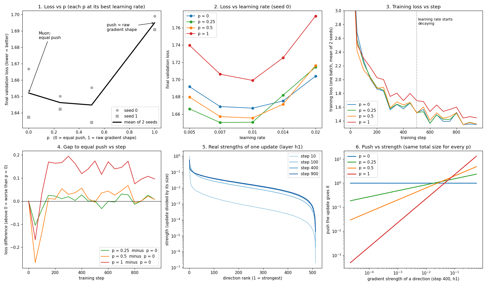

# Experiment 2: does every direction need an equal push?

Summary in [section 7 of the main README](../README.md#7-experiment-does-every-direction-need-an-equal-push). This file has every detail.

**Question.** Muon's ideal is to push every direction of an update by the same amount (all strengths = 1). Is that actually better than pushing weak directions less?

## Setup

- **Data:** the Python standard library's own `.py` files, taken in sorted order until 3 million characters (printable ASCII only). Public, already on every machine with Python, nothing to download. 90% for training, 10% for validation. Python 3.12.8.
- **Model:** a tiny language model that reads 16 characters and predicts the next one. Embedding (32 per character), then three 512-wide layers with ReLU, then the output layer. [train.py](train.py)
- **Optimizer:** Muon (momentum 0.95, Nesterov) on the three 512-wide matrices, AdamW (lr 0.003) on the embedding and output layer. 1000 steps, batch 512. Learning rate flat for 500 steps, then falls linearly to 0.
- **The one thing that changes: p.** Instead of Muon's 5 rounds, each update G is split exactly with an SVD, G = U·S·Vᵀ. Every strength s becomes s^p, then all strengths are scaled together so the update's total size is the same for every p (the size of U·Vᵀ). [exp2_power.py](exp2_power.py)
  - p = 0: every strength becomes 1, every direction pushed equally. This is Muon's ideal.
  - p = 1: the strengths keep their original shape, so weak directions are barely pushed.
  - p = 0.25 and 0.5: in between.
- **Fairness:**
  - Every run uses the same starting weights, the same training batches in the same order, and the same 40 validation batches.
  - Because the total update size is fixed, p changes only how the push is shared between directions, not how big the step is.
  - Each p gets its own best learning rate from 0.005, 0.007, 0.01, 0.014 and 0.02. Every best is inside that grid, not at its edge.
  - Each p is then run again at its best learning rate with a second seed (different starting weights and batch order) to measure noise.
- **Before running,** we predicted that the loss would stay flat for small p and rise sharply toward p = 1 (dotted line in the chart).

## Results


Final validation loss, seed 0, every learning rate:

| p | lr 0.005 | lr 0.007 | lr 0.01 | lr 0.014 | lr 0.02 |
|---|---|---|---|---|---|
| 0 | 1.6918 | 1.6687 | 1.6669 | 1.6752 | 1.7039 |
| 0.25 | 1.6661 | 1.6503 | 1.6506 | 1.6819 | 1.7144 |
| 0.5 | 1.6797 | 1.6571 | 1.6555 | 1.6715 | 1.7164 |
| 1 | 1.7397 | 1.7063 | 1.6990 | 1.7253 | 1.7737 |

At each p's best learning rate, two seeds:

| p | best lr | seed 0 | seed 1 | mean |
|---|---|---|---|---|
| 0 | 0.01 | 1.6669 | 1.6374 | 1.6522 |
| 0.25 | 0.007 | 1.6503 | 1.6424 | 1.6463 |
| 0.5 | 0.01 | 1.6555 | 1.6342 | 1.6448 |
| 1 | 0.01 | 1.6990 | 1.6908 | 1.6949 |

## Analysis

- **Barely pushing the weak directions (p = 1) costs learning.** It is the worst p at every learning rate and on both seeds, 0.04 to 0.05 above the others on average.
- **Pushing them somewhat less (p = 0.25 or 0.5) costs nothing we can measure.** p = 0, 0.25 and 0.5 are within 0.008 of each other. Changing only the seed moved p = 0 by 0.03, so these gaps are noise. With seed 0 alone, p = 0.25 looked best; seed 1 reversed that.
- **The prediction was half right.** The shape (flat, then worse at p = 1) held. The size did not: p = 1 is 0.04 worse than p = 0, not the 0.09 we guessed.
- **What it means for Muon.** Muon's 5 rounds leave strengths between 0.68 and 1.20 instead of exactly 1. That spread is much milder than p = 0.5, which already tied with exact equality here. So an equal push matters only in the coarse sense of "don't starve the weak directions", and the extra cost of reaching exactly 1 buys nothing at this size.

## Related work

Read from the papers' abstracts and text; figures not checked.

- **Qi, Chen, Ye, He, Xiao, [Delving into Muon and Beyond](https://arxiv.org/abs/2602.04669) (February 2026).** Same knob, called spectral compression: U·Σ^p·Vᵀ with p = 1, 1/2, 1/4, 0, on GPT-2 124M, OpenWebText, 200K steps, learning rate tuned per run. On momentum inputs: p = 0 (Muon) best 2.887, p = 1/4 best 2.876, p = 1 (momentum SGD) unstable across learning rates. Adam reached 2.871. Their conclusion: Muon works mainly as a stabilizer, not as a clearly better optimizer.
- **Dong, Sawin, [Muon^p: Muon with Fractional Spectral Powers](https://arxiv.org/abs/2606.13867) (June 2026).** U·S^p·Vᵀ computed with matrix multiplications only (no SVD), default p = 1/3, models from 135M to 3B. Training from scratch: Muon (p = 0) beat p = 1/3, also with exact SVD. Fine-tuning: p = 1/3 beat Muon (e.g. GSM8K pass@8 48.27 vs 41.76 on Llama3-1B). A p sweep while fine-tuning SmolLM-360M kept validation losses within 0.01, with the best p between 0 and 1. Their reason: training from scratch needs every direction pushed, fine-tuning works in fewer directions. Code: github.com/princeton-pli/muon-p.
- **Magakyan, Parrilo, Ozdaglar, [Spectral Scaling Laws of Muon](https://arxiv.org/abs/2606.04058) (June 2026).** Measured the strengths of Muon's momentum in models from 77M to 2.8B parameters. They follow power laws in model size: about M^−0.25 for middle-to-late layers, so 5 rounds should stay enough, and up to M^−0.96 for some late layers, which may drop below what 5 rounds can lift at frontier scale.
- **Selvaraj, [Iterative Orthogonalization Scaling Laws](https://arxiv.org/abs/2505.04005) (May 2025).** Shows on random matrices that strengths shrink as matrices grow, so the rounds may fall short at large scale. No fix proposed.

**How our result compares.** All three p studies find that p between 0 and 0.5 moves the loss by about 0.01 or less, as we found. Which side wins differs: Qi et al. found p = 1/4 slightly better, Dong and Sawin found p = 0 better for training from scratch, and our two seeds cannot tell them apart. p = 1 is worse or unstable in both our run and Qi et al.

## More views of the same runs



Each chart is also saved alone as a square image, `../images/exp2_chart1.png` to `exp2_chart6.png`. Charts 5 and 6 use one extra rerun of p = 0 at learning rate 0.01, seed 0, which gave the same loss as the stored run (1.66688) and recorded the strengths of layer h1's update ([exp2_strengths.json](exp2_strengths.json)).

- **Chart 4: p = 1 is ahead early, then falls behind.** At step 50 the training loss of p = 1 is 0.17 below p = 0 (p = 0.5 is 0.27 below). From step 150 on, p = 1 is 0.12 to 0.19 above, and the gap narrows to about 0.1 while the learning rate decays.
- **Chart 5: real strengths span about four powers of ten.** At step 10 one direction holds almost the whole update (strongest strength 0.99). From step 100 on, the strongest is 36 to 56 times the median, and the top 10 of 512 directions carry about half of the update.
- **Chart 6: what p does to that update.** With the same total size, p = 1 pushes the strongest direction 13 times as hard as Muon does, the median direction 0.33 times, and the weakest 0.0005 times. p = 0.25 keeps all pushes between 0.19 and 2.4.
- **Open:** these runs cannot tell whether p = 1 loses because its strongest direction moves too far or because its weak directions barely move.

## Limits

- One tiny model (three 512-wide layers), 1000 steps, characters of Python code. A bigger model or longer training may behave differently.
- Two seeds per p. The noise between seeds (0.03) is larger than the gaps between p = 0, 0.25 and 0.5, so a real difference smaller than about 0.02 would not show up.
- Exact SVD, not Muon's 5 rounds: this tests the target, not the curve that approximates it.

## Run it

```bash
cd experiments
python3 exp2_power.py 0.01              # p = 0, 0.25, 0.5, 1 at learning rate 0.01, seed 0
python3 exp2_power.py 0.007 0.25 1      # one p, one learning rate, seed 1
python3 plot_exp2.py                    # ../images/exp2_power.png
python3 explore_exp2.py                 # six more views: ../images/exp2_explore.png and exp2_chart1-6.png
```

All runs are saved in [exp2_results.json](exp2_results.json). The full grid (5 learning rates × 4 p + 4 second-seed runs) takes about 24 minutes on a laptop CPU.
