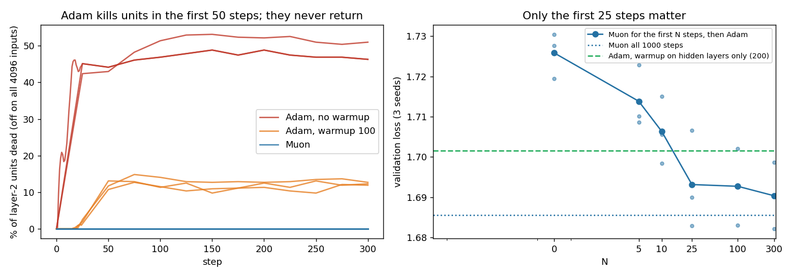

# Character model: why does Adam lose to Muon?

**Question.** In the arithmetic task ([arith](../arith/README.md)), Adam loses units to loss spikes and then cannot learn a rare op. Does the same happen in the speedrun's character model, and how much of Muon's lead over Adam does it explain?

**Setup** ([lmspike.py](lmspike.py)): same data and model as the [speedrun](../speedrun/README.md) (16 characters in, three 512-wide ReLU layers, batch 512, 1000 steps, lr decays over the last 85%). Hidden matrices use Muon (2 rounds, lr 0.02) or AdamW. The embedding and output layers always use AdamW, lr 0.003 unless noted. A unit is dead when it is off on all 4096 fixed validation inputs. 3 seeds per setting; validation loss is the mean over 3 seeds. Logs: lmspike.jsonl, lmwarm.jsonl, lmswitch.jsonl, lmemb.jsonl. Chart: [plot_lmspike.py](plot_lmspike.py).

## 1. Adam kills a quarter to three quarters of layer 2 in the first 50 steps; Muon kills none

| hidden optimizer | layer-2 units dead at the end | validation loss |
|---|---|---|
| Muon, lr 0.02 | **0%** | **1.686** |
| Adam lr 0.001, no warmup | 13–18% | 1.800 |
| Adam lr 0.003, no warmup | 46–48% | 1.774 |
| Adam lr 0.01, no warmup | 74–80% | 1.862 |
| Adam lr 0.003, warmup 100 | 12–16% | 1.719 |
| Adam lr 0.01, warmup 100 | 28–33% | 1.752 |

- **The deaths happen early, then stop.** With Adam lr 0.003 and no warmup, the dead share goes 0% → 10% at step 2 → 46% at step 16 and stays at 44–49% until step 1000. At lr 0.01 the very first Adam step sends the loss from 4.56 to 15.2.
- **No later loss spikes.** No run has a loss jump of more than 1.0 above the recent median after step 50. The arithmetic task's mid-training spikes do not appear here in 1000 steps.
- **Gradient clipping at 1 does not prevent it** (lr 0.003: 44–51% dead). Unlike in arithmetic, the damage comes from many medium steps, not one huge one.
- **Rare characters do not tell anything at this length.** Loss on the rarest characters (2% of the text) is 5.6–6.1 for every optimizer, worse than guessing uniformly (4.56). None of them learns rare characters in 1000 steps.

## 2. Dead units here cannot be revived, not even by Muon

Switching an Adam run to Muon at step 25, 50, 100 or 300 leaves 45–52% of layer 2 dead (validation 1.774–1.795). In arithmetic 10 Muon steps revived 99% of units. The difference: the arithmetic units were off only on × inputs and still got a gradient from + and −. Here the dead units are off on every input, so their row of the gradient is exactly zero. Newton–Schulz maps a zero row to a zero row (checked: max 0.0), so Muon cannot move them either. **Muon prevents the deaths; it cannot undo them.**

Switching Muon → Adam at step 25 or 100 without warmup kills 27–68% of units, with loss spikes right after the switch (steps 101, 102): the same cold-restart death as in arithmetic. With a 50-step lr warmup after the switch, only 5–10% die.

## 3. Muon's lead comes from the first 25 steps

Muon for the first N steps, then Adam (lr 0.003, fresh state, 50-step warmup after the switch):

| N | 0 (Adam, warmup 50) | 5 | 10 | 25 | 100 | 300 | 1000 (Muon only) |
|---|---|---|---|---|---|---|---|
| validation loss | 1.726 | 1.714 | 1.706 | **1.693** | 1.693 | 1.690 | 1.686 |

25 Muon steps (2.5% of training) give 82% of the way from Adam to all-Muon. Steps 25 to 1000 add 0.007.

## 4. It is not Muon's flat update. It is how small the first steps are

What was used for those first 25 steps, then Adam (same switch and 50-step warmup):

| first 25 steps on the hidden matrices | validation loss |
|---|---|
| nothing (hidden matrices frozen) | 1.723 |
| Muon | 1.693 |
| gradient divided by its size, same step size as Muon | 1.695 |
| same, 4× smaller steps | 1.705 |
| same, 4× larger steps | 1.697 |
| **Adam's own direction**, scaled to Muon's step size | 1.700 |
| **plain Adam at a constant lr 0.0002** | 1.700 (1.697 with fresh Adam state at the switch) |

- **Any small gradient-following start works**, including Adam's own direction. Doing nothing does not.
- **Muon's early steps are tiny.** With 2 rounds, the update's size is only 1.7–5.4 (the gradient is close to low rank, so 2 rounds leave most strengths near 0). Times lr 0.02 that is 0.03–0.1 per step against weights of size 13. Adam at lr 0.003 moves each weight matrix by about 1.2 per step, 15–30× more. The matching Adam lr is 0.0001–0.0002.
- **beta2 is not the cause.** Adam warmup 50 with beta2 0.99 gives 1.723, with 0.95 1.734 (0.999: 1.726).

## 5. The usable fix for Adam: warm up only the hidden layers

In the warmup runs above, the embedding and output layers warmed up too. Warming only the hidden matrices:

| warmup steps | all layers warm up | only hidden layers warm up |
|---|---|---|
| 50 | 1.726 | 1.715 |
| 100 | 1.719 | 1.705 |
| 200 | – | **1.702** |
| 300 | 1.729 | – |

With the speedrun's embedding/output lr 0.036:

| | validation loss |
|---|---|
| Muon | **1.654** |
| Adam lr 0.003, all layers warm up (100) | 1.686 |
| Adam lr 0.003, hidden layers warm up (200) | 1.673 |
| Adam lr 0.002, hidden layers warm up (200) | 1.669 |
| Adam lr 0.003, hidden layers warm up (400) | 1.677 |
| Adam lr 0.005, hidden layers warm up (200) | 1.700 |

The Adam-to-Muon gap goes from 0.032 to 0.015: about half of Muon's lead in this model is the start, and an Adam schedule can get it.

**Limits.** One tiny model, 1000 steps, 3 seeds (seed-to-seed spread about 0.01; the per-seed order is the same in every comparison above except Adam lr 0.003 vs 0.005 at warmup 100). Adam's lr and warmup were tuned on a coarse grid only. Why frozen hidden layers lose to tiny steps is not explained yet.
