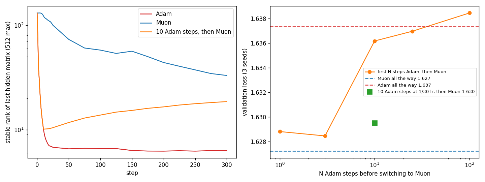

# Character model: why does Adam lose to Muon?

**Question.** In the arithmetic task ([arith](../arith/README.md)), Adam loses units to loss spikes and then cannot learn a rare op. Does the same happen in the speedrun's character model, and how much of Muon's lead over Adam does it explain?

**Setup** ([lmspike.py](lmspike.py)): same data and model as the [speedrun](../speedrun/README.md) (16 characters in, three 512-wide ReLU layers, batch 512, 1000 steps, lr decays over the last 85%). Hidden matrices use Muon (2 rounds, lr 0.02) or AdamW. The embedding and output layers always use AdamW, lr 0.003 unless noted. A unit is dead when it is off on all 4096 fixed validation inputs. 3 seeds per setting; validation loss is the mean over 3 seeds. Logs: lmspike.jsonl, lmwarm.jsonl, lmswitch.jsonl, lmemb.jsonl. Chart: [plot_lmspike.py](plot_lmspike.py).

## 1. Adam kills a quarter to three quarters of layer 2 in the first 50 steps; Muon kills none

| hidden optimizer | layer-2 units dead at the end | validation loss |
|---|---|---|
| Muon, lr 0.02 | **0%** | **1.686** |
| Adam lr 0.001, no warmup | 13–18% | 1.800 |
| Adam lr 0.003, no warmup | 46–48% | 1.774 |
| Adam lr 0.01, no warmup | 74–80% | 1.862 |
| Adam lr 0.003, warmup 100 | 12–16% | 1.719 |
| Adam lr 0.01, warmup 100 | 28–33% | 1.752 |

- **The deaths happen early, then stop.** With Adam lr 0.003 and no warmup, the dead share goes 0% → 10% at step 2 → 46% at step 16 and stays at 44–49% until step 1000. At lr 0.01 the very first Adam step sends the loss from 4.56 to 15.2.
- **No later loss spikes.** No run has a loss jump of more than 1.0 above the recent median after step 50. The arithmetic task's mid-training spikes do not appear here in 1000 steps.
- **Gradient clipping at 1 does not prevent it** (lr 0.003: 44–51% dead). Unlike in arithmetic, the damage comes from many medium steps, not one huge one.
- **Rare characters do not tell anything at this length.** Loss on the rarest characters (2% of the text) is 5.6–6.1 for every optimizer, worse than guessing uniformly (4.56). None of them learns rare characters in 1000 steps.

## 2. Dead units here cannot be revived, not even by Muon

Switching an Adam run to Muon at step 25, 50, 100 or 300 leaves 45–52% of layer 2 dead (validation 1.769–1.795). In arithmetic 10 Muon steps revived 99% of units. The difference: the arithmetic units were off only on × inputs and still got a gradient from + and −. Here the dead units are off on every input, so their row of the gradient is exactly zero. Newton–Schulz maps a zero row to a zero row (checked: max 0.0), so Muon cannot move them either. **Muon prevents the deaths; it cannot undo them.**

Switching Muon → Adam at step 25 or 100 without warmup kills 27–68% of units, with loss spikes right after the switch (steps 101, 102): the same cold-restart death as in arithmetic. With a 50-step lr warmup after the switch, only 5–10% die.

## 3. Muon's lead comes from the first 25 steps

Muon for the first N steps, then Adam (lr 0.003, fresh state, 50-step warmup after the switch):

| N | 0 (Adam, warmup 50) | 5 | 10 | 25 | 100 | 300 | 1000 (Muon only) |
|---|---|---|---|---|---|---|---|
| validation loss | 1.726 | 1.714 | 1.706 | **1.693** | 1.693 | 1.690 | 1.686 |

25 Muon steps (2.5% of training) give 82% of the way from Adam to all-Muon. Steps 25 to 1000 add 0.007.

## 4. It is not Muon's flat update. It is how small the first steps are

What was used for those first 25 steps, then Adam (same switch and 50-step warmup):

| first 25 steps on the hidden matrices | validation loss |
|---|---|
| nothing (hidden matrices frozen) | 1.723 |
| Muon | 1.693 |
| gradient divided by its size, same step size as Muon | 1.695 |
| same, 4× smaller steps | 1.705 |
| same, 4× larger steps | 1.697 |
| **Adam's own direction**, scaled to Muon's step size | 1.700 |
| **plain Adam at a constant lr 0.0002** | 1.700 (1.697 with fresh Adam state at the switch) |

- **Any small gradient-following start works**, including Adam's own direction. Doing nothing does not.
- **Muon's early steps are tiny.** With 2 rounds, the update's size is only 1.7–5.4 (the gradient is close to low rank, so 2 rounds leave most strengths near 0). Times lr 0.02 that is 0.03–0.1 per step against weights of size 13. Adam at lr 0.003 moves each weight matrix by about 1.2 per step, 15–30× more. The matching Adam lr is 0.0001–0.0002.
- **beta2 is not the cause.** Adam warmup 50 with beta2 0.99 gives 1.723, with 0.95 1.734 (0.999: 1.726).

## 5. The usable fix for Adam: warm up only the hidden layers

In the warmup runs above, the embedding and output layers warmed up too. Warming only the hidden matrices:

| warmup steps | all layers warm up | only hidden layers warm up |
|---|---|---|
| 50 | 1.726 | 1.715 |
| 100 | 1.719 | 1.705 |
| 200 | – | **1.702** |
| 300 | 1.729 | – |

With the speedrun's embedding/output lr 0.036:

| | validation loss |
|---|---|
| Muon | **1.654** |
| Adam lr 0.003, all layers warm up (100) | 1.686 |
| Adam lr 0.003, hidden layers warm up (200) | 1.673 |
| Adam lr 0.002, hidden layers warm up (200) | 1.669 |
| Adam lr 0.003, hidden layers warm up (400) | 1.677 |
| Adam lr 0.005, hidden layers warm up (200) | 1.700 |

The Adam-to-Muon gap goes from 0.032 to 0.015: about half of Muon's lead in this model is the start, and an Adam schedule can get it.

**Limits (sections 1–5).** One tiny model, 1000 steps, 3 seeds (seed-to-seed spread about 0.01-0.02). Every start in section 4 except frozen beats Adam warmup 50 on all 3 seeds; differences under 0.01 between those starts are ties. Adam's lr and warmup were tuned on a coarse grid only. Why frozen hidden layers lose to tiny steps is not explained yet.

## 6. With GELU, Adam no longer kills units and the gap halves

ReLU outputs exactly 0 below zero, so a unit that is never positive gets no gradient and stays dead. GELU leaks a small gradient below zero. If dead units are Adam's problem, GELU should remove most of Adam's loss and leave Muon almost unchanged.

Embedding/output lr 0.01, each optimizer's hidden lr tuned on a grid, 3 seeds (dead shares are 3-seed means), data in [lmact.jsonl](lmact.jsonl):

| | ReLU | GELU |
|---|---|---|
| Muon, best lr (ReLU 0.02, GELU 0.03) | **1.649** | **1.627** |
| Adam lr 0.003, no warmup | 1.740 (47% of layer-2 units dead) | 1.637 (0.1% dead) |
| Adam, best warmup found | 1.672 (hidden warmup 200, 12% dead) | 1.637 (no warmup is best) |
| Adam minus Muon | 0.023 | **0.010** |

- **GELU fixes Adam's start by itself.** Plain Adam goes from 1.740 to 1.637. Hidden-layer warmup no longer helps: GELU Adam with warmup 50/100/200 gives 1.642/1.641/1.648.
- **GELU helps Muon much less** (1.649 → 1.627, 0.022) than plain Adam (0.103). Muon never had dead units to lose.
- **Muon still wins by 0.010** with GELU. That part of its lead is not about dead units.
- **Untuned lr can flip the result.** At embedding lr 0.003 with Muon lr 0.02, GELU Adam (1.656) beat Muon (1.668). Muon lr 0.04 gives 1.660 there, and embedding lr 0.01 gives Muon 1.627. Comparing optimizers at one lr per optimizer is not enough.

Other GELU grid points: Adam lr 0.002 / 0.004 with no warmup 1.649 / 1.663; Muon lr 0.02 / 0.04 at embedding lr 0.01 1.644 / 1.650. Leaky ReLU (slope 0.1) at embedding lr 0.003: Muon 1.692, Adam 1.690 to 1.694, untuned.

## 7. With GELU, Muon's lead is lost in Adam's first 10 steps

With no dead units left, what is the remaining 0.010? Same setup as section 6 (GELU, embedding lr 0.01, Muon lr 0.03, Adam lr 0.003), 3 seeds, data in [lmgswitch.jsonl](lmgswitch.jsonl) and [lmgstat.jsonl](lmgstat.jsonl), chart from [plot_gelu.py](plot_gelu.py).

| first hidden steps | then | validation loss |
|---|---|---|
| – | Muon all the way | **1.627** |
| 1 Adam step | Muon | 1.629 |
| 3 Adam steps | Muon | 1.629 |
| 10 Adam steps | Muon | 1.636 |
| 25 Adam steps | Muon | 1.637 |
| 100 Adam steps | Muon | 1.638 |
| – | Adam all the way | 1.637 |
| 10 Adam steps at 1/30 of the lr | Muon | 1.630 |
| 10 Muon steps at 30× the lr | Muon | 1.661 |

- **Ten Adam steps at the start cost 90% of Muon's lead**, and 900 Muon steps afterwards do not win it back. Worse than Muon on all 3 seeds (by 0.012, 0.009, 0.006).
- **It is the size of those steps, not their direction.** The same 10 Adam directions at 1/30 of the lr keep the lead (better than full-size on all 3 seeds). Muon's own directions at 30× the lr for 10 steps are worse than Adam all the way.
- **Why Adam's first step is so big** ([first_step.py](first_step.py)). The first gradient of each hidden matrix is nearly rank 1: 84–94% of its energy is in one direction. Adam's first update is lr × sign(gradient), and the sign of a rank-1 matrix is again rank 1 with every entry ±1, so its strength in that one direction is 512 × 0.003 ≈ 1.0–1.2. The whole starting matrix has top strength 1.15. Muon's first update has strength 0.036 (2 Newton–Schulz rounds leave a near-rank-1 input small).
- **What it does to the weights.** After 10 Adam steps the last hidden matrix's stable rank (how many directions carry its size) drops from 131 to 10. Muon keeps 123 at step 10 and still 27 at the end; Adam ends at 7. Switching to Muon after the 10 steps lifts it only to 19 by step 300.
- **Muon's directions still matter after the start.** Muon's step size each step with Adam's direction (best of lr 0.015/0.03/0.06/0.12) gives 1.653; with the raw gradient's direction 1.644. Both lose to Muon on all 3 seeds.
- **Late Adam costs less.** 25 / 100 / 500 Muon steps, then Adam: 1.637 / 1.633 / 1.629.
- **Capping the strengths does not fix it.** Clipping every hidden matrix's strengths to at most 3 after each step (exact SVD) makes both worse: Adam 1.646, Muon 1.645 (seed 0).

**Reading.** In this model Muon's early updates are small because the early gradient is close to rank 1, which works like a warmup that ends by itself when the gradient spreads. A run that takes a few full-size steps early gets stuck in a lower-rank state. An Adam warmup does not reproduce this (warmup 50/100/200 gives 1.642/1.641/1.648), likely because Adam's later directions are also worse. Untested: whether the same holds in a larger model or a longer run.

## 8. Muon's start is a little too small: 3× lr for the first 10 steps

If 30× Muon's lr for 10 steps hurts and Adam-sized steps hurt, is Muon's own start the best size? Muon with its lr multiplied for the first N steps (GELU, embedding lr 0.01, Muon lr 0.03, 3 seeds):

| first steps | validation loss |
|---|---|
| 10 at 0.1× | 1.631 |
| plain Muon | 1.627 |
| 25 at 2× | 1.627 |
| **10 at 3×** | **1.622** |
| 10 at 5× | 1.626 |
| 10 at 10× | 1.628 |
| 25 at 3× | 1.628 |
| 50 at 3× | 1.633 |
| 10 at 30× | 1.661 |

10 steps at 3× is better than plain Muon on 6 of 6 seeds (seeds 3–5 added: 1.6272 / 1.6213 / 1.6282 vs 1.6274 / 1.6316 / 1.6301). 6-seed means: 1.6237 vs 1.6285, a gain of 0.005. Small, but every seed agrees. Longer boosts (25 or 50 steps) lose it.

On the speedrun's ReLU record settings the same boost gives 4 of 5 seeds better, mean 0.0036 (see [speedrun README](../speedrun/README.md#early-muon-lr-boost)).

## 9. The rank-1 first gradient is the model learning character frequencies; put them in the bias and Adam's start stops hurting

At the start the model predicts nearly uniform characters (first loss 4.56). The cheapest improvement is to predict common characters more often, and that one shared push is the same for every example, which is why the first gradient is nearly rank 1. Starting the output bias at the log character frequencies (one line, `OUTBIAS=1` in [lmspike.py](lmspike.py)) gives that for free:

- First loss 4.56 → 3.27. Stable rank of the first hidden gradients 1.0–1.4 → 2.3–2.6. Strength of Adam's first step in its top direction 1.2 → 0.75 (seed 0, ReLU).

GELU, embedding lr 0.01, 3 seeds, data in [lmbias.jsonl](lmbias.jsonl):

| | default init | output bias = log frequencies |
|---|---|---|
| Adam (lr 0.003; 0.002 / 0.004 are worse with both inits) | 1.637 | **1.630** |
| Muon (lr 0.03; 0.02 / 0.04 are worse with both inits) | 1.627 | 1.627 |
| Adam minus Muon | 0.010 | **0.003** |
| 10 Adam steps, then Muon | 1.636 | 1.627 |
| Muon, 3× lr for the first 10 steps | 1.622 | **1.620** |
| last hidden matrix's stable rank after 10 Adam steps (seed 0) | 10 | 41 |

- **Adam gains 0.007, Muon gains nothing.** Seed by seed, Adam minus Muon is +0.006, +0.003, −0.001: no longer a consistent gap.
- **10 Adam steps at the start no longer cost anything** (1.627, same as Muon all the way).
- **The early boost still helps Muon** (better on all 3 seeds), so it is not only undoing the rank-1 start.
- **With ReLU it is not enough.** Adam still leaves 40% of layer 2 dead and ends at 1.716 (from 1.740), Muon 1.648. Adding hidden warmup 100 or 200: 1.669 (6–11% dead), so the ReLU gap stays at 0.021 (0.023 without the bias init).

The bias init is not allowed in the speedrun (only the optimizer may change there).

## 10. Train 3× longer and Muon's lead is gone; with GELU and weight decay Adam ends 0.003 lower

Everything above is 1000 steps. Same model (GELU, embedding lr 0.01), now 3000 steps (lr still decays over the last 85%). Each optimizer's lr, and then its weight decay, was retuned at 3000 steps. Weight decay is multiplied by lr for both (AdamW's `weight_decay`; for Muon `MWD`, as in the speedrun). 3 seeds, data in [lmlong.jsonl](lmlong.jsonl).

| | 1000 steps | 3000 steps |
|---|---|---|
| Adam, no weight decay, best lr (1000: 0.003; 3000: 0.0015) | 1.6374 | 1.5073 |
| Muon, no weight decay, best lr (1000: 0.03; 3000: 0.02) | **1.6272** | 1.5138 |
| Adam + weight decay, best (1000: lr 0.003, wd 0.15; 3000: lr 0.004, wd 0.3) | 1.6275 | **1.4768** |
| Muon + weight decay, best (1000: lr 0.04, wd 0.05; 3000: lr 0.035, wd 0.05) | **1.6202** | 1.4789 |
| Adam minus Muon, with weight decay | +0.007 | −0.002 |

- **Without weight decay the order flips.** At 1000 steps Muon wins by 0.010; at 3000 steps Adam wins by 0.0065, on all 3 seeds (1.5107 / 1.5075 / 1.5037 vs 1.5137 / 1.5196 / 1.5081). The first comparison at 3000 steps, with the 1000-step lrs, made it look larger (1.5265 vs 1.5335); both lrs had to drop.
- **Weight decay is worth more than the optimizer.** At 3000 steps it gains 0.031 for Adam and 0.035 for Muon. Muon's weight decay window is narrow: 0.025 and 0.05 are good, 0.1 is worse than none (1.517).
- **With weight decay, 1000 steps: Muon still leads on 3 of 3 seeds** (1.6214 / 1.6204 / 1.6186 vs 1.6380 / 1.6256 / 1.6190), though the last seed by only 0.0004.
- **With weight decay, 3000 steps: Adam slightly ahead.** Adam is lower on all 3 seeds, by 0.0031, 0.0008 and 0.0024. Seeds 3–5 added for both best settings: Adam 1.4803 / 1.4699 / 1.4840, Muon 1.4822 / 1.4763 / 1.4888, so Adam is lower on 6 of 6 seeds; 6-seed means 1.4775 vs 1.4807, a gap of 0.003.
- **The output-bias init from section 9 does not help at 3000 steps** (Adam 1.5238 vs 1.5265, Muon 1.5373 vs 1.5335, both at the old lrs without weight decay).

So in this model Muon's advantage is a faster start, not a better end point. Sections 3, 7 and 8 found the start is where its lead is made; with a 3× budget Adam catches up and passes it by a little. Not tested: longer than 3000 steps or wider models.

## 11. With ReLU, Muon still wins at 3000 steps, by 0.005

Same 3000-step setup as section 10, ReLU instead of GELU, weight decay on both. Adam gets hidden-layer warmup (section 5), without which it is far behind (1.534, with 43–57% of layer 2 dead). Grid: Adam lr 0.0015–0.004, weight decay 0.3–0.8, warmup 200 or 500 steps; Muon lr 0.015–0.035, weight decay 0.035–0.07. 3 seeds, data in [lmlong.jsonl](lmlong.jsonl).

| 3000 steps, ReLU | val loss | seeds | dead in layer 2 at the end |
|---|---|---|---|
| Adam, no warmup (lr 0.003, wd 0.3) | 1.5342 | 1.5387 / 1.5367 / 1.5273 | 43–57% |
| Adam, best (lr 0.002, wd 0.5, hidden warmup 200) | 1.4914 | 1.4964 / 1.4871 / 1.4908 | 6–11% |
| Muon, best (lr 0.02, wd 0.05) | **1.4865** | 1.4911 / 1.4831 / 1.4854 | 0% |
| GELU for comparison: Adam / Muon, best (section 10) | 1.4768 / 1.4789 | | |

- **Muon is lower on all 3 seeds**, by 0.0053, 0.0040 and 0.0054. At 1000 steps the ReLU gap was 0.021 (with warmup, no weight decay), so it shrinks with training but does not close, unlike GELU.
- **Fits section 2:** units Adam kills at the start never come back, so even its best ReLU run trains with 6–11% fewer working units in layer 2 for all 3000 steps. More warmup kills fewer (500 steps: 2.5–6% dead) but ends no better (1.4962).
- **GELU is the better choice for both here.** Adam gains 0.015 from it and Muon 0.008.

## 12. Muon first, then Adam: no better than Adam alone

If Muon's edge is the start and Adam's is the end, start with Muon and hand the hidden matrices to AdamW. GELU, 3000 steps, each phase with its best settings from section 10 (Muon lr 0.035, wd 0.05; AdamW lr 0.004, wd 0.3; fresh Adam state at the handoff, optionally a 100-step lr warmup after it). Data in [lmlong.jsonl](lmlong.jsonl).

| 3000 steps, GELU | seeds 0–2 mean | seeds 0–5 mean |
|---|---|---|
| Adam all the way | 1.4768 | 1.4775 |
| Muon all the way | 1.4789 | 1.4807 |
| Muon 300 steps, then Adam | 1.4757 | |
| Muon 300 steps, then Adam with 100-step warmup | 1.4746 | |
| Muon 1000 steps, then Adam | 1.4753 | |
| Muon 1000 steps, then Adam with 100-step warmup | 1.4741 | **1.4771** |

- **Seeds 0–2 suggested a small gain; seeds 3–5 removed it.** Against Adam all the way, the last row is −0.0076, −0.0013, +0.0006, +0.0005, +0.0007, +0.0052 per seed: a tie.
- So with GELU, Muon's faster start buys nothing that lasts once Adam has 2000 steps to train. The early advantage in sections 3 and 7 is real at 1000 steps and does not carry to the end of a longer run.

## 13. Twice as wide (1024): Muon's 1000-step lead is 0.004 and Adam swings more between seeds

Hidden width 512 → 1024 (`HID=1024`), GELU, 1000 steps, weight decay on both, lr and weight decay retuned. Data in [lmwide.jsonl](lmwide.jsonl).

| width 1024, 1000 steps | seeds | mean | spread (sd) |
|---|---|---|---|
| Adam lr 0.0015 / 0.0025 / 0.003 (wd 0.15–0.3) | 3 each | 1.6039 / 1.6142 / 1.6230 | |
| **Adam lr 0.002, wd 0.15** | 1.6053 / 1.5945 / 1.5801 / 1.6130 / 1.6166 / 1.5997 | 1.6016 | 0.013 |
| Muon lr 0.04 / 0.05 / 0.08 (wd 0.05) | 3, 3, 2 | 1.6005 / 1.5966 / 1.6104 | |
| **Muon lr 0.06, wd 0.05** | 1.6006 / 1.5956 / 1.5958 / 1.6027 / 1.5978 / 1.5929 | **1.5976** | 0.004 |

- **Muon is lower by 0.004 on the 6-seed mean, on 4 of 6 seeds.** At width 512 the lead was 0.007 (section 10). Doubling the width does not grow it.
- **Adam's result depends far more on the seed.** Its best and worst seeds are 0.037 apart, Muon's 0.010. Adam's seed 2 (1.5801) is the best single run here; without it Muon wins on 5 of 5. Width 512 shows the same at 1000 steps (Adam seeds 0.019 apart, Muon 0.003), but not at 3000 steps (Adam 0.014, Muon 0.016).
- **Muon's best lr rose with width** (0.03–0.04 → 0.05–0.06): its update has the same total strength per matrix, so each weight gets a smaller share in a wider matrix. **Adam's best lr fell** (0.003 → 0.002).

**Where Adam's seed spread comes from.** The seed sets both the starting weights and the batch order; `DSEED` separates them. Adam lr 0.002, width 1024:

| starting weights \ batch order | data 2 | data 4 | other |
|---|---|---|---|
| init 2 | **1.5801** | 1.5997 | 1.5966 (data 6) |
| init 4 | 1.6041 | 1.6166 | 1.6049 (data 8) |
| init 6 / 8 | 1.5977 (init 6) | 1.6134 (init 8) | |
| Muon lr 0.06, init 2 / 4 | 1.5958 / 1.5923 | 1.6040 / 1.5978 | |

Both halves matter: init 2 beats init 4 with every batch order, and data 2 beats data 4 with every init. The 1.5801 run is the good init paired with the good batch order, 0.017 below the next-best mixed run. Across seeds, a higher stable rank of the first hidden matrix at step 24 goes with a lower final loss (correlation −0.95 over the 6 seeds; 15 for the best run, 10 for the two worst), but that is a correlation over 6 runs, not a tested cause.

## 14. Muon's 1000-step lead is worth about 50 Adam steps

The loss falls fast with longer training, so a lead in loss can be read as a number of steps. Width 512, GELU, weight decay on both, lr near each one's best at every length (Adam lr 0.003 wd 0.3, its best lr at 3000 steps gives the same loss within 0.0007; Muon lr 0.04 up to 1000 steps, 0.035 after). Each run is a full run of that length with its own lr decay, 3 seeds, data in [lmsteps.jsonl](lmsteps.jsonl) and [lmlong.jsonl](lmlong.jsonl).

| steps | Adam | Muon | Adam minus Muon |
|---|---|---|---|
| 750 | | 1.6702 | |
| 1000 | 1.6282 | 1.6202 | +0.008 |
| 1250 | 1.5882 | | |
| 1500 | 1.5598 | | |
| 2000 | 1.5179 | 1.5194 | −0.0015 |
| 3000 | 1.4768 | 1.4789 | −0.002 |

- From 1000 to 1250 steps Adam drops 0.040, so Muon's 0.008 lead at 1000 steps is what Adam gains in about 50 more steps: **Muon saves about 5% of the steps at 1000, and none from 2000 on.**
- The gap from 750 to 1000 steps (0.05 for Muon) is six times the Muon–Adam gap at 1000. The GELU differences in sections 6–9 (at most 0.010) each amount to about 60 Adam steps or fewer. The ReLU gaps (0.02–0.07) are larger because dead units are permanent (sections 1, 2, 11).

## 15. Muon's lead depends on the number of steps, not the batch size

Same data seen (512,000 predictions), split two ways: batch 512 × 1000 steps, or batch 2048 × 250 steps (`BATCH=2048 STEPS=250`). Plus a control: batch 512 × 250 steps, which has the larger batch's step count but a quarter of the data. Width 512, GELU, weight decay on both. lr, embedding lr, Adam's β2 and Adam's hidden-layer warmup retuned for each setting (144 runs, 3 seeds each, in [lmbatch.jsonl](lmbatch.jsonl)).

| setting | best Muon | best Adam | Muon | Adam | Adam minus Muon, per seed | mean |
|---|---|---|---|---|---|---|
| batch 512 × 1000 steps | lr 0.04, emb 0.01 | lr 0.003, emb 0.01, wd 0.15 | 1.6202 | 1.6275 | +0.017 / +0.005 / +0.000 | **+0.007** |
| batch 2048 × 250 steps | lr 0.08, emb 0.03 | lr 0.01, emb 0.03, warmup 50, β2 0.95, wd 0.3 | 1.6614 | 1.6798 | +0.028 / +0.016 / +0.011 | **+0.018** |
| batch 512 × 250 steps | lr 0.06, emb 0.03 | lr 0.005, emb 0.03, warmup 25, wd 0.15 | 1.9276 | 1.9421 | +0.006 / +0.023 / +0.014 | **+0.015** |

- **At 250 steps, Muon leads by about the same at both batch sizes** (0.015 and 0.018), but at the same data it leads by 0.007 at 1000 steps. The lead follows the number of steps. A larger batch helps Muon only because it means fewer steps.
- **The 4× batch wastes data for both.** At the same data, batch 2048 ends 0.041 above batch 512 for Muon and 0.052 above for Adam.
- **Fewer steps need larger lrs and a hot embedding.** Muon's best lr doubles at 250 steps (0.04 → 0.06–0.08). The embedding and output lr triples (0.01 → 0.03) for both; at 1000 steps 0.02 is worse than 0.01 for both (Muon 1.6240, Adam 1.6330).
- **Adam needs a hidden-layer warmup at batch 2048.** Without one, every lr from 0.003 to 0.006 ends at 1.81–1.86 (lr 0.006 spikes on seed 0). 50 warmup steps bring it to 1.70, and β2 0.95 and embedding lr 0.03 to 1.68. Muon needs no warmup at any setting. Over the 144 runs, untuned Adam loses by up to 0.19; tuned Adam loses by 0.018.
- **Limits.** One model, 3 seeds per setting. Seed spread at 250 steps is about 0.01, so the 0.015 and 0.018 leads are clear, but the two are not separable.

## 16. Change the task halfway: Adam's network relearns worse than a fresh one, Muon's relearns better

**Setup.** Train 1000 steps, then change the data and train 1000 more, with the lr schedule restarted (`SHIFT=perm SHIFT_AT=1000 STEPS=2000`). Two changes:
- **perm**: every character is relabeled by a fixed random permutation, in the inputs and in what the model must predict. It is the same language under new names.
- **rev**: the text is reversed, so the model predicts the character before the context.

The score is the validation loss on the new data after the second 1000 steps, compared with a fresh model trained 1000 steps on that data. Width 512, lrs from section 10 (Muon 0.04 with weight decay 0.05, Adam 0.003 with weight decay 0.15), 3 seeds per row. Data in [lmshift.jsonl](lmshift.jsonl).

**Relabeled characters, GELU.** A fresh model reaches Muon 1.6202, Adam 1.6275.

| first 1000 steps → next 1000 steps | after the change | vs fresh | layer 2 dead at the end |
|---|---|---|---|
| Muon → Muon | **1.6150** | −0.005 | 0% |
| Adam → Adam | 1.6835 | **+0.056** | 22–37% |
| Adam → Adam, Adam state reset at the change | 1.6665 | +0.039 | 8–24% |
| Adam → Adam, β2 0.95 | 1.6545 | +0.027 | 5–14% |
| Adam → Adam, hidden-layer warmup 100 steps | 1.6538 | +0.026 | 0% |
| Adam → Muon | 1.6349 | +0.015 (vs fresh Muon) | 0% |
| Muon → Adam (fresh Adam state) | 1.6297 | +0.002 | 0–6% |
| Muon → Adam, warmup 100 | 1.6162 | −0.011 | 0% |

**Reversed text.** Fresh: Muon 1.6220, Adam 1.6316. After 1000 steps on forward text: Muon 1.5883 (−0.034), Adam 1.5835 (−0.048). Both reuse what they learned; Adam gains a little more.

**Relabeled characters, ReLU.** Fresh (= the first phase): Muon 1.641, Adam 1.731. After the change: Muon 1.6784 (+0.037), Adam 1.8183 (+0.087, 50–64% of layer 1 dead).

**What happens at the change (GELU, seed 0).**
- The loss jumps from 1.25 to 6.4 and the gradient norm from 0.7 to 8, for both optimizers.
- Adam's second-moment estimate still holds the small end-of-training gradients, so its first steps after the change are about 10× too large. 66% of layer 2 is dead (never positive on the probe inputs) 25 steps later, and 34% is still dead at step 2000.
- Muon's update has a fixed size whatever the gradient norm, so nothing dies.

**Dead units are not the whole story.** With a warmup after the change, Adam kills nothing and still ends 0.026 worse than fresh. The crossed rows separate the weights from the optimizer:
- Muon starting from Adam's weights ends 0.020 worse than Muon starting from Muon's weights (1.6349 vs 1.6150).
- Adam with warmup starting from Muon's weights matches Muon throughout (1.6162).

So most of the loss is carried by the weights Adam trained. At the change they have larger norms (Frobenius 30–32 per matrix vs 20–25) and a lower stable rank (7–22 vs 25–44), and Adam's second phase does not raise the rank (layer 2 stays at 5–7).

**Shrinking Adam's weights at the change** (`SHIFT_SHRINK`, all three hidden matrices multiplied by a factor):

| at the change | after | vs fresh Adam 1.6275 |
|---|---|---|
| Adam, warmup 100, ×0.7 | 1.6376 | +0.010 |
| Adam, warmup 100, ×0.5 | 1.6384 | +0.011 |
| Adam, warmup 100, ×0.5 + 0.5 × fresh init (shrink and perturb) | 1.6360 | +0.009 |
| Adam, warmup 100, ×0.7, β2 0.95 | **1.6228** | −0.005 |
| Adam → Muon, ×0.7 | 1.6177 | −0.003 (vs fresh Muon) |
| Muon, ×0.5 + 0.5 × fresh init | 1.6233 | +0.003 (Muon alone: −0.005) |
| Adam with weight decay 0.6 instead (both phases), warmup 100 | 1.6510 | +0.024 |

- **Shrinking removes about 0.017 of Adam's loss**, whether Adam or Muon trains afterwards. Stronger weight decay through the first phase does not do the same (1.6510).
- **Adam needs three fixes to match a fresh Adam:** a warmup after the change, shrunk weights and β2 0.95. Muon needs none and ends below fresh.
- Shrink and perturb, the published fix for lost plasticity, hurts Muon.
- **Limits.** One model, 3 seeds (spread about 0.01), one change point. The lrs were tuned for single 1000-step runs, not for the second phase. Relabeling is an extreme change: every output row is wrong at once.

## 17. Twelve task changes in a row: Muon stays flat, Adam breaks

Section 16's change repeated: every 500 steps the characters are relabeled by a new random permutation, and the lr schedule restarts (`SHIFT=perm SHIFT_EVERY=500 STEPS=6000`, 12 tasks). The score of each task is the validation loss at its end, on its own labels. GELU, same lrs as section 16. Muon and Adam 3 seeds; Adam with the section 16 fixes (warmup 100, β2 0.95, weights ×0.7 at every change) 2 seeds. Data in [lmshift12.jsonl](lmshift12.jsonl) and, for 6 tasks, [lmshift.jsonl](lmshift.jsonl).

| validation loss at the end of task | 1 (fresh) | 2 | 3 | 4 | 5 | 6 | 7 | 8 | 9 | 10 | 11 | 12 |
|---|---|---|---|---|---|---|---|---|---|---|---|---|
| Muon | 1.762 | 1.738 | 1.744 | 1.741 | 1.738 | 1.743 | 1.753 | 1.736 | 1.748 | 1.743 | 1.756 | 1.754 |
| Adam | 1.791 | 1.803 | 1.852 | 1.897 | 1.856 | 2.114 | 1.916 | 1.898 | 1.990 | 1.924 | 1.951 | 1.940 |
| Adam + fixes | 1.805 | 1.766 | 1.753 | 1.748 | 1.746 | 1.752 | 1.761 | 1.742 | 1.759 | 1.760 | 1.774 | 1.765 |

- **Muon gets better after the first change and stays there.** Tasks 2–12 average 1.746, against 1.762 when fresh. Layer 3 has no dead units at the end of any task, layer 2 has 3–11% in tasks 7–12, and the largest gradient norm in 6000 steps is 7.
- **Adam gets worse with every few changes.** Tasks 7–12 average 1.937, 0.15 above its fresh 1.791. 64–91% of layer 3 (the last hidden layer) is dead at the end of each of those tasks, and 6–22% of layer 2, and gradient norms reach 78–204. Task 6 is the worst for all 3 seeds (2.10–2.13), but the same permutation costs Muon nothing (1.737–1.749).
- **The section 16 fixes hold up over 12 changes.** Adam + fixes averages 1.760 over tasks 7–12, 0.012 above Muon, with at most 5% of any layer dead. Its first task is 0.014 worse than plain Adam, because the warmup and β2 0.95 cost something on a fresh 500-step run.
- **Muon may be drifting up slightly:** tasks 2–6 average 1.741, tasks 7–12 1.748. That difference is below the 0.01 seed spread, so it is not established.
- **Limits.** One model, relabeling only (each new task is the same language under new names), 500 steps per task, lrs not retuned for the repeated setting.

## 18. Which of Adam's three fixes matters over 12 changes

Section 17's setup (a new relabeling every 500 steps, 12 tasks), with each combination of the three fixes: warmup over 100 steps after every change (`WARM_HID=100`), β2 0.95 (`B2=0.95`), weights ×0.7 at every change (`SHIFT_SHRINK=0.7`). 2 seeds per new row. Data in [lmshift12.jsonl](lmshift12.jsonl).

| warmup | β2 0.95 | ×0.7 | task 1 | tasks 2–6 | tasks 7–12 | worst task (any seed) |
|---|---|---|---|---|---|---|
| | | | 1.791 | 1.904 | 1.937 | 2.126 |
| ✓ | | | 1.800 | 1.811 | 1.892 | 1.950 |
| | ✓ | | 1.802 | 1.868 | 1.899 | 2.093 |
| | | ✓ | 1.798 | 1.874 | **2.127** | 2.632 |
| ✓ | ✓ | | 1.805 | 1.758 | 1.811 | 1.892 |
| | ✓ | ✓ | 1.802 | 1.782 | 1.897 | 2.007 |
| ✓ | | ✓ | 1.800 | 1.765 | **1.774** | 1.811 |
| ✓ | ✓ | ✓ | 1.802 | 1.752 | **1.760** | 1.818 |
| Muon, no fixes | | | 1.762 | 1.741 | 1.748 | 1.774 |

- **Warmup and shrink are the pair that works.** Together: 1.774 on tasks 7–12, no dead units at the end, largest gradient norm 5.4. β2 0.95 adds another 0.014.
- **Shrink without warmup is the worst setting tested.** Tasks 7–12 average 2.127, worse than no fix at all. Gradient norms reach 134–299, and at the end 39–82% of layer 2 and 64–73% of layer 3 are dead. Shrinking the weights by 0.7 while Adam's first steps keep their full size makes each step larger relative to the weights. That is the opposite of what the change needs.
- **Every setting without shrink degrades in the second half.** Warmup + β2 0.95 holds until task 6 (1.758), then drifts to 1.811 on tasks 7–12, with 45–50% of layer 3 dead at the end. Warmup protects each change, but something builds up across changes that only shrinking the weights removes.
- **Muon needs none of this**, and stays 0.012 better than the best Adam combination.

## 19. Deaths pile up from change to change, and shrinking clears them

Why does shrinking the weights at each change work, when warmup and β2 0.95 alone break down after task 6 (section 18)? Same 12-task setup. Layers are numbered 1–3 from the input, as in section 1. Data in [lmshift12.jsonl](lmshift12.jsonl).

**It is not the size of the weights.** Without shrinking, Adam's weights grow from Frobenius norm 21 to 36–42 per matrix over 12 tasks, despite weight decay 0.15. Shrinking keeps them at 18–23. But stronger weight decay, which also keeps them small, does not do the same job (warmup + β2 0.95 in every row, 2 seeds per new row):

| Adam, warmup 100, β2 0.95 | norms at the end | tasks 2–6 | tasks 7–12 | layer 2 dead at the end |
|---|---|---|---|---|
| weight decay 0.15 | 36–42 | 1.758 | 1.811 | 2–8% (layer 3: 45–50%) |
| weight decay 0.4 | 22–32 | 1.781 | 1.838 | 69–72% |
| weight decay 0.8 | 16–20 | 1.774 | 1.816 | 38–43% |
| weight decay 0.15, ×0.7 at each change | 18–23 | 1.752 | **1.760** | 0% |

**What happens instead is a ratchet.** The share of dead units, sampled every 25 steps, seed 0, layer 2 / layer 3, at a given number of steps after the change:

| run | task | at the change | +25 | +50 | +200 | +475 (end of task) |
|---|---|---|---|---|---|---|
| Adam, weight decay 0.8 | 4 | 16 / 0 | 22 / 0 | 25 / 0 | 20 / 0 | 16 / 0 |
| | 7 | 38 / 0 | 50 / 0 | 49 / 0 | 37 / 0 | 28 / 0 |
| | 10 | 33 / 0 | 58 / 0 | 59 / 0 | 43 / 0 | 32 / 0 |
| Adam, weight decay 0.15 | 7 | 9 / 29 | 10 / 46 | 8 / 48 | 10 / 38 | 6 / 26 |
| | 10 | 8 / 55 | 13 / 79 | 13 / 78 | 13 / 56 | 8 / 47 |
| Adam, ×0.7 at each change | 7 | 0 / 0 | 0 / 7 | 0 / 1 | 0 / 0 | 0 / 0 |
| | 10 | 0 / 0 | 0 / 9 | 0 / 1 | 0 / 0 | 0 / 0 |

- **Each change kills units in the first 25–50 steps, and the rest of the task revives only part of them.** The leftovers carry into the next change, which kills more. With weight decay 0.8, layer 2 goes 0% → 16% → 38% → 33% dead at the start of tasks 2, 4, 7 and 10.
- **With the shrink, the same burst still happens** (7–9% of layer 3 dead 25 steps after the change), **but it is gone by step 200**, so nothing carries over. One likely reason, not tested here: multiplying all three matrices by 0.7 shrinks layer 3's inputs as well as its weights, so every unit's input moves toward zero, where GELU passes gradient again.

**Muon has a slow version of the same ratchet, and it does not matter.** Muon (3 seeds, no shrink) collects up to 8–11% dead in layer 2 from task 4 on, never any in layer 3. With ×0.7 or ×0.85 at each change (2 seeds each) layer 2 stays at most 4% dead, but the loss does not move: tasks 7–12 average 1.751 (×0.7) and 1.746 (×0.85) against 1.748 without. Muon's dead units cost nothing measurable, and the drift in section 17 (1.741 → 1.748) does not come from them.

## 20. Muon's step size alone does not protect it; the shape does

Section 16 blamed Adam's trouble at a change on its step size: the second-moment estimate still holds the small end-of-task gradients, so the first steps after the change come out about 10× too large. Muon's step has a fixed size, whatever the gradient. Is that the whole reason Muon survives 12 changes?

Test: keep Muon's step size exactly (every step, the update is rescaled to the Frobenius norm of Muon's 2-round output on that step), but give it another shape. `adamshape` uses Adam's update direction (β 0.9, 0.999); `nsgd` uses the momentum gradient itself. Momentum, Nesterov, weight decay 0.05 and the schedule are Muon's. Same 12-task setup as section 17, 3 learning rates, 2 seeds each. Data in [lmshift12.jsonl](lmshift12.jsonl).

| update, all with Muon's step size | lr | task 1 | tasks 2–6 | tasks 7–12 | layer 2 dead, end of task 12 (worst seed) |
|---|---|---|---|---|---|
| Muon (orthogonalized) | 0.04 | **1.762** | **1.741** | **1.748** | 9% |
| Adam's shape | 0.02 | 1.929 | 1.809 | 1.825 | 46% |
| Adam's shape | 0.04 | 1.820 | 1.832 | 1.889 | 73% |
| Adam's shape | 0.07 | 1.784 | 1.875 | 1.939 | 82% |
| gradient's shape | 0.02 | 1.884 | 1.830 | 1.916 | 62% |
| gradient's shape | 0.04 | 1.800 | 1.847 | 1.909 | 46% |
| gradient's shape | 0.07 | 1.812 | 1.934 | 2.070 | 83% |

- **With the same step size, both other shapes break down the way Adam does.** Layer 2 deaths pile up from change to change in every run (adamshape lr 0.04: 36% after the first change, 73% by task 12), and tasks 7–12 are 0.08–0.32 worse than Muon.
- **There is no learning rate that fixes it.** A higher lr helps the first task and hurts later ones. A lower lr does the reverse. None comes within 0.07 of Muon on tasks 7–12.
- **So the fixed size is not enough.** What keeps Muon's units alive is that Newton–Schulz spreads the update evenly over all directions of the matrix. One likely reason, not tested here: an update dominated by a few directions pushes many units' inputs the same way at once, and after a change those few directions point at the new task's largest error.

## 21. More Newton–Schulz rounds: more even updates, fewer deaths, lower loss after changes

If the even spread of section 20 is what protects Muon, then fewer Newton–Schulz rounds (a less even update) should break down more, and more rounds should hold up better. Test (`ROUNDS=k`): every step, the k-round output is rescaled to the size of the standard 2-round output, so only the shape changes, never the step size. 0 rounds is the momentum gradient itself, the same update as section 20's gradient shape. Same 12-task setup, Muon lr 0.04, weight decay 0.05. Data in [lmshift12.jsonl](lmshift12.jsonl).

| rounds (step size of 2 rounds) | seeds | task 1 (fresh) | tasks 2–12 | tasks 7–12 | layer 2 dead, worst task and seed |
|---|---|---|---|---|---|
| 0 | 2 | 1.800 | 1.878 | 1.901 | 65% |
| 1 | 2 | 1.793 | 1.854 | 1.871 | 62% |
| 2 (standard) | 4 | 1.763 | 1.745 | 1.749 | 11% |
| 3 | 4 | **1.753** | **1.724** | **1.726** | 1% |
| 5 | 3 | 1.773 | 1.726 | 1.728 | 0% |

- **The loss falls with every added round up to 3, and deaths fall with it.** 0 and 1 rounds break down like Adam: 13% of layer 2 dead after the first change, then 43–65%. 2 rounds collect up to 11%. 3 and 5 rounds keep layer 2 at 0–1% for all 12 tasks.
- **3 rounds beat 2 on all 4 seeds**, by 0.015, 0.023, 0.025 and 0.020 on tasks 2–12 (seeds 0–3), more than the 0.01 seed spread, and it costs one more round (about 50% more optimizer compute).
- **The gain grows after changes.** On the fresh first task, 3 rounds are 0.010 better than 2, and 5 rounds are 0.010 worse. After the changes, both are 0.02 better than 2 rounds. A fully even update matters more when the network has to relearn than when it learns from scratch.
- **This does not contradict the speedrun**, where 2 rounds beat 5 on one 1000-step task: there, each round count used its own raw step size, and 5 rounds took larger steps on weak directions. Here the sizes are matched. The speedrun's [weak-direction test](../speedrun/README.md#does-muon-push-weak-directions-too-hard) found a slightly uneven update (S^0.25) best on a single task. With repeated changes, the even update wins.
- **On one fresh 1000-step task it helps too, at these settings.** GELU, lr 0.04, no changes, 5 seeds: 3 rounds 1.6128, 2 rounds 1.6209, better on all 5 seeds (by 0.001–0.012); 5 rounds 1.6173. With ReLU at the same lrs, 3 rounds beat 2 on 4 of 4 seeds by 0.005–0.011. But at the speedrun's tuned record settings (ReLU, Muon lr 0.02, AdamW lr 0.036) it is a tie over 5 seeds ([speedrun](../speedrun/README.md#three-rounds-at-the-size-of-two)). Data in [lmrounds.jsonl](lmrounds.jsonl).
- **Consistency check.** 0 rounds and section 20's `nsgd` at lr 0.04 compute the same update along different code paths. They agree on tasks 7–12 (1.901 vs 1.909), though not bit for bit: after 500 steps the two runs match exactly, but by step 6000 seed 0 differs by 0.03 (1.904 vs 1.936). Runs that are breaking down are that sensitive to rounding.

## 22. With ReLU, Muon also loses ground over changes; 3 rounds plus a shrink stop it

Sections 17–21 used GELU. The speedrun model uses ReLU, whose units can die outright. Same 12-task setup, the speedrun's record settings (ReLU, Muon lr 0.02, weight decay 0.05, AdamW lr 0.036 on the embedding and output), 2 seeds each. "Shrink" multiplies the hidden matrices by 0.7 at every change (section 19). Deaths are the worst share over the run, per layer, counted from the input. Data in [lmshift12.jsonl](lmshift12.jsonl).

| setting | task 1 (fresh) | tasks 2–12 | tasks 7–12 | dead, worst: layer 1 / 2 / 3 |
|---|---|---|---|---|
| 2 rounds | 1.764 | 1.826 | 1.833 | 7% / 1% / 39% |
| 2 rounds, Muon lr 0.04, AdamW 0.01 | 1.779 | 1.829 | 1.831 | 7% / 6% / 36% |
| 3 rounds | 1.773 | 1.805 | 1.813 | 0% / 0% / 44% |
| 2 rounds + shrink 0.7 | 1.764 | 1.783 | 1.788 | 0% / 7% / 12% |
| **3 rounds + shrink 0.7** | 1.773 | **1.769** | **1.772** | 0% / 0% / 4% |
| leaky ReLU (slope 0.1), 2 rounds | 1.768 | 1.789 | 1.801 | 33% / 1% / 5% |
| GELU, 2 rounds, lr 0.04 (section 21) | 1.763 | 1.745 | 1.749 | 11% layer 2 |

- **With ReLU, Muon is not flat.** Tasks 2–12 are 0.06 worse than the fresh first task on both seeds, at both learning-rate settings. With GELU, later tasks are 0.02 better than the first. Up to 39% of the last layer's units go dead during a task. At the end of each run, 8% are still dead.
- **3 rounds help here too, and at the record's settings.** 0.021 and 0.020 better on tasks 2–12 (seeds 0, 1), although on a fresh 1000-step task they tie with 2 rounds at these settings ([speedrun](../speedrun/README.md#three-rounds-at-the-size-of-two)). They keep layers 1 and 2 at 0% dead, but not layer 3.
- **The shrink reaches layer 3.** It cuts the worst layer-3 deaths from 39% to 12% and tasks 2–12 by 0.043.
- **The two add up.** 3 rounds + shrink: 1.769 on tasks 2–12, no worse than the first task (1.773), with at most 4% of any layer dead. That is 0.057 better than plain Muon, on both seeds (1.767 vs 1.827, 1.771 vs 1.825).
- **Leaky ReLU removes most of the loss but not all** (1.789). Its "dead" units (never positive, still passing 0.1 of the signal) move to layer 1. So dying is a large part of ReLU's loss, though not all of it.
- **GELU still ends best** (1.745 with 2 rounds, 1.724 with 3), but its task 1 is no better. For a network that will be retrained on new data, the activation matters more than for one trained once.

## 23. The real cause: the old output table. Resetting it at each change fixes Adam and Muon

A relabeling only renames characters. Permuting the rows of the embedding and output tables would give back task 1's exact loss without touching the hidden layers. So how much do the hidden layers have to change, and what damages them? `OPT2=frozen SWITCH=500` stops all hidden updates after task 1; `EMB_RESET` puts the embedding (`emb`), the output layer (`out`) or both (`1`) back to a fresh random init with fresh AdamW state at every change. Same 12-task setup. Data in [lmshift12.jsonl](lmshift12.jsonl).

| model | setting | seeds | task 1 | tasks 2–12 | tasks 7–12 |
|---|---|---|---|---|---|
| Muon, ReLU, record lrs | plain (section 22) | 2 | 1.764 | 1.826 | 1.833 |
| | hidden frozen after task 1 | 2 | 1.764 | 2.295 | 2.318 |
| | hidden frozen + fresh tables | 2 | 1.764 | 2.153 | 2.154 |
| | fresh embedding only | 1 | 1.769 | 1.875 | 1.885 |
| | fresh output layer only | 2 | 1.764 | 1.773 | 1.780 |
| | **fresh embedding + output** | 2 | 1.764 | **1.747** | **1.748** |
| | 3 rounds + shrink (section 22) | 2 | 1.773 | 1.769 | 1.772 |
| Muon, GELU, lr 0.04 | plain (section 21) | 4 | 1.763 | 1.745 | 1.749 |
| | **fresh embedding + output** | 2 | 1.763 | **1.720** | **1.718** |
| Adam, GELU | plain (section 17) | 3 | 1.791 | 1.922 | 1.937 |
| | warmup + β2 0.95 + shrink (section 18) | 4 | | | 1.760 |
| | fresh embedding + output | 2 | 1.798 | 1.751 | 1.755 |
| | **fresh output layer only** | 1 | 1.812 | **1.741** | **1.743** |

- **The hidden layers must keep learning.** Frozen after task 1, later tasks reach only 2.30 (2.15 with fresh tables), against 1.77 when they train. 500 steps are not enough for the tables alone to find the renaming.
- **But the old output layer damages them.** At a change, the old output layer predicts the old characters with confidence. The loss at the first step after a change is 6.0, well above the 4.57 of a uniform guess (fresh output layer). The gradient over the next 25 steps grows 1.7× for Muon and 6.3× for Adam, and within 50 steps 26% (Muon ReLU) and 80% (Adam) of the last layer's units are dead. With a fresh output layer the gradient barely rises (1.04× and 1.4×), and the deaths drop to 11% and 0.3%.
- **Adam's breakdown from sections 17–19 is almost all this.** A fresh output layer alone takes Adam from 1.922 to 1.741 on tasks 2–12, better than all three fixes of section 18 together (1.760 on tasks 7–12, vs 1.743), and as good as Muon with GELU (1.745). The gap between Adam and Muon over changes was mainly how each survives the old output layer's huge first gradients, not a lasting difference in plasticity.
- **Muon gains as well.** With ReLU, fresh tables take it from 1.826 to 1.747, 0.022 better than 3 rounds + shrink, and later tasks end better than the first. With GELU, from 1.745 to 1.720, as much as 3 rounds gave (1.724).
- **A fresh embedding alone hurts** (1.875 vs 1.826): with a new embedding feeding the old output layer, the first loss after a change is even higher (7.4) and 47% of layer 3 is dead after 50 steps.
- **Limit.** This setup is a pure relabeling, where the old output layer is exactly wrong. In real data shifts the old output layer is partly right, and a full reset would throw that away. The general lesson tested here: the damage comes from large, confident errors at the output after a change, and Muon, whose step size does not depend on the gradient's size, suffers less from them than Adam. Likely reason, not measured here: Adam's second-moment average (β2 0.999) lags a sudden jump in the gradient, so for a few dozen steps its update grows up to about 3× (0.1/√0.001); section 18's β2 0.95 and warmup both shorten that window.

## 24. Capping confidence without knowing when a change comes: soft-capping and label smoothing do not replace the reset

Section 23's reset needs to know when a change happens. Two common ways to limit how confident the output can be, with no knowledge of changes, on seed 0 (seed 1 where noted). `SOFTCAP=c`: logits = c·tanh(logits/c) (Gemma 2, modded-nanogpt). `LSMOOTH=s`: label smoothing in the training loss; validation stays plain cross-entropy. Data in [lmshift12.jsonl](lmshift12.jsonl).

| setting | Adam GELU: task 1 | tasks 2–12 | Muon ReLU: task 1 | tasks 2–12 |
|---|---|---|---|---|
| plain | 1.791 | 1.922 | 1.764 | 1.826 |
| soft-cap 3 | 1.905 | 5.219 | 1.881 | 1.922 |
| soft-cap 5 | 1.795 | 3.310 | 1.777 | 1.801 (seed 1: 1.795) |
| soft-cap 10 | 1.800 | 1.902 | 1.770 | 1.827 |
| soft-cap 20 | 1.799 | 1.920 | | |
| label smoothing 0.1 | 1.842 | 1.894 | 1.806 | 1.810 |
| label smoothing 0.3 | 2.025 | 2.058 | 1.980 | 1.980 |
| fresh output layer at each change (section 23) | 1.812 | **1.741** | 1.764 | **1.773** |

- **A small soft-cap destroys Adam over changes.** With cap 3 or 5, tasks 2–12 end above a uniform guess (4.57), and they get worse task after task (cap 5: 4.06 on tasks 7–12). Likely reason, not measured: after a relabeling, the old output layer pushes some wrong logits up to the cap, where tanh is flat and passes almost no gradient, so the model cannot unlearn them. Muon does not collapse with the same cap.
- **With Muon, cap 5 helps a little.** 0.025 and 0.032 better (seeds 0, 1), and the worst layer-3 deaths drop from 37–39% to 3–11%, but it stays 0.025 behind the reset. Cap 10 changes nothing. Cap 3 costs 0.11 on the first task.
- **Label smoothing makes later tasks about as good as the first, by making the first one worse.** Muon at 0.1: no rise from task 1 to the later ones (1.806 → 1.810), but task 1 is 0.04 worse than plain. Adam at 0.1 gains 0.03 over plain.
- None matches resetting the output layer: the closest, Muon with cap 5, is 0.025 behind; for Adam the closest is 0.15 behind.

## 25. When the reset pays: only once the old output layer is worse than a uniform guess

In section 23 every character was renamed, so the old output layer was entirely wrong. `SHIFT_FRAC=f` renames only a random share f of the 96 characters among themselves; the rest keep their labels. Seed 0, plain vs a fresh output layer at each change. "Loss at change" is the training loss on the first batch after a change, averaged over the 11 changes; a uniform guess gives ln 96 = 4.56. Data in [lmshift12.jsonl](lmshift12.jsonl).

| characters renamed | Adam GELU: loss at change | plain | fresh output | Muon ReLU: loss at change | plain | fresh output |
|---|---|---|---|---|---|---|
| 25% | 3.59 | **1.613** | 1.615 | 3.59 | **1.633** | 1.636 |
| 50% | 4.62 | 1.725 | **1.677** | 4.69 | **1.681** | 1.703 |
| 75% | 5.66 | 1.859 | **1.724** | 5.93 | 1.808 | **1.751** |
| 100% (section 23) | 5.99 | 1.922 | **1.741** | 6.08 | 1.826 | **1.773** |

(tasks 2–12; the 100% plain rows are seed means from sections 17 and 22.)

- **With 25% renamed, the old output layer is mostly right** (loss 3.59, below a uniform guess), nothing breaks down, and a reset throws away what it knew: a tie for both.
- **Once the old layer is about as bad as a uniform guess, the optimizers part.** At 50%, Adam's gradient grows 2.4× after each change and 31% of layer 3 is dead 50 steps later. The reset gains 0.048. Muon's gradient grows 1.5×, under 2% of layer 3 dies, and the reset costs 0.022.
- **Above that, the reset pays for both.** At 75%: 0.135 for Adam, 0.057 for Muon.
- **A rule this suggests, not tested as an automatic method:** reset the output layer only when the loss right after a change is above a uniform guess (ln of the vocabulary size). For Muon the break-even point lies a little higher, between 50% and 75% renamed.

## 26. Measured: after a change Adam's step doubles, Muon's shrinks

Section 23 guessed that Adam's update grows after a change while Muon's stays fixed. `UPD=1` logs, every step, the total size of the change to the three hidden matrices (‖ΔW‖ summed), divided by the learning-rate multiplier of that step, so the lr schedule's restart at each change is taken out. Shown relative to the same number on task 1, steps 25–100. 12-task setup, seed 0. Data in [lmupd.jsonl](lmupd.jsonl).

| setting | step 0 after a change | step 2 | step 4 | step 10 | step 20 | tasks 2–12 |
|---|---|---|---|---|---|---|
| Adam, β2 0.999 | 1.93× | 1.99× | 1.84× | 1.38× | 0.90× | 1.919 |
| Adam, β2 0.95 | 1.27× | 1.36× | 1.25× | 0.92× | 0.70× | 1.893 |
| Adam, fresh output layer | 1.04× | 1.17× | 1.09× | 0.98× | 0.96× | 1.741 |
| Muon (ReLU, record lrs) | 0.64× | 0.64× | 0.65× | 0.71× | 0.79× | 1.825 |

(each value averaged over the 11 changes)

- **Adam's step about doubles for the first 10 steps after a change.** The large, new gradient from the old output layer raises Adam's first moment faster than its second-moment average (β2 0.999) can catch up. With β2 0.95 the second moment catches up sooner: 1.3× instead of 2×. That is why section 18's β2 0.95 helped.
- **With a fresh output layer the gradient does not jump, and Adam's step stays at its normal size** (1.0–1.2×).
- **Muon's step shrinks to 0.64×.** Newton–Schulz first divides the momentum by its total (Frobenius) size. When one large error direction dominates, every other direction becomes small after that division, and 2 rounds do not lift them back to full size, so the output is smaller. The same effect makes Muon's very first steps small (0.45× at task 1, steps 0–5; section 8). So Muon slows down by itself exactly when the gradient is large and one-sided, the opposite of Adam.
- **Step size is not the whole story.** Section 20 gave Adam's update shape Muon's size, which shrinks after a change, and it still broke down (46–82% of layer 2 dead). Both the doubled step and the one-sided shape of Adam's update do damage. Muon avoids both, and a fresh output layer removes the large gradient that triggers both.
- This fits section 25 (not measured at 50% renamed): there the gradient jump is smaller, Muon's shrunken step does little damage, and Adam's larger step already kills 31% of layer 3.
