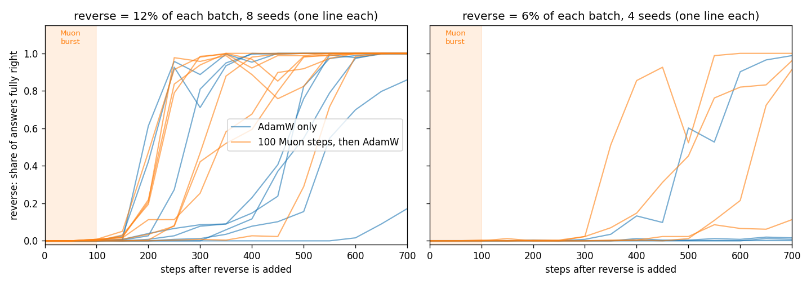
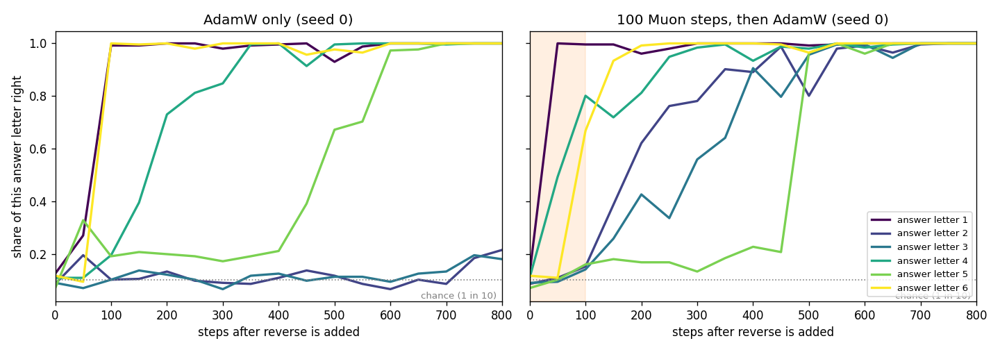
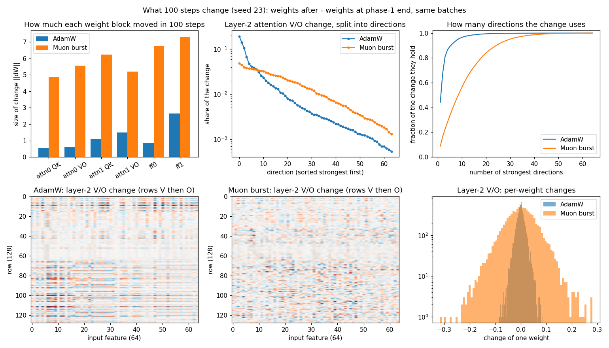
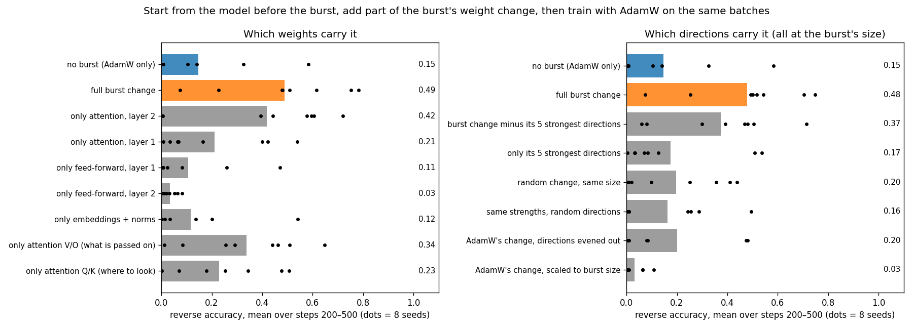

# 100 Muon steps make AdamW learn a new task faster, and the reason sits in the weak directions

*Work in progress, 2026-10-18. Tiny language model on a laptop CPU. Each claim links to the data and script behind it.*

## The short version

A small transformer trained with AdamW is taught a new task. AdamW often gets stuck on it for hundreds or thousands of steps. If the first 100 steps after the new task arrives use the Muon optimizer instead, and AdamW takes over again after that, the model learns the new task much faster.

The strange part: at the moment Muon hands back to AdamW, the model still can't do the parts of the task AdamW was stuck on. The speed-up only shows up later, during AdamW training.

So far the cause points to **the weak directions of Muon's weight change in attention**. Keep only those and most of the speed-up remains. Keep only the 5 strongest directions and almost all of it is gone. Scale AdamW's own change up to the same size and learning gets *worse* than no burst at all.

## Setup

**Model.** The `MinimalLLM` transformer from [llm-research-kit](https://github.com/vukrosic/llm-research-kit), unchanged: 2 layers, 4 attention heads, width 64, about 100k weights. Muon is the kit's own implementation with the kit's split: Muon on the 2-D weight matrices (attention and feed-forward), AdamW on embeddings and norms.

**Tasks.** Every sequence is a task token, 6 digits (0–9), a separator, then the 6 answer digits the model predicts.

| task | input | answer |
|---|---|---|
| copy | `C 3 8 1 0 5 7 \|` | `3 8 1 0 5 7` |
| shift (+1 to each digit) | `S 3 8 1 0 5 7 \|` | `4 9 2 1 6 8` |
| reverse | `R 3 8 1 0 5 7 \|` | `7 5 0 1 8 3` |

**Training.**
1. Phase 1: 1,000 steps of copy and shift with AdamW (lr 0.003, weight decay 0.2, batch 64). Both reach 100%.
2. Phase 2: reverse is added as 12% of each batch, with copy and shift at 44% each.
   - *AdamW only:* AdamW continues at lr 0.003.
   - *Burst:* 100 steps of the kit's Muon (lr 0.012), then a fresh AdamW at lr 0.003.

**Score.** The share of reverse examples where all 6 answer digits are right, on 256 fresh examples.

**Tuning.** Both learning rates come from a sweep on the same data:
- AdamW: 0.0003 to 0.01. 0.003 was fastest: 2 of 3 seeds passed 50% within 1,000 steps, and no rate did better ([tune.jsonl](tune.jsonl)).
- Muon: 0.006 to 0.1. 0.012 was fastest: 3 of 3 seeds passed 50% by steps 150–300.

Muon used for the whole of phase 2 also learns reverse fast. The question here is why *100 steps* of it keep helping after AdamW takes over again.

## Finding 1: the burst speeds AdamW up on most seeds, not all

Each seed changes both the starting weights and the order of the data. The figure above shows 12 runs.

- **Reverse at 12% of each batch:** the burst reaches 50% accuracy first on 6 of 8 seeds and ties on one. On the eighth (seed 26) it is 50 steps behind, but both runs are fast there. On seed 21, AdamW alone never reaches 50% within 700 steps; with the burst it does by step 550.
- **Reverse at 6% of each batch:** AdamW alone never reaches 50% on 3 of 4 seeds, and the burst does on all three. Seed 22 goes the other way: AdamW reaches 99%, the burst run stalls at 11%.
- **Copy and shift** stay at 100% in every burst run.

AdamW alone does learn reverse eventually. Over 12 seeds and 4,000 steps, all reached 100%, but the step where they first passed 50% ranged from 350 to 2,800 ([adam_seeds.png](adam_seeds.png)).

Data: [confirm.jsonl](confirm.jsonl), [adam_seeds.jsonl](adam_seeds.jsonl).

## Finding 2: AdamW learns reverse one answer digit at a time, and some digits sit at chance

Each reverse answer digit has to read a different input position: answer digit 1 reads input digit 6, answer digit 2 reads input digit 5, and so on.

- **AdamW alone:** answer digits 1 and 6 are learned in about 100 steps. Digits 2 and 3 stay at chance (1 in 10) for more than 700 steps.
- **Burst:** the same digits climb from about step 150.

Two quick checks on seed 0, from [probe.py](probe.py):

- **At the end of the burst, the stuck digits are still at chance.** Their attention to the input digit they need is 0.10–0.15, about the same as after 100 AdamW steps (0.07–0.19). So the burst did not half-build the "look here" pattern for them.
- **Restarting the optimizer is not the cause.** The burst run starts a fresh AdamW at step 100. Doing that restart without a burst leaves digits 2 and 3 at 0.12 and 0.11 at step 500. With the burst they reach 0.85 and 0.95.

## Finding 3: what the burst changes in the weights

The thing to look at is the weight change: weights after 100 steps minus weights before them, on the same batches.

- **Size:** the burst moves every weight block 3–9× more than AdamW does (top left).
- **Shape:** any matrix change can be split into independent directions, each with a strength.
  - AdamW puts about 85% of its change in layer-2 attention into 5 directions.
  - The burst spreads its change over about 30 (top middle and right). That is what Muon does by design: it evens out the strengths of the directions in each update.

Script: [plot_delta.py](plot_delta.py).

## Finding 4: the speed-up lives in attention, in the burst's weak directions

The test:
1. Take the model from before the burst.
2. Add only part of the burst's weight change.
3. Train with AdamW on exactly the same batches.

If that part carries the speed-up, the model should still learn reverse fast.

**Which weights** (left):
- Attention in layer 2 alone recovers most of the effect (0.42 of 0.49).
- Feed-forward and embedding changes alone do about as well as no burst.
- Inside attention, the weights that set *what a head passes on* (V/O) help more than the ones that set *where it looks* (Q/K): 0.34 vs 0.23.

**Which directions** (right): every change in this panel is scaled to the size of the burst's change, so size is equal and only the direction differs.

| change added to the pre-burst model | score |
|---|---|
| burst change without its 5 strongest directions | **0.37** |
| only its 5 strongest directions | 0.17 |
| random change | 0.20 |
| burst's strengths with random directions | 0.16 |
| AdamW's own change, directions evened out | 0.20 |
| AdamW's own change, scaled up | 0.03 (worse than no burst, 0.15) |

Scripts: [cause.py](cause.py), [weak.py](weak.py). Data: [cause.jsonl](cause.jsonl), [cause_qkvo.jsonl](cause_qkvo.jsonl), [weak.jsonl](weak.jsonl). Score: reverse accuracy averaged over steps 200–500, 8 seeds.

## What we conclude so far

A 100-step Muon burst leaves a change in the attention weights, mostly in layer 2. Its useful part is in the weak directions, the ones AdamW's own update barely uses. The change doesn't solve the stuck answer digits by itself. It makes them learnable, and AdamW then learns them in a few hundred steps instead of a few thousand.

A bigger AdamW step does not do this: it only amplifies AdamW's few strong directions, and that makes learning slower.

This matches an earlier result on a different network. In [clock arithmetic](../arith/README.md), a Muon burst got an AdamW-trained MLP unstuck on a newly added operation.

## Limits

- One tiny model (about 100k weights), one synthetic task, a laptop CPU.
- One run per seed, 8–12 seeds per test. Some seeds don't show the effect (seed 21 barely benefits even from the full burst; seed 22 at 6% is worse with the burst).
- One pair of learning rates, chosen by a sweep on the same data.
- Nothing here is tested at scale.

## Next

- **Why the weak directions make a digit learnable.** Can the stuck digit's identity already be read out at the answer position after the burst? Is the training signal that teaches attention "where to look" larger for those digits?
- **Whether Muon is needed.** On clock arithmetic, a burst along the raw gradient worked as well as Muon. Test it on this transformer.
- **Dose.** How few burst steps are enough, and how the speed-up depends on the burst's learning rate.
- **A larger model** that still fits on the laptop.

Code for every run is in this folder. `python3 tinylm.py SEED adam burst` runs one seed in about 10 s.
